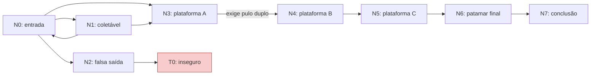

# DS-14 — Grafo das rotas da Fase 1

Card: https://trello.com/c/3lLKunqY

O componente `PhaseRouteGraph`, salvo na cena `DS07_Fase1_Jogavel`, executa uma busca em largura ao iniciar a fase. Como a morte recarrega a cena, a busca também ocorre em cada nova tentativa. O resultado fica em `LastResult` e é registrado no Console.

## Modelo e relação com o mapa

O estado da busca é o par **(ponto, obteve pulo duplo)**. Visitar um ponto sem poder não impede visitá-lo novamente depois da coleta. O salto N3 → N4 só pode ser explorado quando a busca já passou por N1 com seu coletável disponível.

Cada ponto guarda referências ao marcador e ao colisor do piso da cena. Pisos desabilitados, inativos ou deslocados para fora da projeção horizontal do marcador tornam o ponto indisponível. O ponto T0 representa o chão falso e é excluído da rota segura mesmo quando sua geometria está visível.

| Índice no Inspector | Ponto | Referência no mapa |
| --- | --- | --- |
| 0 | N0 | Entrada e checkpoint |
| 1 | N1 | Coletável de pulo duplo, sobre o piso de entrada |
| 2 | N2 | Aproximação da falsa saída |
| 3 | T0 | Chão falso, marcado como inseguro |
| 4 | N3 | Plataforma A |
| 5 | N4 | Plataforma B; chegada do salto que exige o poder |
| 6 | N5 | Plataforma C |
| 7 | N6 | Patamar final |
| 8 | N7 | Aproximação da porta de conclusão, no patamar final |



A rota encontrada no mapa atual é `N0 → N1 → N3 → N4 → N5 → N6 → N7`. A busca visita 11 estados. Há no máximo dois estados por ponto; fila, conjunto de visitados e predecessores evitam ciclos infinitos e permitem reconstruir o percurso. A busca retorna um caminho com o menor número de conexões disponíveis, sem atribuir pesos às distâncias.

As conexões representam passagens declaradas pelo desenho DS-02. O grafo verifica sua conectividade e a obtenção do poder; ele não calcula trajetórias balísticas nem garante, sozinho, que cada salto é fisicamente executável. A calibração e o playtest das plataformas continuam necessários. A armadilha T0 é tratada como insegura conforme o desenho; este card não implementa sua queda.

## Demonstração válida e inválida

1. Abrir `Assets/Scenes/DS07_Fase1_Jogavel.unity` na Unity **6000.6.0f1** e iniciar Play. O Console deve registrar `DS-14: rota segura: N0 -> N1 -> N3 -> N4 -> N5 -> N6 -> N7`.
2. Selecionar `DS14 - Grafo da Fase 1`. Com Gizmos ligados, a Scene View mostra os pontos e as conexões dirigidas. Verde indica ponto disponível; ciano, passagem comum; amarelo, passagem que exige pulo duplo; vermelho, ponto ou conexão indisponível.
3. No menu de contexto do componente, escolher **Demonstrar rota interrompida (bloquear salto com poder)**. A busca bloqueia N3 → N4 em uma cópia dos dados e registra `DS-14 demonstração: sem rota segura`. A cena e a rota jogável permanecem preservadas.
4. Escolher **Validar rota segura** para repetir o caso válido. Para demonstrar um mapa realmente alterado durante Play, desabilitar o colisor da plataforma B e validar; reabilitá-lo e validar novamente.
5. Coletar o pulo duplo e cair na zona de falha. Após a recarga, o coletável reaparece e a busca registra novamente a rota segura.

A busca parte do estado inicial de uma tentativa, sem poder. Uma validação manual depois de consumir o coletável avalia essa disponibilidade atual; ela não funciona como orientação a partir da posição atual do jogador. O resultado calculado no início permanece em `LastResult` até solicitar nova validação.

## Código e montagem

- `Assets/Scripts/Routes/PowerRouteSearch.cs`: busca em largura, estado do poder, predecessores e validação dos dados de entrada; sem dependência da Unity.
- `Assets/Scripts/Routes/PhaseRouteGraph.cs`: referências à cena, disponibilidade dos pisos e coletável, execução ao iniciar, demonstração e Gizmos.
- `Assets/Scripts/Editor/PhaseOneGraphSetup.cs`: montagem repetível pelo menu `Dreamscape > DS-14 > Configurar grafo na Fase 1`. A opção **Configurar grafo na cena aberta** também permite usar os objetos do layout DS-02 em outra cena.

A montagem liga o `DoubleJumpPickup` existente ao coletável e configura seu colisor como trigger. Não altera o motor, as dimensões dos pisos, as pistas nem a lista de cenas do build. A inclusão do coletável coincide com a configuração feita pelo DS-13; seu portal permanece sob responsabilidade do PR #15. As assemblies de runtime e editor reutilizam as definições e GUIDs dos PRs #14/#15, DS-09 e DS-19.

## Validação

```sh
mkdir -p Logs/DS14
/Applications/Unity/Hub/Editor/6000.6.0f1/Unity.app/Contents/MacOS/Unity \
  -batchmode -nographics -projectPath "$PWD" \
  -runTests -testPlatform EditMode \
  -testFilter Dreamscape.Tests.PowerRouteSearchTests \
  -testResults "$PWD/Logs/DS14/search.xml" \
  -logFile "$PWD/Logs/DS14/search-tests.log"

/Applications/Unity/Hub/Editor/6000.6.0f1/Unity.app/Contents/MacOS/Unity \
  -batchmode -nographics -projectPath "$PWD" \
  -runTests -testPlatform PlayMode \
  -testFilter Dreamscape.Tests.RouteSceneTests \
  -testResults "$PWD/Logs/DS14/scene-final.xml" \
  -logFile "$PWD/Logs/DS14/scene-final.log"
```

Os testes de busca verificam a aquisição do poder antes do salto, revisita após a coleta, coletável inacessível, pisos inseguros, conexão bloqueada, ciclos, caminho mínimo e dados inválidos. Os testes da cena verificam a execução automática, correspondência dos marcadores aos pisos, perda de conectividade ao remover o coletável ou piso, demonstração sem alterar os dados, referências ausentes e três mortes com coleta real e nova validação. O save anterior é preservado e restaurado pela suíte.

Na Unity **6000.6.0f1**, macOS ARM64: **13/13 testes EditMode** e **7/7 testes PlayMode aprovados**, sem falhas nem testes ignorados. O caso adicional de PlayMode confirma a recusa de uma plataforma movida 20 metros para fora de seu marcador. Evidências locais em `Logs/DS14/search.xml` e `Logs/DS14/scene-final.xml`, acompanhadas dos logs do Editor e ignoradas pelo Git.

## Critério acadêmico

O GDD exige usar recursos de computação e cita grafos entre os exemplos. O DS-14 implementa uma busca executada pelo projeto e permite demonstrar casos válido e inválido, conforme o guia do quadro.

O DS-01 não registra uma rubrica acadêmica detalhada, e seu item sobre os critérios conhecidos não está preenchido. Assim, a confirmação de exigências adicionais com o professor e a revisão de outro integrante permanecem pendentes. O funcionamento da busca não representa aprovação acadêmica nem substitui a validação completa das fases.
