# Fase 11: Sala de Leitura Flutuante

Cena: `Assets/Scenes/Fase11_SalaDeLeituraFlutuante.unity`, gerada por `Assets/Scripts/Editor/Phases/Fase11Builder.cs` (menu **Dreamscape > Fases > Gerar todas as fases novas**). O tema fica dentro do próprio builder (`Fase11Builder.Tema`): noite alta, azul de lua, com destaque **turquesa** (abajur mágico). No segundo arco ("a noite na biblioteca até o amanhecer"), a fase fica um passo acima da Fase 10: saturação 10 e exposição 0,02. A neblina é mais rala que nas fases fechadas (0,016) para as ilhas aparecerem ao longe.

## Objetivo

A sala de leitura da biblioteca se partiu em ilhas de pilhas de livros, mesas e livros abertos gigantes que flutuam no vazio. O estudante precisa chegar à porta de conclusão, sobre um livro aberto no fim da ponte de páginas. Cair ou tocar uma armadilha reinicia a cena. Nada é sorteado: os ciclos são fixos e usam `Time.timeSinceLevelLoad`, então cada tentativa começa no mesmo ponto do ritmo.

A ideia central, repetida em todo trecho, é **cada ilha é uma pausa; o vazio entre elas é o desafio**: as armadilhas ficam sempre longe da borda de pouso, e todo trecho termina numa ilha larga onde dá para parar e olhar o próximo.

## Ritmo e espaço

| Ato | Trecho | Papel | Espaço |
| --- | --- | --- | --- |
| 1 | I0 Ilha do despertar, I1–I2 pilhas, I3 mesa-ilha da serra | Apresenta: pulos entre ilhas (2,0 / 2,2 / 2,3 m) e uma serra numa ilha larga, onde dá para desviar dela pelo lado. | Ilhas pequenas e próximas, depois um livro aberto de 6 × 7 m. |
| 2 | I4 Encruzilhada → rota oeste (A1) **ou** rota leste (B2, B3) → I6 | Testa e dá escolha: a rota curta exige a Pluma em dois saltos de 5,5 m sobre o vazio; a longa não usa poder, mas tem um pêndulo e uma fileira de espinhos em ciclo. | A ilha mais larga (10 × 7 m), com as duas rotas à vista. |
| 3 | D1–D3 torre de livros, E1 túnel coberto, ponte de páginas, G | Desafio final: subida pelas mesas (+3,2 m), túnel de estantes com laser e espinhos em ciclo sob teto baixo, ponte de páginas que cedem com um pêndulo no meio. | Vertical, depois o trecho mais apertado da fase (2,7 m × 2,3 m), depois a ponte aberta até a porta. |

**Marcos e linha de visão.** O relógio do sonho (`DreamClock`, raio 3,5 m) flutua a 13 m de altura atrás da porta, em (0,5; 13; 106), com o mostrador voltado para o spawn. Do spawn, o olhar até ele sobe ≈ 6°, e nenhum objeto do caminho fica nessa linha: o ponto mais alto, o topo das estantes do túnel (y = 7,1 em z 71..83), fica mais de 2 m abaixo dela. Com a neblina de 0,016 (exponencial ao quadrado), o relógio fica nítido a partir da encruzilhada (≈ 80 m). Um segundo relógio, menor, flutua a oeste da encruzilhada e marca a rota da Pluma. Da ilha do encontro (I6), a torre de livros e a boca do túnel ficam em linha reta à frente.

**Leitura da rota.** O tapete (com o friso turquesa) marca sempre onde dá para parar: no centro de cada ilha, no refúgio do túnel entre o laser e os espinhos e na passarela leste antes do pêndulo. As páginas que cedem não têm tapete. Os abajures turquesa ficam nos cantos das ilhas, e os da rota da Pluma têm luz azul-clara.

## Mecânicas

| Mecânica | Onde | O que pede |
| --- | --- | --- |
| Serra | I3, varre o livro em X | Esperar a serra ir para um lado e passar pelo outro. |
| Pluma (`PickupKind.Gravity`) | Pedestal em I4 | Rota curta: dois saltos de 5,5 m (I4 → A1 → I6). Opcional. |
| Pêndulo | B2 (rota leste) e ponte final | Passar pelo meio quando o peso está no alto de um dos lados. |
| Espinhos em ciclo | B3 (dois campos lado a lado) e túnel E1 | Observar e atravessar na janela recolhida. |
| Mesas como degraus | D1 e D2 | Subir 1,6 m em dois pulos de 0,8 m (chão → tampo → ilha seguinte). |
| Laser | Túnel E1 | Esperar apagar; o teto baixo impede saltar por cima. |
| Escudo | Prateleira lateral E0, 1 m ao lado do topo da torre | Opcional: absorve um toque no túnel ou na ponte. |
| Pisos que cedem | Ponte final (4 páginas) | Não parar: cada página cede 0,8 s depois de pisada. |

Só a Pluma e o Escudo aparecem nesta fase. Os efeitos dos poderes **se somam** (`ActivePowerUps` empilha os efeitos), e a Pluma pode continuar ativa até a ponte final. Por isso, toda a geometria depois da encruzilhada foi conferida contra um jogador ainda com a Pluma (veja "Atalhos"). A Velocidade e o pulo duplo ficam para a Fase 12, e não há nesta fase uma combinação de poderes que abra atalhos.

Placas (`kit.Sign`, sem acentos): `FASE 11` / `SALA DE LEITURA FLUTUANTE` / `cada ilha e uma pausa` à frente do spawn; `espere a serra passar` em I3; `PLUMA: PELO VAZIO` e `MESAS: PELO PENDULO` em I4; `observe o ritmo` em B3; `SUBA PELAS MESAS` em I6; `teto baixo: espere o feixe` na boca do túnel; `nao pare na ponte` na saída do túnel.

## Estética (biblioteca do sonho)

- **Ilhas:** todo piso é `BookPlatform` (pilhas de livros gigantes que descem de 2 a 5,5 m no vazio) ou `OpenBookPlatform` (I3, A1 e o patamar da porta G). Nenhum `Platform` "da escola": aqui tudo é biblioteca.
- **Mobília:** mesas de leitura com vela (`ReadingDesk`) em I0 e I3 (obstáculos nos cantos), em I4 (canto sul) e em D1/D2, onde são os degraus. Não há mesa na ilha do encontro: perto da borda, ela serviria de trampolim (veja "Atalhos").
- **Estantes sólidas:** fundo do despertar, a "guarda" de B3 e as paredes do túnel (3,4 m).
- **Estruturas dos pêndulos:** cada pêndulo pende de uma viga de livros (`BookPlatform` de 9 × 0,6 m, 4,3 m acima do piso), apoiada em duas colunas de estante de cenário que descem até y = −10, 3,5 m ou mais ao lado do caminho.
- **Cenário flutuante:** livros voando abaixo das ilhas (y entre −4 e −2) ou a 3 m ou mais das bordas; páginas brilhando a 6 m ou mais acima do piso (encruzilhada, rastro da Pluma, porta); poeira turquesa no vazio central abaixo do caminho.
- **Moldura:** `LibraryBackdrop` cobre x −5..13 e z −4..102, com 6 m de margem, base em y = −10 e 22 m de altura (as estantes de fundo somem na neblina abaixo das ilhas).

## Números do motor usados

Valores de `CharacterMotor` e do prefab `FirstPersonPlayer`: gravidade −20 m/s², pulo 1,1 m, corrida 5 m/s, raio 0,28 m, altura 1,76 m, `stepOffset` 0,3 m, *coyote time* 0,12 s, velocidade de "colar no chão" −2 m/s. A Pluma reduz a gravidade à metade, mas mantém o impulso do pulo. Ao bater no teto, a velocidade vertical é zerada.

- Impulso: v0 = √(2 · 1,1 · 20) = **6,633 m/s**. Apogeu normal 1,1 m; com a Pluma, 2,2 m.
- Alcance nominal correndo (5 · tempo no ar até o desnível): plano **3,32 m**; +0,5 **2,88**; +0,8 **2,52**; −0,5 **3,66**. Com a Pluma: plano **6,63**; −0,5 **6,99**; +1,6 **5,05**.
- **Limite teórico**, usado para provar que um atalho é impossível (mesmo método de `docs/Fase3.md`): pulo no fim do *coyote* (0,6 m a mais, saindo 0,38 m mais baixo) e mais 0,28 m de borda do controlador em cada lado. Sem poder: plano **4,16 m**; +0,5 **3,56**; −0,5 **4,56**; −0,8 **4,77**. Com a Pluma: plano **7,49**; −0,5 **7,88**; +1,6 **5,53**.
- **Degrau máximo alcançável:** apogeu mais o `stepOffset`, ou seja, 1,4 m sem poder e 2,5 m com a Pluma.
- **Teto baixo** (2,3 m livres): a cabeça bate quando o pé está a 0,54 m, então nenhum pulo, nem com a Pluma, deixa o pé acima de 0,54 m sob o teto.

## Plataformas (topo em Y, medidas X × Z)

| Peça | Tipo | Centro do topo | Tamanho | Extensão |
| --- | --- | --- | --- | --- |
| I0 Ilha do despertar | `BookPlatform` | (0, 0, 0) | 8 × 8 | x −4..4, z −4..4 |
| I1 Pilha baixa | `BookPlatform` | (0, 0, 7,5) | 3 × 3 | z 6..9 |
| I2 Pilha alta | `BookPlatform` | (0, 0,5, 12,7) | 3 × 3 | z 11,2..14,2 |
| I3 Mesa-ilha | `OpenBookPlatform` | (0, 0,5, 20) | 6 × 7 | x −3..3, z 16,5..23,5 |
| I4 Encruzilhada | `BookPlatform` | (0, 0,5, 29) | 10 × 7 | x −5..5, z 25,5..32,5 |
| I4 Pedestal da Pluma | `BookPlatform` | (−3,5, 1,0, 27,5) | 2 × 2 | x −4,5..−2,5, z 26,5..28,5 |
| A1 Livro do meio do vazio | `OpenBookPlatform` | (−3, 0,5, 40) | 4 × 4 | x −5..−1, z 38..42 |
| B2 Passarela do pêndulo | `BookPlatform` | (8,5, 1,0, 36) | 4 × 12 | x 6,5..10,5, z 30..42 |
| B3 Ilha dos espinhos | `BookPlatform` | (8,5, 1,0, 48) | 4 × 8 | x 6,5..10,5, z 44..52 |
| I6 Ilha do encontro | `BookPlatform` | (0,5, 0,5, 51,5) | 9 × 8 | x −4..5, z 47,5..55,5 |
| D1 Base da torre | `BookPlatform` | (0,5, 0,5, 59,5) | 4 × 4 | x −1,5..2,5, z 57,5..61,5 |
| Mesa D1 (degrau) | `ReadingDesk` | tampo a 1,3 | 1,6 × 0,8 | x −0,3..1,3, z 60,6..61,4 |
| D2 Torre 1 | `BookPlatform` | (0,5, 2,1, 63,5) | 3 × 3 | x −1..2, z 62..65 |
| Mesa D2 (degrau) | `ReadingDesk` | tampo a 2,9 | 1,6 × 0,8 | z 64,2..65 |
| D3 Torre 2 | `BookPlatform` | (0,5, 3,7, 67,5) | 3 × 3 | z 66..69 |
| E0 Prateleira do Escudo | `BookPlatform` | (4, 3,7, 67,5) | 2 × 2 | x 3..5, z 66,5..68,5 |
| E1 Piso do túnel | `BookPlatform` | (0,5, 3,7, 77) | 3,9 × 12 | x −1,45..2,45, z 71..83 |
| E1 Teto baixo | `BookPlatform` | (0,5, 6,5, 78,1) | 2,7 × 9,2 | x −0,85..1,85, z 73,5..82,7, colisão y 6,0..6,5 |
| Páginas que cedem 1–4 | `CrumblingPlatform` | (0,5, 3,7, 84,8 + 2,8·i) | 2 × 2 | z 83,8..85,8 / 86,6..88,6 / 89,4..91,4 / 92,2..94,2 |
| G Patamar da porta | `OpenBookPlatform` | (0,5, 3,7, 98,5) | 8 × 7 | x −3,5..4,5, z 95..102 |

**Armadilhas.** Serra em (−2,2; 0,5; 20,5), indo +4,4 m em X, com período de 3,2 s. Pêndulo leste em (8,5; 1; 36), 50°, 2,6 s, balançando em X. Espinhos em ciclo (1,2 s expostos / 1,6 s recolhidos) em (7,5; 1; 47,5), (9,5; 1; 47,5) e (0,5; 3,7; 80,1). Laser em (0,5; 3,7; 75,6), yaw 0, 1,4 s ligado e 1,8 s desligado. Pêndulo da ponte em (0,5; 3,7; 90,4), 55°, 2,4 s, balançando em X.

**Poderes, marcos e limites.** Pluma em (−3,5; 1; 27,5) e Escudo em (4; 3,7; 67,5). *Spawn* em (0, 0, −2), com yaw 0. Porta em (0,5; 3,7; 100,7), com yaw 180. Zona de queda em y = −8.

**Estantes que limitam o caminho** (linha central; a face fica a 0,3 m dela):

| Trecho | Estante | Face |
| --- | --- | --- |
| I0 | fundo z = −3,7 (3,5 m) | z = −3,4 |
| B3 | "guarda" x = 6,8, z 44..48,6 (3 m) | ocupa x 6,5..7,1 |
| E1 | x = −1,15 e x = 2,15, z 71,3..82,7 (3,4 m) | x = −0,85 e 1,85 (2,7 m livres) |

## Pontos do grafo

| Ponto | Coordenada | Referência |
| --- | --- | --- |
| N0 | (0, 0, −2) | Spawn |
| I1, I2 | (0, 0, 7,5), (0, 0,5, 12,7) | Pilhas |
| I3 | (0, 0,5, 18) | Pouso antes da faixa da serra |
| I4 | (0, 0,5, 29) | Encruzilhada |
| P | (−3,5, 1, 27,5) | Pedestal da Pluma |
| A1 | (−3, 0,5, 40) | Livro no meio do vazio (só com Pluma) |
| B2s, B2n | (8,5, 1, 31), (8,5, 1, 41,5) | Passarela, antes e depois do pêndulo |
| B3a, B3b | (8,5, 1, 45), (8,5, 1, 49,5) | Antes e depois dos espinhos |
| I6 | (0,5, 0,5, 51,5) | Ilha do encontro |
| D1, M1, D2, M2, D3 | z 59,5 / 61 / 63,5 / 64,6 / 67,5 | Torre: ilha, mesa, ilha, mesa, ilha |
| E0 | (4, 3,7, 67,5) | Escudo (beco opcional) |
| Ea, Er, Eb | z 72,5 / 77,45 / 82,6 | Túnel: boca, refúgio, saída |
| T1..T4 | z 84,8 / 87,6 / 90,4 / 93,2 | Páginas (T3 sob o pêndulo) |
| G, Porta | z 98,5 / 100,7 | Patamar e porta |

## Grafo das rotas

O estado é o par **(ponto, tem Pluma)**: as arestas duplas (`==>`) só existem com a Pluma. As pontilhadas marcam atalhos permitidos que só a Pluma abre. O peso é a distância no plano XZ.

```mermaid
flowchart LR
    N0["N0 spawn"] -->|"pulo 2,0 · 9,5"| I1
    I1 -->|"pulo 2,2 +0,5 · 5,2"| I2
    I2 -->|"pulo 2,3 · 7,3"| I3["I3 serra"]
    I3 -->|"ritmo: serra, pulo 2,0 · 9,0"| I4["I4 encruzilhada"]
    I4 -->|"subir 0,5 · 3,8"| P["P Pluma"]
    P -->|"ganha a Pluma"| I4
    P ==>|"salto 5,5 com Pluma · 12,5"| A1
    A1 ==>|"salto 5,5 com Pluma · 12,0"| I6
    I4 -->|"pulo 1,5 +0,5 · 8,7"| B2s["B2 antes do pêndulo"]
    B2s -->|"ritmo: pêndulo · 10,5"| B2n
    B2n -->|"pulo 2,0 · 3,5"| B3a["B3 antes dos espinhos"]
    B3a -->|"ritmo: espinhos · 4,5"| B3b
    B3b -->|"pulo 1,5 −0,5 · 8,3"| I6["I6 encontro"]
    B2n -.->|"salto 5,7 −0,5 com Pluma"| I6
    I6 -->|"pulo 2,0 · 8,0"| D1
    D1 -->|"subir 0,8 (mesa) · 1,5"| M1
    M1 -->|"pulo 0,6 +0,8 · 2,5"| D2
    D2 -->|"subir 0,8 (mesa) · 1,1"| M2
    M2 -->|"pulo 1,0 +0,8 · 2,9"| D3
    D3 -->|"pulo 1,0 · 3,5"| E0["E0 Escudo"]
    E0 --> D3
    D3 -->|"pulo 2,0 · 5,0"| Ea["túnel"]
    Ea -->|"ritmo: laser · 4,95"| Er["refúgio"]
    Er -->|"ritmo: espinhos · 5,15"| Eb
    Eb -->|"pulo 0,8 · 2,2"| T1
    T1 -->|"pulo 0,8 · 2,8"| T2
    T2 -->|"ritmo: pêndulo · 2,8"| T3
    T3 -->|"pulo 0,8 · 2,8"| T4
    T4 -->|"pulo 0,8 · 5,3"| G
    G -->|"caminhar · 2,2"| Porta
    style P fill:#cfeefe,stroke:#3a8fb5
    style A1 fill:#cfeefe,stroke:#3a8fb5
    style E0 fill:#d8f3e8,stroke:#3a9a7a
    style Porta fill:#cdeccd,stroke:#3a8a3a
```



**Rotas e distâncias** (soma dos pesos, contando o ida e volta ao pedestal na rota da Pluma):

| Rota | Arestas | Distância |
| --- | --- | --- |
| Curta (Pluma): N0 → … → I4 → P → A1 → I6 → torre → túnel → ponte → Porta | 21 | **108,5 m** |
| Longa (sem poder): N0 → … → I4 → B2 → B3 → I6 → torre → túnel → ponte → Porta | 23 | **115,7 m** |

A rota da Pluma é a mais curta e evita o pêndulo e os espinhos da rota leste, mas tem os saltos mais apertados da fase (margem de 1,13 m sobre o vazio, duas vezes). A rota leste sempre existe e não exige poder.

## Cálculo de cada pulo

O vão é medido de borda a borda. A margem é o alcance nominal menos o vão (ou o apogeu menos o degrau).

| Salto | Vão | Desnível | Alcance nominal | Margem |
| --- | --- | --- | --- | --- |
| I0 → I1 | 2,0 m | 0 | 3,32 m | 1,32 m |
| I1 → I2 | 2,2 m | +0,5 | 2,88 m | 0,68 m |
| I2 → I3 | 2,3 m | 0 | 3,32 m | 1,02 m |
| I3 → I4 | 2,0 m | 0 | 3,32 m | 1,32 m |
| I4 → pedestal | — | +0,5 | apogeu 1,1 m | 0,6 m de altura |
| **I4 → A1 com Pluma** | 5,5 m | 0 | 6,63 m | **1,13 m** |
| **A1 → I6 com Pluma** | 5,5 m | 0 | 6,63 m | **1,13 m** |
| I4 → A1 sem Pluma | 5,5 m | 0 | limite 4,16 m | impossível, faltam 1,34 m |
| I4 → B2 | 1,5 m | +0,5 | 2,88 m | 1,38 m |
| B2 → B3 | 2,0 m | 0 | 3,32 m | 1,32 m |
| B3 → I6 (depois dos espinhos) | 1,5 m | −0,5 | 3,66 m | 2,16 m |
| I6 → D1 | 2,0 m | 0 | 3,32 m | 1,32 m |
| D1 → tampo da mesa | — | +0,8 | apogeu 1,1 m | 0,3 m de altura |
| Mesa D1 → D2 | 0,6 m | +0,8 | 2,52 m | 1,92 m |
| D2 → tampo da mesa | — | +0,8 | apogeu 1,1 m | 0,3 m de altura |
| Mesa D2 → D3 | 1,0 m | +0,8 | 2,52 m | 1,52 m |
| D1 → D2 sem a mesa | 0,5 m | +1,6 | — | impossível, alcança 1,4 m |
| D3 → E0 | 1,0 m | 0 | 3,32 m | 2,32 m |
| D3 → E1 | 2,0 m | 0 | 3,32 m | 1,32 m |
| E1 → T1, T1 → T2, T2 → T3, T3 → T4, T4 → G | 0,8 m | 0 | 3,32 m | 2,52 m |

Todos os degraus sem poder são de 0,5 ou 0,8 m, abaixo do máximo de 0,9 m. O degrau de 0,8 m da mesa usa o pulo, porque o `stepOffset` de 0,3 m não basta.

## Atalhos: por que não existem

**Sem poder** (limite 4,16 m no plano e 1,4 m de degrau):

- **I0 → I2** (7,2 m) e **I4 → A1** (5,5 m): impossíveis. A mesa da encruzilhada fica no canto sul, em (3; 0,5; 25,3); do tampo (+0,8) até A1 são mais de 12 m.
- **B2 → I6 pulando B3**: da quina (6,5; 42) até a quina (5; 47,5) são 5,70 m com −0,5 m, contra o limite de 4,56 m.
- **B3 sem passar pelos espinhos.** Os gatilhos ficam em z 46,6..48,4 (x 6,6..8,4 e 8,6..10,4). A fresta entre os campos tem 0,2 m e a sobra na borda leste 0,1 m, menos que os 0,56 m do corpo. Antes dos espinhos, o corpo fica em z ≤ 46,32. Para chegar a I6 (x ≤ 5), é preciso passar por x 6,5..7,1, mas ali fica a estante "guarda", com 3 m de altura, até z 48,6. Contorná-la pelo norte exige estar em z ≥ 48,88, já do outro lado dos espinhos. Saltar os espinhos exige o pé acima de 0,65 m por 2,36 m de avanço, e o pulo normal dá 2,12 m.
- **Torre sem as mesas:** os desníveis de D1 → D2 e de D2 → D3 são de 1,6 m, e o máximo alcançável é 1,4 m. Do tampo da mesa de D1 até D3 são +2,4 m.
- **Túnel:** as estantes têm 3,4 m e o teto fica 2,8 m acima do piso. O piso de E1 só existe entre as estantes e por baixo delas; do lado de fora há o vazio.
- **Laser e espinhos do túnel:** sob o teto, o pé não passa de 0,54 m. O laser exige mais de 1,175 m e os espinhos mais de 0,65 m.
- **Ponte:** de E1 até G são 12 m, e de E1 até T4, 9,2 m. De T2 até T4 são 3,6 m (só com a borda perfeita, acima dos 3,32 m nominais). Mesmo assim, o corpo passa pelo pêndulo no ar: o pé sobe no máximo 1,1 m, e o peso, no ponto mais baixo, ocupa de 0,53 a 1,77 m.

**Com a Pluma ainda ativa** (dura 30 s, e os efeitos se somam; limite 7,49 m no plano e 2,5 m de degrau). A Pluma é o atalho oferecido, então quem a pega pode encurtar a rota leste. Os casos abaixo são **permitidos**:

- B2 → I6 direto (5,7 m, −0,5, contra 6,99 m nominais), saltar os espinhos de B3 (o pé fica acima de 0,65 m por 5,57 m) e passar por cima do pêndulo de B2 (apogeu de 2,2 m, acima dos 1,77 m do peso).
- D1 → D2 sem a mesa (+1,6 m, abaixo dos 2,5 m).

Mesmo com a Pluma, **continuam impossíveis**:

- **I6 → D2:** 6,5 m com +1,6 m, contra o limite de 5,53 m.
- **Teto ou topo das estantes do túnel**, vindo de D3 ou da boca: +2,8 m e +3,4 m, contra 2,5 m.
- **Contornar o túnel por fora:** de D3/E0 até T1 são mais de 15 m.
- **Atravessar o túnel no ar:** sob o teto, o pé fica abaixo de 0,54 m.
- **E1 → T4 e E1 → G:** 9,2 m e 12 m, contra 7,49 m.

**Risco aceito:** com a Pluma ainda ativa ao chegar à ponte (exige ir de I4 até T2 em menos de 30 s), dá para saltar de T2 a T4 por cima do peso do pêndulo, quando ele está embaixo. É uma recompensa de quem correu, e ainda depende de ler o balanço: nos extremos, o peso sobe até 2,9 m. Não há Velocidade nem pulo duplo na fase, então não existe combinação de poderes que encurte mais que isso.

## Ritmo das armadilhas

**Serra (I3).** A esfera de dano tem raio de 0,78 m e centro 0,85 m acima do piso (vai até 1,63 m), então não dá para pular por cima (o pé sobe 1,1 m). A serra vai e volta entre x −2,2 e 2,2 (curva suave), 1,6 s por trecho. Na linha central, o perigo dura 0,53 s por passagem e a janela livre, 1,07 s. A faixa a cruzar tem 2,12 m e leva 0,42 s correndo. Também dá para passar pelo lado oposto ao da serra, porque o livro tem 6 m de largura. Entre a borda de pouso e a faixa da serra há 2,9 m.

**Pêndulo de B2 (50°, 2,6 s).** O peso tem raio de 0,62 m e fica a 2,65 m do pivô, que está 3,8 m acima do piso. Ele toca quem está na linha central quando o ângulo é menor que 19,9°. Isso dá 0,34 s de perigo e 0,96 s livres a cada meia oscilação. A travessia de 1,8 m leva 0,36 s. A passarela tem 4 m de largura, e o peso, no extremo, chega a 2,03 m do centro.

**Espinhos em ciclo (B3 e túnel).** Os espinhos ficam 1,2 s expostos e 1,6 s recolhidos (período de 2,8 s) e começam a subir 0,3 s antes de ferir. A travessia cobre 1,8 + 0,56 = 2,36 m, o que leva 0,47 s correndo (≈ 0,55 s saindo parado), contra 1,3 s de janela antes do aviso. Em B3, o jogador espera no tapete (z 44..46,3). No túnel, espera no refúgio entre o laser e os espinhos, que tem 2,9 m livres (z 76,0..78,9).

**Laser (túnel).** O feixe fica 1,4 s ligado e 1,8 s desligado, e pisca nos 0,4 s antes de ligar. O gatilho vai de 0,825 a 1,175 m de altura e cobre a largura toda (2,7 m). A travessia de 0,81 m leva 0,16 s correndo.

**Pêndulo da ponte (55°, 2,4 s), sobre a página 3.** Ele toca a linha central quando o ângulo é menor que 19,9°, ou seja, 0,28 s de perigo e 0,92 s livres a cada meia oscilação. Como as páginas cedem 0,8 s depois de pisadas, não dá para esperar sobre elas. O jogador observa da saída do túnel (Eb, chão firme). Correndo a 5 m/s a partir da borda de E1 (z 83), ele chega à faixa do pêndulo (z 89,5..91,3) em ≈ 1,3 s e a deixa em ≈ 1,66 s. Os perigos caem a cada 1,2 s (±0,14 s em torno da passagem pelo centro). Para a faixa ficar livre durante a travessia, é preciso sair entre 0,04 e 0,6 s depois que o peso passa pelo centro, uma janela de ≈ 0,56 s. A regra prática é **sair logo que o peso cruza o meio**. Cada página fica sob o pé por ≈ 0,4 s, metade do atraso de 0,8 s.

## Como gerar

Com a Unity fechada para outros processos:

```sh
/Applications/Unity/Hub/Editor/6000.6.0f1/Unity.app/Contents/MacOS/Unity \
  -batchmode -quit -projectPath "$PWD" \
  -executeMethod Dreamscape.EditorTools.PhaseBuildMenu.BuildAllBatch
```

Ou, no editor, `PhaseBuildMenu.BuildPhase("Fase11_SalaDeLeituraFlutuante")`.

## Pendências

- Escrita sem abrir a Unity: os números vêm do motor e precisam de *playtest*. O código compila contra as DLLs da Unity 6000.6 (Roslyn, C# 9).
- Pontos a observar:
  - os postes do laser ficam 0,15 m dentro das estantes do túnel, como na Fase 3;
  - as luminárias de teto do túnel pendem a ≈ 2,1 m do piso e podem aparecer na frente da câmera num pulo;
  - os saltos de 5,5 m da Pluma, com 1,13 m de margem;
  - o número de luzes pontuais (abajures, velas, luminárias, postes).
- A janela de saída para a ponte (0,56 s) é a mais apertada da fase. Se ficar difícil demais, aumente o período do pêndulo da ponte para 2,8 s.
