# Fase 12: Arquivo das Lembranças

Cena: `Assets/Scenes/Fase12_ArquivoDasLembrancas.unity`, gerada por `Assets/Scripts/Editor/Phases/Fase12Builder.cs` (menu **Dreamscape > Fases > Gerar todas as fases novas**). O tema fica dentro do próprio builder (`Fase12Builder.Tema`): fim da madrugada, sépia de fotografia antiga, com destaque **rosa-lembrança**. No segundo arco, a fase fica entre a Fase 11 e a roxa Fase 13: saturação 12 e exposição 0,05.

## Objetivo

O arquivo morto da biblioteca guarda as lembranças do estudante em fichas. Prensas de carimbo descem em ritmo fixo sobre corredores estreitos, e as fichas velhas (pisos que cedem) se apagam sob os pés. O estudante precisa chegar à porta, no fim de uma ponte de fichas sob um teto baixo. Cair ou tocar uma armadilha reinicia a cena. Os ciclos são fixos e usam `Time.timeSinceLevelLoad`.

A ideia central é **o arquivo carimba no ritmo; a lembrança some se você parar**: nas prensas, é preciso esperar; nas fichas que cedem, é proibido esperar. A fase alterna as duas atitudes e, no fim, cobra as duas juntas.

## Ritmo e espaço

| Ato | Trecho | Papel | Espaço |
| --- | --- | --- | --- |
| 1 | R0 Recepção (ficha apagada sobre fosso raso), K1 primeira prensa, F1 corredor de fichas que cedem | Apresenta: a ficha escura cede sem risco (fosso de 0,8 m), uma prensa sozinha num corredor de 1,6 m, depois quatro fichas seguidas sobre o vazio, que só se atravessam correndo. | Sala fechada e quente, depois corredor estreito entre estantes. |
| 2 | L1 patamar (Escudo opcional), K3 galeria das três prensas em onda, M1 sala do esquecimento (Velocidade e serra), vão de 4,4 m e ponte de fichas, N1 | Testa: esperar entre prensas defasadas; pegar a Velocidade, passar pela serra, saltar 4,4 m e não parar sobre as fichas. | Corredor longo e baixo, que se abre numa sala ampla e na primeira ponte sobre o vazio. |
| 3 | N1 pulo duplo, escada de fichas (+1,6 m × 3), K4 corredor alto, ponte final com serra, G | Desafio final: subir por fichas que cedem com o pulo duplo, atravessar prensa, espinhos (sob teto baixo) e prensa com refúgios de 1,24 m, e cruzar a última ponte de fichas sob a serra. | Vertical, depois o corredor mais apertado (1,6 m), depois a ponte coberta até a porta. |

**Marcos e linha de visão.** O relógio grande da lembrança (`DreamClock`, raio 4 m) flutua a 16 m de altura sobre a porta, em (0, 16, 120). Do spawn, a reta até ele sobe ≈ 6° e passa acima de todas as estantes do caminho: no fim de K4 (z 96), ela está a ≈ 13 m de altura, e as estantes chegam a 9 m. Ele aparece pela fresta dos corredores, sempre em frente. Um relógio menor gira sobre a sala do esquecimento (a 8,5 m, deslocado para x = −2,5 para não tapar o grande), onde está a Velocidade. As fileiras do arquivo morto (estantes de cenário de 16 a 20 m, x = ±5..5,5) ladeiam toda a fase e dão a sensação de corredor infinito.

**Leitura da rota.** O piso da escola (`Platform`, na cor sépia do tema) é chão firme; as fichas que cedem usam o material de piso falso e nunca têm tapete. Tapetes rosa marcam os refúgios entre prensas e espinhos. As luminárias de teto ficam sobre os refúgios, nunca sobre uma prensa.

## Mecânicas

| Mecânica | Onde | O que pede |
| --- | --- | --- |
| Ficha que cede (apresentação) | R0, ao lado do spawn | Nada: quem pisa cai 0,8 m num fosso fechado e volta com um pulo. Placa `ficha escura se apaga`. |
| Prensa | K1 (sozinha), K3 (três em onda), K4 (duas, meio ciclo defasadas) | Esperar subir e passar por baixo. Só fere enquanto desce e fica embaixo. |
| Fichas que cedem | F1 (4, contíguas), ponte (4), escada (2), ponte final (4) | Correr sem parar: cada uma cede 0,8 s depois de pisada. |
| Escudo | L1, fora da linha central | Opcional: absorve um toque (prensas ou serras). |
| Velocidade | M1 | Obrigatória para o vão de 4,4 m. |
| Serra | M1 (varre a sala) e ponte final | Ritmo. A da ponte não dá para esperar em cima: é preciso sair na hora certa do chão firme. |
| Pulo duplo | N1 | Obrigatório: três degraus de +1,6 m, dois deles fichas que cedem. |
| Espinhos em ciclo | K4, sob teto baixo | Ritmo, com refúgios curtos dos dois lados. |

Os efeitos dos poderes **se somam** (`ActivePowerUps` empilha), e a Velocidade, pega em M1, pode durar até o fim da fase. A partir de N1 vale o pior caso, **Velocidade e pulo duplo juntos**, e toda a geometria foi conferida contra ele (veja "Atalhos"). Não há Pluma nesta fase.

Placas (sem acentos): `FASE 12` / `ARQUIVO DAS LEMBRANCAS` / `o arquivo carimba no ritmo` na saída da recepção; `ficha escura se apaga` ao lado do fosso; `CORRA: AS FICHAS SE APAGAM` no fim de K1; `tres prensas: espere entre elas` na entrada de K3; `VELOCIDADE: SALTE E NAO PARE` na borda de M1; `PULE DUAS VEZES, SEM DEMORA` acima da escada; `espere a serra antes de pisar` na saída de K4.

## Estética (biblioteca do sonho)

- **Arquivo:** corredores de estantes sólidas (`Bookshelf`, 3,2 a 4 m) com 1,6 m livres, a largura exata da prensa. Arcos de estante (`ShelfArch`) com o friso rosa na saída da recepção e na entrada da galeria das prensas.
- **Pisos:** as salas do arquivo (R0, K1, K3, M1, K4) são `Platform`, o piso de "fichário" na cor do tema. Os patamares de chegada (L1, N1) são `BookPlatform`; a porta fica sobre um `OpenBookPlatform`.
- **Mobília:** o balcão do arquivista (`ReadingDesk`) na recepção e duas mesas no fundo da sala do esquecimento, longe da borda do vão; abajures sépia nos cantos.
- **Tetos baixos:** placas de livros (`BookPlatform` de uma só camada) a 2,3 m do piso sobre os espinhos de K4 e sobre a ponte final. É o "arquivo de gavetas" e, na jogabilidade, impede saltar armadilhas.
- **Cenário:** fileiras do arquivo morto a 1,5 m ou mais além de qualquer piso (x ±5,5 em z 5..42 e x ±5 em z 53..103), fichas brilhando (`FloatingPages`) 5,2 m ou mais acima do piso, livros voando abaixo das pontes, poeira rosa no vazio das pontes.
- **Moldura:** `LibraryBackdrop` cobre x −5..5 e z −4..115, com 6 m de margem, base em y = −8 e 22 m de altura.

## Números do motor usados

Os mesmos de `docs/Fase11.md`: v0 = 6,633 m/s, gravidade −20, corrida 5 m/s (7,5 m/s com Velocidade), raio 0,28 m, altura 1,76 m, `stepOffset` 0,3, *coyote* 0,12 s; o teto zera a velocidade vertical. A **caminhada** é 2,2 m/s (sem correr).

- **Alcance nominal:** plano **3,32 m**; +0,8 **2,52**. Com a Velocidade, plano **4,97**.
- **Pulo duplo:** sobe ao apogeu de 1,1 m (0,33 s) e pula de novo com o mesmo impulso. O apogeu total é 2,2 m (2,5 m contando o `stepOffset`). Alcance a +1,6 m: **4,54 m** a 5 m/s e **6,81 m** com a Velocidade. No plano, com a Velocidade: **8,49 m**.
- **Limite teórico** (pulo no fim do *coyote*, saindo 0,38 m mais baixo, mais 0,28 m de borda em cada lado): sem poder, plano **4,16 m**; com Velocidade, **5,96 m**; com Velocidade e pulo duplo, plano **≈ 9,6 m**.
- **Degrau máximo:** 1,4 m sem pulo duplo e 2,5 m com ele.
- **Sob teto baixo** (2,3 m livres): o pé sobe no máximo 0,54 m, mesmo com o pulo duplo, e um pulo correndo cobre ≈ 1,6 m.

## Plataformas (topo em Y, medidas X × Z)

| Peça | Tipo | Centro do topo | Tamanho | Extensão |
| --- | --- | --- | --- | --- |
| R0 Piso | `Platform` | (1, 0, 0) | 6 × 8 | x −2..4, z −4..4 |
| R0 Canto | `Platform` | (−3, 0, −2,75) | 2 × 2,5 | x −4..−2, z −4..−1,5 |
| R0 Ficha apagada | `CrumblingPlatform` | (−3, 0, −0,5) | 2 × 2 | z −1,5..0,5 |
| R0 Frente | `Platform` | (−3, 0, 2,25) | 2 × 3,5 | z 0,5..4 |
| F0 Fosso | `Platform` | (−3, −0,8, −0,5) | 2 × 2 | sob a ficha apagada |
| K1 Corredor da prensa | `Platform` | (0, 0, 9) | 2,2 × 10 | z 4..14 |
| Fichas que cedem 1–4 | `CrumblingPlatform` | (0, 0, 15 + 2·i) | 2,2 × 2 | z 14..22, contíguas |
| L1 Patamar | `BookPlatform` | (0, 0,8, 25) | 6 × 6 | x −3..3, z 22..28 |
| K3 Galeria das prensas | `Platform` | (0, 0,8, 35,5) | 2,2 × 15 | z 28..43 |
| M1 Sala do esquecimento | `Platform` | (0, 0,8, 47) | 8 × 8 | x −4..4, z 43..51 |
| Ponte de fichas 1–4 | `CrumblingPlatform` | (0, 0,8, 56,4 + 2,6·i) | 2,4 × 2 | z 55,4..57,4 / 58..60 / 60,6..62,6 / 63,2..65,2 |
| N1 Patamar do pulo duplo | `BookPlatform` | (0, 0,8, 69) | 6 × 6,4 | x −3..3, z 65,8..72,2 |
| Degrau de ficha 1 | `CrumblingPlatform` | (0, 2,4, 74,5) | 2,4 × 3 | z 73..76 |
| Degrau de ficha 2 | `CrumblingPlatform` | (0, 4,0, 78,5) | 2,4 × 3 | z 77..80 |
| K4 Corredor alto | `Platform` | (0, 5,6, 88,5) | 2,2 × 15 | z 81..96 |
| K4 Teto baixo | `BookPlatform` | (0, 8,4, 89) | 1,6 × 4,8 | z 86,6..91,4, colisão y 7,9..8,4 |
| Fichas finais 1–4 | `CrumblingPlatform` | (0, 5,6, 97,6 + 2,6·i) | 2,4 × 2 | z 96,6..98,6 / 99,2..101,2 / 101,8..103,8 / 104,4..106,4 |
| Teto da ponte final | `BookPlatform` | (0, 8,4, 101,5) | 2,4 × 9,8 | z 96,6..106,4, colisão y 7,9..8,4 |
| G Patamar da porta | `OpenBookPlatform` | (0, 5,6, 111) | 8 × 8 | x −4..4, z 107..115 |

### Armadilhas

| Armadilha | Posição | Ciclo | Defasagem |
| --- | --- | --- | --- |
| Prensa de carimbo (K1) | (0, 0, 9,5) | erguida 2,2 s, embaixo 0,8 s | 0 |
| Prensas da onda (K3) | z 31,5 / 35,5 / 39,5, y = 0,8 | mesmo ciclo | 2,2 / 0,9 / 3,6 |
| Serra do esquecimento | (−3; 0,8; 47,5), +6 m em X | 3 s | — |
| Prensa alta A | (0; 5,6; 85,5) | erguida 2,0 s, embaixo 0,8 s | 0 |
| Prensa alta B | (0; 5,6; 92,5) | mesmo ciclo | 1,9 |
| Espinhos em ciclo (K4) | (0; 5,6; 89) | 1,2 s expostos, 1,6 s recolhidos | — |
| Serra da ponte final | (−2,5; 5,6; 100,2), +5 m em X | 2,4 s | — |

### Poderes e marcos

| Item | Posição | Observação |
| --- | --- | --- |
| Escudo | (2,2; 0,8; 24,3) | opcional |
| Velocidade | (0; 0,8; 44,8) | |
| Pulo duplo | (0; 0,8; 68,6) | |
| *Spawn* | (1, 0, −1,5) | yaw 0 |
| Porta | (0; 5,6; 113,4) | yaw 180 |
| Zona de queda | y = −8 | |

**Estantes que limitam o caminho** (linha central; a face fica a 0,3 m dela). Os corredores K1, F1, K3 e K4 têm as estantes em x = ±1,1, com as faces em ±0,8 (1,6 m livres). Na recepção, a estante oeste fica em x = −4,3 e desce até y = −0,8, fechando o fosso. A frente fica em z = 3,7, com o arco de 1,6 m. Em L1, as estantes ficam em x = ±3,3 e a frente em z = 27,7, com o arco. Em M1, ficam em x = ±4,3 e o sul em z = 43,3.

## Grafo e rota

```mermaid
flowchart LR
    N0["N0 spawn"] -.->|"pisar na ficha escura"| F0["F0 fosso"]
    F0 -->|"subir 0,8"| N0
    N0 -->|"caminhar · 6,1"| K1a["K1 antes da prensa"]
    K1a -->|"ritmo: prensa · 9,0"| K1b["K1 fim"]
    K1b -->|"correr sem parar · 8,5"| L1["L1 patamar (+0,8)"]
    L1 -->|"desvio"| Esc["Escudo"]
    Esc --> L1
    L1 -->|"· 4,5"| K3a["K3 entrada"]
    K3a -->|"ritmo: prensa 1 · 4,0"| R1["refúgio 1"]
    R1 -->|"ritmo: prensa 2 · 4,0"| R2["refúgio 2"]
    R2 -->|"ritmo: prensa 3 · 4,5"| M1["M1 + Velocidade"]
    M1 -->|"ritmo: serra"| M1b["M1 borda"]
    M1b ==>|"salto 4,4 com Velocidade · 9,4"| T1["ponte de fichas"]
    T1 -->|"sem parar · 12,6"| N1["N1 + pulo duplo"]
    N1 ==>|"pulo duplo +1,6 · 5,5"| C1["degrau 1 (cede)"]
    C1 ==>|"pulo duplo +1,6 · 4,0"| C2["degrau 2 (cede)"]
    C2 ==>|"pulo duplo +1,6 · 3,5"| K4a["K4 entrada"]
    K4a -->|"ritmo: prensa A · 5,2"| RA["refúgio A"]
    RA -->|"ritmo: espinhos · 3,6"| RB["refúgio B"]
    RB -->|"ritmo: prensa B · 4,2"| K4b["K4 saída"]
    K4b -->|"ritmo: serra, sem parar · 11,4"| G["G"]
    G -->|"· 2,4"| Porta
    style F0 fill:#f3e3c3,stroke:#b58a3a
    style Esc fill:#d8f3e8,stroke:#3a9a7a
    style Porta fill:#cdeccd,stroke:#3a8a3a
```



A fase é linear (a rota alternativa ficou com a Fase 11). Somando as arestas da linha central do spawn até a porta, são **≈ 115 m**. As arestas duplas exigem o poder pego logo antes: a Velocidade está a 6,2 m da borda do vão, e o pulo duplo a 3,6 m do primeiro degrau. Os dois duram 30 s e são usados em poucos segundos.

## Cálculo de cada pulo

| Salto | Vão | Desnível | Alcance nominal | Margem |
| --- | --- | --- | --- | --- |
| F0 → R0 (sair do fosso) | — | +0,8 | apogeu 1,1 m | 0,3 m de altura |
| K1 → fichas F1 | contíguo | 0 | — | — |
| Ficha 4 → L1 | 0 | +0,8 | apogeu 1,1 m | 0,3 m de altura |
| **M1 → ponte com Velocidade** | 4,4 m | 0 | 4,97 m | **0,57 m** |
| M1 → ponte sem Velocidade | 4,4 m | 0 | limite 4,16 m | impossível, faltam 0,24 m |
| Entre as fichas da ponte e até N1 | 0,6 m | 0 | 3,32 m | 2,72 m |
| **N1 → degrau 1 (pulo duplo)** | 0,8 m | +1,6 | 4,54 m (apogeu 2,2) | 3,74 m; 0,6 m de altura |
| **Degrau 1 → degrau 2** | 1,0 m | +1,6 | 4,54 m | 3,54 m; 0,6 m de altura |
| **Degrau 2 → K4** | 1,0 m | +1,6 | 4,54 m | 3,54 m; 0,6 m de altura |
| Qualquer degrau sem pulo duplo | — | +1,6 | alcança 1,4 m | impossível |
| K4 → fichas finais → G (sob o teto) | 0,6 m | 0 | ≈ 1,6 m (pulo limitado pelo teto) | ≈ 1,0 m |

## Atalhos: por que não existem

**Antes da Velocidade** (sem poder):

- **K1 → L1 pulando as fichas:** 8 m com +0,8 m. Impossível.
- **Fugir das prensas:** as estantes têm de 3,2 a 4 m, e o pulo alcança 1,4 m. Fora dos corredores só há o vazio, e as frentes das salas (R0, L1, M1) são fechadas por estantes e arcos.
- **O fosso de R0 é fechado:** a estante oeste desce até o fundo, e as lajes vizinhas deixam só 0,3 m por baixo, contra 1,76 m de cápsula. O fosso só devolve o jogador a R0, então não é saída.

**Com a Velocidade** (limite de 5,96 m no plano; nenhum ganho de altura):

- **M1 → segunda ficha da ponte:** 7 m. Impossível.
- **M1 → N1:** 14,8 m. Impossível.
- As mesas de M1 ficam no fundo da sala (z 44..44,8), a mais de 6 m da borda. Delas até a ponte são mais de 10 m.

**Com Velocidade e pulo duplo juntos** (pior caso a partir de N1: ≈ 9,6 m no plano, 2,5 m de degrau):

- **Pular um degrau da escada** (N1 → degrau 2, degrau 1 → K4): +3,2 m, acima dos 2,5 m. Impossível. Por isso cada degrau sobe exatamente 1,6 m.
- **Estantes de K4:** 3,4 m acima do piso. Impossível. O teto de K4 fica 2,8 m acima do piso: não dá para subir nele pelas partes abertas do corredor.
- **Saltar os espinhos de K4:** os gatilhos (z 88,1..89,9) e os dois refúgios ficam sob o teto (z 86,6..91,4), onde o pé não passa de 0,54 m. Os espinhos exigem mais de 0,65 m por 2,36 m.
- **K4 → porta num salto:** de z 96 até G (z 107) são 11 m, acima dos ≈ 9,6 m. Além disso, o teto da ponte começa em z 96,6, logo na saída: qualquer salto bate nele e cai sobre a primeira ficha.
- **Saltar a serra final:** a serra vai até 1,63 m de altura, e sob o teto o pé fica abaixo de 0,54 m. Também não dá para subir no teto da ponte: o topo fica a +2,8 m de K4 e de G, contra 2,5 m.

## Ritmo das armadilhas

**Prensas.** Ciclo = erguida + 0,2 s descendo + embaixo + 0,8 s subindo; a prensa só fere ao descer e embaixo. A faixa de dano tem 1,6 m e cobre o corredor todo; a travessia (1,6 + 0,56 = 2,16 m) leva 0,43 s correndo.

- **K1:** ciclo de 4,0 s, perigo de 1,0 s, janela de 3,0 s. É a apresentação.
- **K3 (onda):** mesmo ciclo. Na fase do ciclo, a prensa 1 fere em 0..1,0 s, a 2 em 1,3..2,3 s e a 3 em 2,6..3,6 s. Os refúgios (z 32,58..34,42 e 36,58..38,42, com tapete) têm 1,84 m para um corpo de 0,56 m.
  - Parando nos refúgios: atravessa-se cada prensa logo que ela termina de descer.
  - Sem parar: quem entra na faixa da prensa 1 entre 2,0 e 3,57 s do ciclo, correndo a 5 m/s, passa as três (janela de 1,57 s).
  - Com o Escudo de L1, um erro é perdoado.
- **K4:** ciclo de 3,8 s (2,0 erguida). A prensa A fere em 2,0..3,0 s e a B (defasada 1,9 s) em 0,1..1,1 s. Entre elas, os espinhos têm período diferente (2,8 s), então a combinação muda a cada volta. Por isso há dois refúgios de 1,24 m (z 86,58..87,82 e 90,18..91,42, com tapete). A entrada (z 81..84,4) dá 3,4 m para parar depois do último pulo duplo.

**Fichas que cedem.** Cada ficha cede 0,8 s depois de pisada.

- **F1:** fichas de 2 m. Correndo (5 m/s), cada uma fica sob o corpo ≈ 0,51 s, com 0,29 s de folga. Andando (2,2 m/s), seria ≈ 1,16 s, e ela cai. Daí a placa `CORRA`. A última ficha termina num degrau de +0,8 m (L1), que se sobe com um pulo sem parar.
- **Ponte de fichas:** com a Velocidade, ≈ 0,35 s por ficha.
- **Escada:** a ficha cede 0,8 s depois do pouso. Como o pulo duplo recarrega ao tocar o chão, basta pular de novo logo.

**Serras.** Esfera de 0,78 m de raio a 0,85 m do piso (até 1,63 m); vão e voltam com curva suave.

- **M1** (x −3..3, 3 s): na linha central, 0,36 s de perigo e 1,14 s livres por passagem. Depois da faixa da serra sobram 2,44 m até a borda, mais que os 1,1 m necessários para chegar a 7,5 m/s (aceleração de 25 m/s²).
- **Ponte final** (x −2,5..2,5, 2,4 s, sobre a segunda ficha): 0,35 s de perigo e 0,85 s livres por passagem. As fichas não deixam esperar, então se sai do chão firme de K4 (z 93,6..96). Partindo de z 96, chega-se à faixa da serra (z 99,14..101,26) em ≈ 0,73 s e sai-se dela em ≈ 1,15 s. É preciso sair entre 0,64 e 1,07 s depois que a serra cruza o meio, uma janela de 0,43 s. A regra prática é **sair quando a serra toca uma das pontas**.

**Espinhos (K4).** Ficam 1,2 s expostos e 1,6 s recolhidos, com aviso de 0,3 s. A travessia de 2,36 m leva 0,47 s, contra 1,3 s de janela antes do aviso.

## Como gerar

```sh
/Applications/Unity/Hub/Editor/6000.6.0f1/Unity.app/Contents/MacOS/Unity \
  -batchmode -quit -projectPath "$PWD" \
  -executeMethod Dreamscape.EditorTools.PhaseBuildMenu.BuildAllBatch
```

Ou `PhaseBuildMenu.BuildPhase("Fase12_ArquivoDasLembrancas")`.

## Pendências e riscos

- Escrita sem abrir a Unity. O código compila contra as DLLs da Unity 6000.6 (Roslyn, C# 9), mas os números precisam de *playtest*.
- **Vão da Velocidade (4,4 m):**
  - a margem é de 0,57 m com o poder, e o vão fica só 0,24 m acima do limite teórico sem ele;
  - se no *playtest* alguém passar sem a Velocidade, aumente o vão para 4,6 m (margem de 0,37 m);
  - o salto exige vir correndo; a sala tem 6,2 m da Velocidade até a borda.
- **Pulo duplo com a Velocidade ainda ativa:** o salto rende até 6,8 m e pode passar do degrau 1 (3 m de fundo). A placa pede pressa, mas o jogador precisa soltar o avanço no ar. Observe isso no *playtest*. Se for um problema, aumente o fundo dos degraus para 3,5 m.
- **Prensas:** durante a subida (0,8 s), o modelo ainda está baixo, mas não fere. O jogador pode "atravessar" a prensa visualmente, como na Fase 6.
- **Saída de K4 para a ponte final:** a janela de 0,43 s é a mais apertada da fase. Para aliviar, aumente o período da serra para 2,8 s.
- O grafo descreve a fase, mas a cena ainda não tem um `PhaseRouteGraph`.
