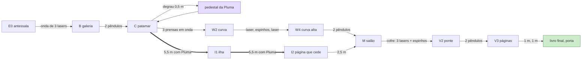

# Fase 13: Ala Proibida

Cena: `Assets/Scenes/Fase13_AlaProibida.unity`, gerada por `Assets/Scripts/Editor/Phases/Fase13Builder.cs`. O tema fica na própria classe (`Fase13Builder.Tema`) e continua a noite da Fase 12: roxo intenso, neblina densa (0,03), saturação 14, exposição 0,06. O destaque é violeta (`Accent` 0,86 / 0,40 / 1,0).

## Ideia central

A seção trancada da biblioteca, vigiada por feixes e pêndulos. **Os feixes andam em onda**: em cada grupo, a armadilha seguinte atrasa exatamente o tempo de correr até ela a 5 m/s. Quem pega o ritmo atravessa direto; quem não pega para entre dois feixes. Regra de luz da fase: **luz quente marca refúgio, luz roxa marca perigo**.

Ritmo:

- **Apresentar:** corredor dos feixes e galeria dos pêndulos, cada mecânica sozinha.
- **Testar:** no patamar da escolha, a rota principal (prensas, depois laser com espinhos, depois um par de pêndulos) ou o atalho opcional da Pluma.
- **Desafio final:** o cofre de teto baixo, com uma onda que não se pula, a ponte estreita de dois pêndulos e as páginas que cedem até o livro final.

O relógio sobre a porta (y 10, z 112) serve de marco.

Placas: `FASE 13` / `ALA PROIBIDA` / `OS FEIXES ANDAM EM ONDA` na antessala, `PASSE PELO LADO VAZIO` na galeria, `ATALHO: SO COM A PLUMA` e `ROTA DAS PRENSAS` no patamar, `O COFRE` / `TETO BAIXO: SO PASSA NO RITMO` no salão.

## Números do motor

Os valores são os de `docs/Fase3.md`: gravidade −20 m/s², pulo 1,1 m (v0 = 6,633 m/s), corrida 5 m/s, raio 0,28 m, altura 1,76 m, *coyote* 0,12 s e `stepOffset` 0,3 m.

- **Alcance nominal:** plano 3,32 m; com Pluma (g = 10), 6,63 m.
- **Limite teórico**, usado para provar que um atalho é impossível: alcance nominal + 0,6 m de *coyote* + 0,56 m das bordas do controlador. Plano, **4,48 m**; Pluma no plano, **7,79 m**.
- **Borda alcançável:** apogeu + 0,3 m de `stepOffset`. Sem poder, 1,4 m; com Pluma, **2,5 m**.
- **Saltar armadilhas:** o pulo comum mantém o pé acima de 0,65 m (topo do gatilho dos espinhos) por só 2,12 m e nunca passa de 1,175 m (topo do feixe). Com a Pluma, o pé fica acima de 1,175 m por 4,5 m e acima de 1,77 m (topo do peso do pêndulo embaixo) por 2,9 m.

## Plataformas (topo em Y; extensão em X e Z)

| Peça | Centro do topo | Extensão | Observação |
| --- | --- | --- | --- |
| E0 Antessala | (0, 0, 0) | x −4..4, z −3..3 | *spawn* em (0, 0, −0,8), yaw 0 |
| A Corredor dos feixes | (0, 0, 11,5) | x −1,95..1,95, z 3..20 | interno 2,7 m (estantes em x ±1,65) |
| B Galeria dos pêndulos | (0, 0, 27) | x −3,6..3,6, z 20..34 | interno 6 m |
| C Patamar da escolha | (0, 0, 38) | x −4,5..4,5, z 34..42 | pedestal da Pluma em (3; 0,5; 36,5) |
| I1 Ilha de livros | (2, 0, 48,75) | x 0,75..3,25, z 47,5..50 | rota opcional |
| I2 Página solta (cede) | (2, 0, 56,5) | z 55,5..57,5 | rota opcional |
| W1 Corredor das prensas | (−10, 0, 40) | x −15,5..−4,5 | interno 1,6 m (z 39,2..40,8) |
| W2 Curva | (−17,5, 0, 40) | x −19,5..−15,5, z 38..42 | |
| W3 Corredor das grades | (−17,5, 0, 51) | z 42..60 | interno 2,7 m |
| W4 Curva alta | (−17,5, 0, 62,7) | z 60..65,4 | |
| W5 Corredor dos pêndulos | (−10, 0, 62) | x −15,5..−4,5 | interno 5,6 m (z 59,2..64,8) |
| M Salão do cofre | (0, 0, 64) | x −4,5..4,5, z 60..68 | |
| V1 Cofre | (0, 0, 75) | z 68..82 | interno 2,7 m, teto a 2,3 m |
| V2 Ponte do pêndulo | (0, 0, 88,75) | x −1..1, z 82..95,5 | |
| V3 Páginas 1 e 2 (cedem) | (0, 0, 97,5) e (0, 0, 100,5) | 2 × 2 cada | vãos de 1 m |
| Livro final | (0, 0, 106,5) | x −4..4, z 102,5..110,5 | porta em (0, 0, 108,5), yaw 180 |

Todas as estantes de parede têm 4,5 m (5 m na galeria e no corredor dos pêndulos, 6 m no fim). A zona de queda fica em y = −10. Tudo é plano em y 0: a dificuldade vem do ritmo, não da altura.

## Grafo

O estado é (ponto, tem Pluma); as arestas duplas exigem a Pluma.

| Rota | Percurso aproximado |
| --- | --- |
| Principal (sem poder) | 3 + 17 + 14 + 8 + 11 + 4 + 18 + 4 + 11 + 8 + 14 + 13,5 + 6 + 6 ≈ **138 m** |
| Atalho da Pluma | E0 → … → C → I1 → I2 → M → … ≈ **100 m** |

A rota opcional troca três trechos de armadilhas por dois saltos longos sobre o abismo e uma página que cede.

## Cálculo de cada pulo

| Salto | Vão | Desnível | Alcance nominal | Margem |
| --- | --- | --- | --- | --- |
| C → pedestal | 0 | +0,5 m | apogeu 1,1 m | 0,6 m |
| **C → I1 com Pluma** | 5,5 m | 0 | 6,63 m | **1,13 m** |
| C → I1 sem Pluma | 5,5 m | 0 | limite teórico 4,48 m | impossível |
| **I1 → I2 com Pluma** | 5,5 m | 0 | 6,63 m | **1,13 m** |
| I2 → M | 2,5 m | 0 | 3,32 m | 0,82 m (pular antes de 0,8 s) |
| V2 → V3 → V3 → livro | 1,0 m cada | 0 | 3,32 m | 2,32 m |

O resto da fase é piso contínuo.

## Ritmo das armadilhas

Notação: T = (t + offset) mod período. A **onda** usa `offset = (−d / 5) mod período`, em que d é a distância até a primeira armadilha do grupo. Quem cruza a primeira na fase φ encontra as outras também em φ.

**A. Corredor dos feixes.**

- Lasers em z 7, 11 e 15, com 1,2 s ligado e 2,0 s apagado (período 3,2 s) e offsets 0, 2,4 e 1,6.
- Cruzar o feixe (0,25 + 0,56 m) leva 0,16 s. Correndo, a janela é φ de 1,28 a 3,12 s, ou seja, **1,84 s**.
- Parado, há 3,2 m livres entre os feixes, sob luz quente.
- O corredor tem 2,7 m internos, a largura do feixe, então não há como contornar.

**B. Galeria dos pêndulos.**

- Pêndulos de 55° com período 2,4 s em z 24,5 (offset 0) e z 29,5 (offset 1,2). Balançam em X, meio período defasados.
- O peso alcança 2,65 · sen 55° + 0,62 = 2,79 m, dentro dos 3 m de meia largura.
- **Junto à parede** (x = ±2,5): o peso toca quando está a mais de 1,6 m para aquele lado (θ > 37,1°, sen φ > 0,675). São 0,63 s ferindo e **1,77 s seguros contínuos** por ciclo. Daí a placa: passe pelo lado vazio.
- **No meio:** duas janelas seguras de 0,92 s. Cruzar a faixa de 1,8 m leva 0,36 s, então há 0,56 s de entrada.
- Refúgio entre os pêndulos: 3,2 m.

**W1. Prensas.**

- Prensas em x −7,5, −10,5 e −13,5. Ficam 1,4 s erguidas, levam 0,2 s descendo, 0,8 s embaixo e 0,8 s subindo (período 3,2 s); ferem com T entre 1,4 e 2,4.
- Offsets em onda para quem corre em −X: 0, 2,6 e 2,0.
- Cruzar o bloco (1,6 + 0,56 m) leva 0,43 s. Cada prensa tem 2,2 s seguros, o que dá **1,77 s de entrada**.
- Entre duas prensas há 1,4 m de piso (0,84 m de folga para o centro do corpo).
- O corredor tem 1,6 m, a largura do bloco.

**W3. Grades.**

- Laser em z 45 (offset 0), dois campos de espinhos seguidos em z 48..52 (1,2 s fora e 2,0 s dentro, offset 2,2) e laser em z 55 (offset 1,2). Tudo tem período de 3,2 s.
- O bloco de espinhos mede 4,56 m com o corpo, e o pulo comum só cobre 2,12 m acima do gatilho: é preciso esperar.
- Correndo, a janela é φ de 1,66 a 2,74 s (**1,08 s**).
- Parado, há refúgios de 2,3 m entre o laser e os espinhos e entre os espinhos e o segundo laser, os dois sob luz quente.
- Os campos de 1,8 m deixam 0,45 m de cada lado num corredor de 2,7 m, menos que o corpo (0,56 m).

**W5. Corredor dos pêndulos.**

- O corredor tem 5,6 m internos. Pêndulos de 55° e período 2,4 s em x −12,5 (offset 0) e x −8,5 (offset 1,2), balançando em Z.
- As janelas são as mesmas da galeria: 1,77 s seguros junto à parede do lado vazio.
- Refúgio entre os pêndulos: 2,2 m.

**V1. Cofre.**

- Lasers em z 71, 74,5 e 78, com 1,5 s ligado e 1,5 s apagado e offsets 0, 2,3 e 1,6. Espinhos em z 81 (1,2 s fora e 1,8 s dentro, offset 1,0).
- Correndo, a janela é φ de 1,58 a 2,74 s (**1,16 s**).
- Parado, há 2,69 m entre os feixes e 1,3 m antes dos espinhos.
- O **teto a 2,3 m** limita o pé a 0,54 m de altura (2,3 − 1,76). Isso fica abaixo do feixe (0,825 m) e do topo do gatilho dos espinhos (0,65 m), então nem com a Pluma dá para saltar.

**V2. Ponte do pêndulo.**

- Ponte de 2 m sobre o abismo. Pêndulos de 70° e período 3 s em z 87 (offset 0) e z 92,5 (offset 1,5).
- No centro, o peso toca quando |θ| < 19,9° (|sen φ| < 0,284): duas janelas de 0,275 s por ciclo. As janelas seguras são de 1,225 s, e a entrada, de **0,86 s**, duas vezes por ciclo.
- Refúgio entre os pêndulos: 3,7 m, sob luz quente.

**V3. Páginas.** Cada página tem 2 m e cede 0,8 s depois de pisada. A 5 m/s, gastam-se 0,6 s por página, contando o vão de 1 m.

## Atalhos impossíveis

- **Sem Pluma, para as ilhas:** C → I1 tem 5,5 m, mais que o limite de 4,48 m.
- **Pular uma ilha com a Pluma:** C → I2 tem 13,5 m e I1 → M tem 10 m, contra o limite de 7,79 m.
- **Pular paredes:** todas as estantes de parede têm 4,5 m ou mais, contra a borda alcançável de 2,5 m com a Pluma. Os corredores W1, W3 e W5 são fechados, e não há como passar de um corredor a outro por cima.
- **Contornar o cofre:** o teto fica em 2,8 m (topo), mais que 2,5 m, então não se anda por cima dele. O salão M fica a 14 m da ponte, e os lados do cofre dão para o abismo.
- **Contornar armadilhas:** feixes de 2,7 m em corredores de 2,7 m; prensas de 1,6 m em corredor de 1,6 m; espinhos de 1,8 m em corredores de 2,7 m (sobram 0,45 m de cada lado, contra um corpo de 0,56 m).

## Poderes

Só a **Pluma**, no pedestal do patamar C, ao lado do primeiro salto que ela permite. A rota sem poder sempre existe.

A Pluma pode chegar ativa ao cofre: o percurso do pedestal ao salão leva cerca de 6 s, e o efeito dura 30 s. O teto baixo anula a vantagem. Na ponte, a Pluma permite saltar o peso do pêndulo quando ele está embaixo (2,9 m acima de 1,77 m, contra uma faixa de 2,36 m). É uma recompensa arriscada de quem pegou o poder, não um atalho de rota.

## Riscos e pendências

- O código compila; a cena ainda não foi jogada. Os números precisam de *playtest*.
- Quem ficar mais de ~24 s parado na ilha I1 perde a Pluma e não volta ao patamar. Nesse caso, pular no abismo reinicia a fase.
- Pontos a observar:
  - o modelo da prensa dentro do corredor de 1,6 m;
  - as luminárias do cofre (2,15 m) à altura da cabeça;
  - as colunas da ponte (x ±3,8), perto do alcance do pêndulo de 70° (3,11 m).
