# Fase 15: Mar de Páginas

Cena: `Assets/Scenes/Fase15_MarDePaginas.unity`, gerada por `Assets/Scripts/Editor/Phases/Fase15Builder.cs`. O tema fica na própria classe (`Fase15Builder.Tema`): a noite clareia em azul-marinho, com névoa de mar (0,018) e destaque turquesa (`Accent` 0,40 / 0,95 / 0,95). Saturação 20, exposição 0,15.

## Ideia central

Ilhas de livros sobre um mar de páginas brilhando, do cais até um farol de estantes. Os vãos são grandes demais para o pulo comum, e **cada poder vence um tipo de vão**:

- a **Velocidade** vence vãos longos em descida (5 m, −0,5 m);
- a **Pluma** vence vãos em subida (+1,5 m), que nenhum outro poder alcança.

O farol, com um relógio no alto, é o marco visto desde o cais.

Ritmo:

1. **Apresentar:** pedras de livro e páginas que cedem.
2. **Testar:** a correnteza (três saltos com Velocidade).
3. **Escolher:** a ponte dos feixes (curta e difícil, com o Escudo como rede de segurança) ou a escada de páginas (longa, sem poder).
4. **Desafio final:** o voo da Pluma, com três saltos subindo entre pêndulos e uma nuvem que cede, e o salto até o farol.

Placas: `FASE 15` / `MAR DE PAGINAS` no cais, `CORRA E SALTE` na ilha da Velocidade, `PONTE DOS FEIXES` e `ESCADA DE PAGINAS` na ilha das correntes, `SO A PLUMA ALCANCA O FAROL` na ilha alta.

## Números do motor

Os valores são os de `docs/Fase3.md`: gravidade −20 m/s², pulo 1,1 m (v0 = 6,633 m/s), corrida 5 m/s (7,5 com Velocidade), raio 0,28 m, *coyote* 0,12 s e `stepOffset` 0,3 m.

Tempo de voo até pousar `dh` acima do ponto de partida: T = (v0 + √(v0² − 2·g·dh)) / g. O alcance é a velocidade × T.

| Condição | Plano | +0,5 m | +0,75 m | −0,5 m | +1,5 m |
| --- | --- | --- | --- | --- | --- |
| Pulo comum (5 m/s) | 3,32 | 2,88 | 2,59 | 3,66 | impossível |
| Velocidade (7,5 m/s) | 4,97 | 4,33 | 3,89 | **5,49** | impossível |
| Pluma (g = 10) | **6,63** | | | | **5,19** |
| Pluma + Velocidade | 9,95 | | | | 7,78 |

- **Limite teórico**, usado para provar que um atalho é impossível: alcance nominal + velocidade × 0,12 s de *coyote* + 0,56 m das bordas do controlador. Pulo comum em −0,5 m: **4,82 m**. Velocidade no plano: 6,43 m. Pluma em +1,5 m: 6,35 m. Pluma + Velocidade em +1,5 m: **9,24 m**.
- **Borda alcançável:** apogeu + 0,3 m de `stepOffset`. Sem Pluma, **1,4 m**: um degrau de 1,5 m exige a Pluma. Com ela, 2,5 m: dois degraus seguidos (3,0 m) não se vencem nem com a Pluma.
- **Borda do controlador:** de pé na beirada, o centro do corpo pode ficar até 0,28 m além dela. Por isso as armadilhas desta fase cobrem a largura da ilha mais essa folga, ou ficam entre estantes.

## Plataformas (topo em Y; extensão em X e Z)

| Peça | Centro do topo | Extensão | Observação |
| --- | --- | --- | --- |
| P0 Cais (livro aberto) | (0, 0, 0) | x −4..4, z −3..3 | *spawn* (0, 0, −1), yaw 0 |
| B1 | (0, 0, 6) | x −1,5..1,5, z 4,5..7,5 | |
| B2 | (1,5; 0,5; 11) | x 0..3, z 9,5..12,5 | |
| B3 (cede) | (1,5; 0,5; 15) | x 0,25..2,75, z 13,75..16,25 | |
| B4 (cede) | (0; 0,5; 19) | x −1,25..1,25, z 17,75..20,25 | |
| B5 Ilha da Velocidade | (0, 1, 24,5) | x −2..2, z 21,5..27,5 | Velocidade em (0, 1, 23); 4,5 m de pista |
| S1 | (0; 0,5; 34,5) | x −1,75..1,75, z 32,5..36,5 | |
| S2 | (0, 0, 43,5) | z 41,5..45,5 | |
| S3 | (0; −0,5; 53,5) | z 50,5..56,5 | |
| H Ilha das correntes (livro aberto) | (0; −0,5; 62) | x −4..4, z 58..66 | Escudo em (2,5; −0,5; 62,5) |
| R1 Ponte dos feixes | (2,5; 0,25; 68,5) | x 1,3..3,7, z 66..71 | laser em z 69 entre estantes |
| R2 Ponte dos espinhos | (2,5; 1; 74) | z 71..77 | 2 × 2 campos (z 72,5..76,5) |
| R3 Ponte final | (2,5; 1,75; 78,5) | z 77..80 | laser em z 78,5 entre estantes |
| E1 | (−7; 0,25; 63) | x −8,5..−5,5, z 61..65 | |
| E2 Ponte do pêndulo | (−7, 1, 70,5) | x −8..−6, z 66,5..74,5 | pêndulo de 70° em z 70,5 |
| E3 Ilha dos espinhos | (−7, 1, 80) | x −8,8..−5,2, z 76..84 | 2 × 2 campos (z 78..82) |
| E4 (cede) | (−7; 1,75; 86,25) | x −8,25..−5,75, z 85..87,5 | |
| A Ilha alta (livro aberto) | (0; 2,5; 84) | x −4..4, z 80..88 | Pluma em (−1,5; 2,5; 86,5) |
| G1 | (0, 4, 94,5) | x −1,75..1,75, z 92..97 | pêndulo de 55° em z 94,5 |
| G2 Nuvem de páginas (cede) | (0; 5,5; 102,25) | x −1,5..1,5, z 101..103,5 | |
| G3 | (0, 7, 110,5) | z 107,5..113,5 | pêndulo de 55° em z 110,5 (offset 1,2) |
| Farol (livro aberto) | (0, 7, 123) | x −4..4, z 119..127 | porta em (0, 7, 125), yaw 180 |

A zona de queda fica em y = −9. O mar (`FloatingPages` e `DreamMotes`) fica entre y −6,5 e −3,5, abaixo de todas as ilhas e sem colisão.

## Grafo

O estado é (ponto, poderes ativos). As arestas duplas exigem o poder indicado.

```mermaid
flowchart LR
    P0["P0 cais"] --> B1 --> B2 --> B3["B3 cede"] --> B4["B4 cede"] --> B5["B5 Velocidade"]
    B5 ==>|"5 m, −0,5, Velocidade"| S1 ==>|"5 m, −0,5"| S2 ==>|"5 m, −0,5"| S3
    S3 -->|"1,5 m"| H["H ilha das correntes, Escudo"]
    H -->|"R1 laser"| R2["R2 espinhos"] -->|"R3 laser"| A["A ilha alta, Pluma"]
    H -->|"1,5 m, +0,75"| E1 --> E2["E2 pêndulo"] --> E3["E3 espinhos"] --> E4["E4 cede"] -->|"1,75 m, +0,75"| A
    A ==>|"4 m, +1,5, Pluma"| G1["G1 pêndulo"] ==> G2["G2 cede"] ==> G3["G3 pêndulo"] ==>|"5,5 m, Pluma"| F["Farol, porta"]
    style B5 fill:#fff1c4,stroke:#c49a2a
    style A fill:#e6dcff,stroke:#7a55c0
    style F fill:#cdeccd,stroke:#3a8a3a
```

| Rota | Percurso aproximado |
| --- | --- |
| Pela ponte dos feixes | 3 + 24,5 + 29 + 1,5 + 8 + 14 + 8 + 39 ≈ **127 m** |
| Pela escada de páginas | ≈ **140 m** (desvio lateral de ~13 m) |

## Cálculo de cada pulo

| Salto | Vão | Desnível | Alcance nominal | Margem |
| --- | --- | --- | --- | --- |
| P0 → B1 | 1,5 m | 0 | 3,32 m | 1,82 m |
| B1 → B2 | 2,0 m | +0,5 m | 2,88 m | 0,88 m |
| B2 → B3 (cede) | 1,25 m | 0 | 3,32 m | 2,07 m |
| B3 → B4 (cede) | 1,5 m | 0 | 3,32 m | 1,82 m |
| B4 → B5 | 1,25 m | +0,5 m | 2,88 m | 1,63 m |
| **B5 → S1, S1 → S2, S2 → S3 (Velocidade)** | 5,0 m | −0,5 m | 5,49 m | **0,49 m** |
| Os mesmos sem Velocidade | 5,0 m | −0,5 m | limite teórico 4,82 m | impossível |
| S3 → H | 1,5 m | 0 | 3,32 m | 1,82 m |
| H → R1 → R2 → R3 → A | 0 (degraus) | +0,75 m cada | apogeu 1,1 m | 0,35 m de altura |
| H → E1 | 1,5 m | +0,75 m | 2,59 m | 1,09 m |
| E1 → E2 | 1,5 m | +0,75 m | 2,59 m | 1,09 m |
| E2 → E3 | 1,5 m | 0 | 3,32 m | 1,82 m |
| E3 → E4 (cede) | 1,0 m | +0,75 m | 2,59 m | 1,59 m |
| E4 → A | 1,75 m | +0,75 m | 2,59 m | 0,84 m (pular antes de 0,8 s) |
| **A → G1, G1 → G2, G2 → G3 (Pluma)** | 4,0 m | +1,5 m | 5,19 m | **1,19 m** |
| Os mesmos sem Pluma | — | +1,5 m | borda alcançável 1,4 m | impossível |
| **G3 → Farol (Pluma)** | 5,5 m | 0 | 6,63 m | **1,13 m** |

Páginas que cedem (0,8 s):

- B3 e B4 se atravessam em 0,5 a 0,6 s.
- Em G2 (2,5 m de comprimento), pousa-se na metade de trás e salta-se 0,4 s depois.

## Armadilhas e ritmo

**Ponte dos feixes (rota curta).** O tique é de 2,8 s: lasers com 1,2 s ligado e 1,6 s apagado; espinhos com 1,4 s fora e 1,4 s dentro. Os offsets formam uma onda a 5 m/s a partir do laser de R1: espinhos em (−5,5 / 5) mod 2,8 = 1,7 e laser de R3 em (−9,5 / 5) mod 2,8 = 0,9.

- O bloco de espinhos tem 4 m (4,56 m com o corpo, 0,91 s de travessia) e janela de 1,4 s.
- Correndo, a janela comum é φ de 1,86 a 2,34 s (**0,49 s**). É a rota difícil.
- Quem parar tem refúgios: 1,3 m depois do laser de R1, 1,2 m antes dos espinhos e 1,3 m entre os espinhos e o laser de R3.
- O **Escudo** (na ilha H) absorve um toque e dá 1 s de proteção para terminar a travessia.

Cobertura da ponte dos feixes:

- **Lasers:** cada um fica entre duas estantes de 3 m de altura e 4 m de comprimento (x 1,0 e 4,0, faces em 1,3 e 3,7). O feixe de 2,7 m (x 1,15..3,85) cobre todo o espaço entre elas. Contornar pelo ar exigiria voar 4 m por fora da estante e voltar, e passar por cima, subir mais de 3 m.
- **Espinhos:** dois campos lado a lado (x 1,9 e 3,1) cobrem x de 1,0 a 4,0. O corpo na ponte de 2,4 m vai de x 1,02 a 3,98 (com a folga da borda), e passar ao lado exigiria x < 0,72 ou x > 4,28.

**Escada de páginas (rota longa).**

- **Pêndulo de E2:** 70°, período 3 s, sobre uma ponte de 2 m. No centro, o peso toca quando |θ| < 19,9°, o que deixa duas janelas de entrada de **0,86 s** por ciclo. O peso alcança 3,11 m para cada lado, além da borda.
- **Espinhos de E3:** duas fileiras de dois campos (x −7,9 e −6,1), com 1,2 s fora e 1,8 s dentro. Cobrem x de −8,8 a −5,2 numa ilha de 3,6 m. Atravessar 4,56 m leva 0,91 s, o que dá **0,89 s de entrada**. Há refúgios de 1,8 m antes e depois.

**Voo da Pluma.** Pêndulos de 55° com período 2,4 s em G1 (offset 0) e G3 (offset 1,2). As ilhas têm 3,5 m de largura, e o peso alcança 2,79 m para cada lado.

- Junto à beirada (x = ±1,5): 1,38 s seguros contínuos por ciclo.
- No meio: duas janelas de 0,56 s.
- Pousa-se na faixa livre antes do pêndulo: 1,6 m em G1 e 2,1 m em G3.

## Atalhos impossíveis

- **Correnteza sem Velocidade:** 5,0 m em −0,5 m, contra o limite de 4,82 m.
- **Pular uma ilha da correnteza com Velocidade:** B5 → S2 tem 14 m, contra o limite de 6,43 m.
- **Da ilha das correntes direto para a ilha alta:** são +3,0 m.
- **Saltar R1 inteira:** H → R2 tem +1,5 m. E3 → A também tem +1,5 m; a página E4 é obrigatória.
- **Pular uma ilha do voo:** A → G2 e G1 → G3 sobem 3,0 m, mais que 2,5 m até com a Pluma. G2 → Farol tem 15,5 m, contra o limite de 9,24 m com Pluma + Velocidade.
- **Trocar de rota no meio:** a escada (x ≤ −5,2) e a ponte (x ≥ 1,3) ficam a mais de 6 m uma da outra. Um salto entre elas com Velocidade só leva à outra rota, que também termina na ilha alta, então não encurta nada.

## Poderes

- **Velocidade** (B5): coletada logo antes dos três vãos que a exigem; a cadeia leva cerca de 6 a 8 s.
- **Escudo** (H): opcional, protege um erro em qualquer das duas rotas.
- **Pluma** (A): coletada logo antes dos quatro saltos que a exigem; a cadeia leva cerca de 10 s.

Combinações:

- A Velocidade pode chegar ativa à ilha alta. Com Pluma + Velocidade, ainda não se pula nenhuma ilha (ver acima). O único ganho é pousar em G1 depois do pêndulo (7,4 m em +1,5 m, contra o limite de 9,24 m), passando por cima do peso. É arriscado e não encurta a rota.
- Não se podem pegar dois coletáveis do mesmo tipo durante um efeito, porque cada poder aparece uma única vez. Assim se evita que o fim do primeiro efeito desligue o segundo, já que `ActivePowerUps` remove o efeito por coletável.

## Riscos e pendências

- O código compila; a cena ainda não foi jogada.
- A margem dos vãos com Velocidade é de 0,49 m. É preciso correr desde o começo da ilha; vale ajustar o vão para 4,8 m se o *playtest* mostrar que ficou duro demais.
- Quem ficar parado mais de ~22 s numa ilha da correnteza (S1, S2) ou do voo (G1, G3) perde o poder e não volta. Nesse caso, cair no mar reinicia a fase. As ilhas não têm motivo para espera longa: nenhuma armadilha na correnteza, e pêndulos de 2,4 s no voo.
- Pontos a observar:
  - as estantes de R3, que entram 0,5 m na borda sul da ilha alta;
  - as colunas do pêndulo de E2 (x −10,8 e −3,2), que descem até y −8.
