# Fase 3: Corredor das Luzes

Cena: `Assets/Scenes/Fase3_CorredorDasLuzes.unity`, gerada por `Assets/Scripts/Editor/Phases/Fase3Builder.cs` (menu **Dreamscape > Fases > Gerar todas as fases novas**). O tema é `PhaseTheme.Fase3`, ciano e verde-água. Ainda é uma fase escura, mas tem mais cor que as Fases 1 e 2 (saturação -6, exposição 0), seguindo a paleta progressiva do GDD.

## Objetivo

O sonho leva o estudante a uma sequência de corredores iluminados por luminárias frias. Ele precisa chegar à porta de conclusão no patamar elevado do fim (N13). Cair ou tocar uma armadilha reinicia a cena. Nada é sorteado: os ciclos são fixos e cada tentativa tem a mesma geometria.

## Mecânicas introduzidas

| Mecânica | Onde | O que ensina |
| --- | --- | --- |
| Espinhos fixos | N1, duas fileiras desencontradas | Desviar. A passagem livre fica à direita na primeira fileira e à esquerda na segunda. Não dá para saltar por cima (ver cálculo). |
| Espinhos em ciclo | Corredor N2–N3, pares A e B | Observar antes de passar. Os pares se alternam: quando A recolhe, B sobe. Atravessa-se A, espera-se no refúgio N3 e atravessa-se B. |
| Pluma (`PickupKind.Gravity`) | Pedestal N5 | Opcional. Com metade da gravidade, o mesmo impulso rende um salto mais alto (2,2 m) e mais longo (6,6 m), o que vence o vão de 5,5 m entre N4 e N8. |
| Laser | Corredor N9–N10 | Uma única vez, perto do fim. O feixe pisca antes de ligar, e o corredor tem exatamente a largura do feixe. |
| Truque de cenário | Corredor escuro T0 | Mostra o caminho direto para a porta, mas é piso falso e sem luz. Ensina a regra da fase: **onde há luminária no teto, há chão firme**. |

Dicas no cenário (`kit.Sign`): `FASE 3` / `CORREDOR DAS LUZES` na entrada, `OBSERVE O RITMO` na boca do corredor dos espinhos em ciclo e `SIGA AS LUZES` no salão, ao lado do corredor escuro.

## Números do motor usados

Valores de `CharacterMotor` e do prefab `FirstPersonPlayer`: gravidade -20 m/s², altura de pulo 1,1 m, corrida 5 m/s, raio do controlador 0,28 m, *coyote time* 0,12 s.

- Velocidade inicial do pulo: v0 = √(2 · 1,1 · 20) = **6,633 m/s**. A Pluma não muda esse impulso, só a gravidade da queda (`SetGravityScale(0,5)`), então o apogeu passa a 6,633² / (2 · 10) = **2,2 m**.
- Tempo no ar até pousar `dh` metros acima: t = (v0 + √(v0² − 2·g·dh)) / g. O alcance é 5 · t.
- Alcance nominal correndo: plano **3,32 m**; +0,5 m **2,88 m**; +0,75 m **2,59 m**; −0,5 m **3,66 m**. Com a Pluma (g = 10): plano **6,63 m**; +1,5 m **5,19 m**.
- O **limite teórico** é usado para provar que um atalho indesejado é impossível. Ele soma o pulo depois de 0,12 s de *coyote* (0,6 m a mais, saindo 0,38 m mais baixo) e 0,28 m de borda do controlador em cada lado. Plano: **4,16 m**. +0,5 m: **3,55 m**. Pluma a +1,5 m: **5,87 m**.

## Plataformas (topo em Y, medidas X × Z)

| Peça | Centro do topo | Tamanho | Extensão |
| --- | --- | --- | --- |
| N0 Entrada | (0, 0, 0) | 6 × 4 | x −3..3, z −2..2 |
| N1 Sala dos espinhos fixos | (0, 0, 8,5) | 6 × 9 | z 4..13 |
| N2-N3 Corredor do ritmo | (0, 0, 18,5) | 2 × 11 | x −1..1, z 13..24 |
| N4 Patamar da escolha | (0, 0, 28) | 8 × 8 | x −4..4, z 24..32 |
| N5 Pedestal da Pluma | (−3, 0,5, 27) | 2 × 2 | x −4..−2, z 26..28 (sobre N4) |
| N6 Galeria lateral | (7,5, 0, 29) | 3 × 8 | x 6..9, z 25..33 |
| N7 Degrau lateral | (8, 0,5, 37,5) | 3 × 5 | x 6,5..9,5, z 35..40 |
| N8 Salão | (0, 0, 41,5) | 8 × 8 | x −4..4, z 37,5..45,5 |
| T0 Corredor escuro (piso falso) | (0, −1, 48,75) | 2 × 6,5 | z 45,5..52 |
| N9-N10 Corredor do laser | (−7, 0, 45) | 3 × 10 | x −8,5..−5,5, z 40..50 |
| N11 Degrau final | (−7, 0,75, 53) | 3 × 4 | z 51..55 |
| N12 Patamar da porta | (−0,5, 1,5, 56) | 7 × 8 | x −4..3, z 52..60 |

São 12 seções: 11 plataformas firmes e o piso falso. As armadilhas são espinhos fixos em (−2, 0, 7,5), (0, 0, 7,5), (0, 0, 11) e (2, 0, 11). Os espinhos em ciclo do par A ficam em (0, 0, 15) e (0, 0, 17); os do par B, em (0, 0, 21) e (0, 0, 23). O laser fica em (−7, 0, 47,5), com yaw 0. A Pluma fica em (−3, 0,5, 27), a porta em (0, 1,5, 58) com yaw 180, o *spawn* em (0, 0, 0) com yaw 0 e a zona de queda em y = −8.

## Pontos do grafo

| Ponto | Coordenada | Referência no mapa |
| --- | --- | --- |
| N0 | (0, 0, 0) | Entrada e *spawn*, com o pufe atrás |
| N1 | (0, 0, 9,25) | Faixa livre entre as fileiras de espinhos fixos |
| N2 | (0, 0, 13,5) | Observação, antes do par A |
| N3 | (0, 0, 19) | Refúgio entre os pares A e B |
| N4 | (0, 0, 28) | Patamar da escolha, à beira do vão de 5,5 m |
| N5 | (−3, 0,5, 27) | Pedestal da Pluma |
| N6 | (7,5, 0, 29) | Galeria lateral, desvio sem poder |
| N7 | (8, 0,5, 37,5) | Degrau lateral |
| N8 | (0, 0, 41,5) | Salão, onde os dois caminhos se juntam |
| T0 | (0, −1, 48,75) | Corredor escuro, **inseguro** |
| N9 | (−7, 0, 43) | Entrada do corredor do laser |
| N10 | (−7, 0, 49,5) | Fim do corredor do laser |
| N11 | (−7, 0,75, 53) | Degrau final |
| N12 | (−0,5, 1,5, 56) | Patamar da porta |
| N13 | (0, 1,5, 58) | Porta de conclusão |

## Grafo das rotas

Como no DS-14, o estado é o par **(ponto, tem Pluma)**: as arestas duplas (`==>`) só existem com a Pluma. As arestas pontilhadas levam ao ponto inseguro. O peso de cada aresta é a distância em linha reta no plano XZ.

```mermaid
flowchart LR
    N0["N0 entrada"] -->|"pulo 2,0 m · 9,25"| N1["N1 espinhos fixos"]
    N1 -->|"caminhar, desvio · 4,25"| N2["N2 observação"]
    N2 -->|"ritmo: par A · 5,5"| N3["N3 refúgio"]
    N3 -->|"ritmo: par B · 9,0"| N4["N4 patamar da escolha"]
    N4 -->|"subir 0,5 m · 3,16"| N5["N5 Pluma"]
    N5 -->|"descer, ganha a Pluma · 3,16"| N4
    N4 ==>|"pulo com Pluma 5,5 m · 13,5"| N8["N8 salão"]
    N4 -->|"pulo 2,0 m · 7,57"| N6["N6 galeria lateral"]
    N6 -->|"pulo 2,0 m, +0,5 · 8,51"| N7["N7 degrau lateral"]
    N7 -->|"pulo 2,5 m, −0,5 · 8,94"| N8
    N8 -->|"pulo 1,5 m · 7,16"| N9["N9 corredor do laser"]
    N9 -->|"ritmo: laser · 6,5"| N10["N10 fim do corredor"]
    N10 -->|"pulo 1,0 m, +0,75 · 3,5"| N11["N11 degrau final"]
    N11 -->|"pulo 1,5 m, +0,75 · 7,16"| N12["N12 patamar da porta"]
    N10 ==>|"pulo com Pluma 2,5 m, +1,5 · 9,19"| N12
    N12 -->|"caminhar · 2,06"| N13["N13 porta"]
    N8 -.->|"descer 1 m · 7,25"| T0["T0 corredor escuro"]
    T0 -.->|"voltar em menos de 0,8 s"| N8
    style T0 fill:#f8cccc,stroke:#bb3333
    style N5 fill:#cfeefe,stroke:#3a8fb5
    style N13 fill:#cdeccd,stroke:#3a8a3a
```



Não há aresta de T0 para N12 nem de T0 para N13. A porta fica 2,5 m acima do piso do corredor, mais que os 2,2 m de apogeu com a Pluma, e o piso cede de qualquer forma.

**Rotas e distâncias** (somando os pesos, sem contar o zigue-zague dentro de N1):

| Rota | Pontos | Arestas | Distância |
| --- | --- | --- | --- |
| Mais curta (com Pluma) | N0 → N1 → N2 → N3 → N4 → N5 → N4 → N8 → N9 → N10 → N12 → N13 | 11 | **72,7 m** |
| Com Pluma, pelo degrau | … → N10 → N11 → N12 → N13 | 12 | 74,2 m |
| Sem Pluma | N0 → N1 → N2 → N3 → N4 → N6 → N7 → N8 → N9 → N10 → N11 → N12 → N13 | 12 | **79,4 m** |

A rota com a Pluma é a mais curta tanto em arestas (busca em largura) quanto em metros (Dijkstra). Ela passa duas vezes por N4, uma em cada estado do poder. A rota sem Pluma sempre existe: o poder é um atalho, não uma exigência.

## Cálculo de cada pulo

O vão é medido de borda a borda; a margem é o alcance nominal menos o vão.

| Salto | Vão | Desnível | Alcance nominal | Margem |
| --- | --- | --- | --- | --- |
| N0 → N1 | 2,0 m | 0 | 3,32 m | 1,32 m |
| N4 → N5 (subir no pedestal) | — | +0,5 m | apogeu 1,1 m | 0,6 m de altura |
| N4 → N6 | 2,0 m | 0 | 3,32 m | 1,32 m |
| N6 → N7 | 2,0 m | +0,5 m | 2,88 m | 0,88 m |
| N7 → N8 | 2,5 m | −0,5 m | 3,66 m | 1,16 m |
| **N4 → N8 com Pluma** | 5,5 m | 0 | 6,63 m | **1,13 m** |
| N4 → N8 sem Pluma | 5,5 m | 0 | 3,32 m (limite teórico 4,16 m) | impossível, faltam 1,34 m |
| N8 → N9 | 1,5 m | 0 | 3,32 m | 1,82 m |
| N10 → N11 | 1,0 m | +0,75 m | 2,59 m | 1,59 m |
| N11 → N12 | 1,5 m | +0,75 m | 2,59 m | 1,09 m |
| N10 → N12 com Pluma | 2,5 m (diagonal 1,5 × 2,0) | +1,5 m | 5,19 m | 2,69 m |
| N10 → N12 sem Pluma | — | +1,5 m | — | impossível, o pulo sobe 1,1 m |
| T0 → N8 (fuga) | ~0,5 m | +1,0 m | 2,16 m | 0,1 m de altura; só antes de o piso ceder |

Para não sobrar atalho indesejado, cada um foi comparado com o limite teórico:

- Quina de N4 (4, 32) até a quina de N7 (6,5, 35): 3,90 m e +0,5 m, contra o limite de 3,55 m. Não dá para pular N6, e o pilar em (3,5, 0, 31,5) ainda atrapalha a corrida.
- Quina de N6 (6, 33) até a quina de N8 (4, 37,5): 4,92 m contra o limite de 4,16 m. Não dá para pular N7.
- Do salão N8 (z 45,5) até N12 (z 52) por cima do corredor escuro, com a Pluma: 6,5 m e +1,5 m, contra o limite de 5,87 m. Também é impossível.
- As paredes têm 3 m e o pé alcança no máximo 2,2 m com a Pluma, então nenhuma parede pode ser escalada.

## Ritmo das armadilhas

**Espinhos fixos (N1).** O gatilho de cada campo mede 1,8 m e fica de 0,05 m a 0,65 m acima do piso. Um pulo normal mantém o pé acima de 0,65 m por apenas 2,12 m de avanço. Para passar por cima, seria preciso cobrir 1,8 + 2 · 0,28 = 2,36 m, então o desvio é obrigatório. A primeira fileira (z 7,5) deixa livre o lado direito (x +2), e a segunda (z 11) deixa livre o lado esquerdo (x −2). Entre o pouso do vão e a primeira fileira há 2,6 m de piso.

**Espinhos em ciclo (N2–N3).** Os espinhos ficam 1,2 s expostos e 1,5 s recolhidos, num período de 2,7 s; nos últimos 0,3 s recolhidos começam a subir, como aviso. O par B tem `offset` de 1,35 s (meio período). Em termos da fase de A (T_A = tempo mod 2,7):

- A fere quando T_A está entre 0 e 1,2 s; B fere quando T_A está entre 1,35 e 2,55 s. É uma alternância quase perfeita.
- Atravessar um par vai de z 13,82 a 18,18, ou seja, 4,36 m a 5 m/s: 0,87 s (cerca de 0,97 s saindo parado). Cada janela segura dura 1,5 s, o que deixa cerca de 0,5 s de folga.
- O jeito de aprender é parar em N2 e ver um ciclo. Quando A recolhe (T_A = 1,2), atravessa-se A e espera-se no refúgio N3: são 2,2 m livres, e o corpo tem 0,56 m. Quando B recolhe (T_A = 2,55), atravessa-se B até T_A = 4,05.
- Quem já entendeu o ritmo pode atravessar sem parar, correndo a 5 m/s a partir de z 13,82 e entrando entre T_A = 1,35 e 1,83 s (uma janela de 0,48 s).
- As fases dos ciclos usam `Time.time`, que não zera ao recarregar a cena. O ritmo é sempre o mesmo, mas o ponto do ciclo em que a tentativa começa varia. Por isso o jogador deve observar antes de passar.

**Laser (N9–N10).** O feixe fica 1,5 s ligado e 1,8 s apagado, e pisca nos 0,4 s antes de ligar. O gatilho vai de 0,825 m a 1,175 m de altura. Agachado, o jogador tem 1,06 m e ainda toca o feixe; o pulo normal não passa por cima. A travessia cobre 0,25 + 0,56 m, o que leva 0,16 s correndo ou 0,37 s andando, contra uma janela de 1,8 s. A largura interna do corredor é 2,7 m, a mesma do feixe, então não há como contornar. Com a Pluma, o pé fica acima de 1,175 m por 4,53 m e dá para saltar o laser: é uma recompensa extra de quem pegou o poder.

## Truque de cenário: o corredor escuro

Do salão N8 o jogador vê a porta em linha reta, no fim de um corredor estreito de paredes altas. É o caminho óbvio. O caminho verdadeiro desvia para o oeste, por um corredor iluminado com um laser, e sobe dois degraus.

A falha é justa:

- O corredor não tem nenhuma luminária, enquanto todo piso firme da fase tem uma.
- O piso é o `Trap_PisoFalso`, com material diferente, e fica 1 m abaixo do salão.
- O letreiro `SIGA AS LUZES` está ao lado da entrada.
- O piso treme por 0,8 s antes de ceder, e dá para voltar ao salão (+1 m) nesse tempo.

Se o jogador insiste, o piso cai. Mesmo que ele chegasse ao fundo, a porta está 2,5 m acima e protegida por uma parede, fora do alcance até com a Pluma. A lição vale para as fases seguintes: o caminho mais curto à vista nem sempre é uma aresta do grafo, e a luz marca o chão firme.

## Como gerar

Com a Unity fechada para outros processos:

```sh
/Applications/Unity/Hub/Editor/6000.6.0f1/Unity.app/Contents/MacOS/Unity \
  -batchmode -quit -projectPath "$PWD" \
  -executeMethod Dreamscape.EditorTools.PhaseBuildMenu.BuildAllBatch
```

## Pendências

- O código ainda não foi compilado nem jogado na Unity, porque o editor estava indisponível quando a fase foi escrita. Os números vêm do motor e precisam de *playtest*. Pontos a observar: a altura real dos letreiros, a orientação do modelo da porta (yaw 180) e se os postes do laser se sobrepõem às paredes do corredor.
- O grafo deste documento descreve a fase; a cena ainda não tem um `PhaseRouteGraph` como o da Fase 1.
