# Fase 4 — Bloco de Aulas

Cena `Assets/Scenes/Fase4_BlocoDeAulas.unity`, gerada por `Assets/Scripts/Editor/Phases/Fase4Builder.cs` (menu **Dreamscape > Fases > Gerar todas as fases novas**). Tema `PhaseTheme.Fase4`, âmbar e dourado. É a primeira fase com saturação positiva (+2), seguindo a paleta do GDD, que começa escura e ganha cor a cada fase.

## Objetivo

O estudante continua sonhando na biblioteca, e o sonho mistura a biblioteca com o bloco de aulas da faculdade. As salas de aula viram salas de leitura e o piso cede sob os pés. O jogador sai do pufe na sala de aula e chega à porta de conclusão, sobre um livro aberto gigante no fim do bloco, sem parar sobre os pisos que cedem.

## Ritmo, espaço e transformação

| Ato | Trecho | Papel | Espaço e estética |
| --- | --- | --- | --- |
| 1 | Sala de aula, travessia | Apresenta o piso que cede: três placas curtas, correndo passa. | Ainda é escola: paredes, carteiras (pilares baixos), piso de sala. A porta da sala já é um arco de estantes, e páginas escapam por cima das paredes. |
| 2 | Corredor de espinhos | Repete a mecânica conhecida (espinhos em ciclo) em onda. | Corredor apertado entre estantes de 2,4 m; tapetes marcam os refúgios. |
| 3 | Sala de espera, sala lateral, corredor sob o livro | Testa: o caminho óbvio cai; a solução é buscar a Velocidade. | A sala de aula virou sala de leitura (estantes, mesas com vela, tapete). O corredor é baixo (2 m) e o forro é um único livro gigante deitado. |
| 4 | Salão de leitura, varanda do escudo | Respiro e escolha. | O espaço mais amplo e aberto da fase: daqui se veem a subida, o pêndulo, a porta e o relógio. |
| 5 | Subida (duas rotas), pêndulo, saída | Desafio final: subir 2 m e atravessar o pêndulo. | Pilhas de livros, ponte de livro e a porta sobre um livro aberto, emoldurada por um arco de estantes. |

**Marcos e linha de visão.** O relógio do sonho (`DreamClock`, raio 3 m) flutua em (0, 10, 76), atrás da porta, com o mostrador voltado para o spawn. Do spawn ele aparece pelo arco da sala de aula, ao longo do eixo do percurso: as estantes baixas da travessia (1,4 m) e do corredor de espinhos (2,4 m) e a sala de espera (3 m, a 27 m de distância) ficam abaixo da linha de visão (≈ 6° acima do olho). No salão de leitura, a porta (y = 2) e o relógio ficam bem à frente.

**Leitura da rota.** Toda placa e todo degrau firme têm luminária. A cor de destaque aparece nos frisos dos arcos de estante e dos tapetes: o tapete da sala de espera tem o friso apontando para a sala lateral (onde está a Velocidade), e o arco na borda direita do salão de leitura emoldura a rota longa e segura.

## Mecânicas

| Mecânica | Situação | Onde |
| --- | --- | --- |
| Piso que cede (`CrumblingPlatform`, 0,8 s) | **Nova**: é o tema da fase | Travessia, corredor de forro baixo, arquibancada |
| Velocidade (`PickupKind.Speed`, 5 → 7,5 m/s por 30 s) | Obrigatória pela primeira vez | Sala lateral, num desvio curto, logo antes do corredor |
| Espinhos em ciclo (`Spikes`, 1,2 s expostos / 1,5 s recolhidos) | Já conhecidos da fase anterior | Corredor de espinhos |
| Pêndulo (`Pendulum`, 55°, 2,4 s) | **Novo**: aparece uma única vez, isolado | Ponte perto do fim |
| Escudo (`PickupKind.Shield`) | Recompensa opcional que absorve um golpe | Varanda à esquerda do salão de leitura |

**Truque de cenário.** Quem entra na sala de espera vê o corredor de forro baixo bem à frente. Esse caminho direto é enganoso, porque é formado por placas de 5 m. Sem Velocidade, a primeira placa cede quando ainda falta cerca de 1 m para o fim, e o jogador cai. A falha é justa por quatro motivos:

- a placa treme no instante em que é pisada, como na travessia que o jogador acabou de cruzar;
- o letreiro "ATRASADO? ->" aponta para a sala lateral iluminada;
- o friso do tapete da sala aponta para o mesmo lado;
- o power-up gira e brilha bem ao lado.

A queda ensina que correr nem sempre basta. Uma placa mais longa pede mais velocidade, e por isso o jogador volta para buscar o power-up. O forro a 2,0 m do piso impede pular por cima das placas, então a única solução é a velocidade horizontal.

**Rotas alternativas.**

- **Varanda do escudo** (opcional, arriscada): um salto de 3,5 m sobre o vazio, só possível com a Velocidade ainda ativa, rende o escudo para o pêndulo.
- **Subida ao pêndulo** (escolha): a **arquibancada** é curta (≈ 11 m) e arriscada, com três degraus que cedem e não deixam parar; a **escada de livros** pela direita é longa (≈ 24 m) e segura, com quatro pulos de 1,5 m em pilhas de livros firmes, onde dá para parar e olhar o pêndulo de cima. As duas chegam ao mesmo patamar; nenhuma pula o pêndulo.

## Estética (biblioteca do sonho)

- **Da escola à biblioteca:** a sala de aula mantém `Wall`, `Platform` e carteiras (`Pillar` de 0,75 m). A partir da travessia, as divisórias e paredes viram estantes (`Bookshelf`) colocadas por fora do piso, com a face interna onde antes ficava a face da parede: as larguras jogáveis não mudam. As carteiras da sala de espera viram mesas de leitura (`ReadingDesk`).
- **Arcos de estantes** (`ShelfArch`): porta da sala de aula (vão de 3 m), borda direita do salão de leitura (vão de 2 m, rota longa) e portal da saída (vão de 2,6 m).
- **Plataformas:** o forro do corredor é um único livro gigante (`BookPlatform` com `stackDepth` 0,3, só o livro do topo); a escada de livros, o patamar do pêndulo e a ponte são pilhas de livros (`BookPlatform`); a varanda do escudo e a saída são livros abertos (`OpenBookPlatform`). Os pisos que cedem continuam com o material de piso falso, para serem reconhecíveis.
- **Mobília e luz:** tapetes nos refúgios dos espinhos, na sala de espera e no salão; abajures de leitura só em cima de paredes e estantes; mesas com vela longe das linhas de pulo.
- **Cenário flutuante:** páginas a 5,2 m sobre a sala de aula; livros voando dos dois lados da travessia (a mais de 2 m das estantes); livros a 7,5 m sobre o salão de leitura; páginas a 4,5 m sobre a varanda do escudo.
- **Moldura:** `LibraryBackdrop` cobre x −12..9,5 e z −3..72, com 6 m de margem, base em y = −5 e 15 m de altura.

## Seções (12)

| # | Seção | Faixa (m) |
| --- | --- | --- |
| 1 | Sala de aula de entrada, com carteiras e o arco de estantes na porta | z −2 … 3 |
| 2 | Travessia: 3 pisos que cedem de 3 × 2,5 m, entre estantes de 1,4 m | z 3 … 10,5 |
| 3 | Corredor de espinhos de 2,2 m de largura, com 3 campos em onda | z 10,5 … 21 |
| 4 | Sala de espera (sala de leitura), onde fica o truque | z 21 … 27 |
| 5 | Sala lateral com Velocidade (desvio) | x 4 … 7, z 22 … 26 |
| 6 | Corredor de forro rebaixado: entrada, 3 placas de 5 m e saída | z 27 … 47 |
| 7 | Salão de leitura (patamar) | z 47 … 51 |
| 8 | Varanda do escudo (opcional) | x −11,5 … −7,5, z 47,5 … 50,5 |
| 9a | Arquibancada: vão de 1,5 m e 3 degraus de 0,5 m que cedem | z 52,5 … 58,5 |
| 9b | Escada de livros: 4 pilhas firmes subindo 0,5 m cada | x 1,5 … 8,5, z 47,75 … 59,25 |
| 10 | Patamar do pêndulo (y = 2) | x −2 … 4, z 58,5 … 61,5 |
| 11 | Ponte do pêndulo, com 2 m de largura | z 61,5 … 67,5 |
| 12 | Saída e porta de conclusão | z 67,5 … 71,5 |

O percurso principal tem cerca de 79 m pela arquibancada (70,5 m em Z, 6,7 m a mais pelo desvio da Velocidade e 2 m de subida) e cerca de 92 m pela escada de livros. A zona de queda fica em y = −8.

## Pontos do grafo

Coordenadas (x, y, z) do chão onde o jogador pisa, no mesmo sistema usado no código.

| Ponto | Referência | Coordenadas |
| --- | --- | --- |
| N0 | Entrada e spawn, com o pufe atrás em z = −1,4 | (0, 0, 0) |
| N1 | Início do corredor de espinhos, antes do 1º campo | (0, 0, 11,5) |
| N2 | Refúgio A, entre os espinhos 1 e 2 | (0, 0, 15,1) |
| N3 | Refúgio B, entre os espinhos 2 e 3 | (0, 0, 18,4) |
| N4 | Sala de espera (bifurcação) | (0, 0, 24) |
| N5 | Sala lateral: power-up Velocidade | (5,6, 0, 24) |
| N6 | Entrada do corredor, sob o forro | (0, 0, 28,25) |
| T0 | Placa longa 1 sem Velocidade (inseguro) | (0, 0, 32) |
| N7 | Saída do corredor | (0, 0, 45,75) |
| N8 | Salão de leitura | (0, 0, 49) |
| N9 | Varanda do escudo: power-up Escudo | (−9,5, 0, 49) |
| E1 | Escada de livros 1 | (7, 0,5, 49) |
| E2 | Escada de livros 2 | (7, 1, 53,25) |
| E3 | Escada de livros 3 | (7, 1,5, 57,75) |
| E4 | Escada de livros 4 | (2,75, 2, 57,5) |
| N10 | Patamar do pêndulo | (0, 2, 60) |
| N11 | Porta de conclusão | (0, 2, 70,5) |

Peças intermediárias usadas nas arestas:

| Peça | Tipo | Centro do topo | Tamanho X × Z |
| --- | --- | --- | --- |
| Piso que cede 1, 2 e 3 | `CrumblingPlatform` | (0, 0, 4,25), (0, 0, 6,75), (0, 0, 9,25) | 3 × 2,5 |
| Espinhos 1, 2 e 3 (offset 1,8 / 0,9 / 0 s) | `Spikes` | (0, 0, 13,5), (0, 0, 16,75), (0, 0, 20) | 2 × 2 (gatilho de 1,8) |
| Placa longa 1, 2 e 3 | `CrumblingPlatform` | (0, 0, 32), (0, 0, 37), (0, 0, 42) | 3 × 5 |
| Forro rebaixado (topo; a face de baixo fica em y = 2,0) | `BookPlatform`, 1 livro | (0, 2,5, 37) | 3 × 20 |
| Degrau que cede 1, 2 e 3 | `CrumblingPlatform` | (0, 0,5, 53,5), (0, 1,0, 55,5), (0, 1,5, 57,5) | 2,5 × 2 |
| Escada de livros 1 | `BookPlatform` | (7, 0,5, 49) | 3 × 2,5 (x 5,5..8,5, z 47,75..50,25) |
| Escada de livros 2 | `BookPlatform` | (7, 1,0, 53,25) | 3 × 3 (z 51,75..54,75) |
| Escada de livros 3 | `BookPlatform` | (7, 1,5, 57,75) | 3 × 3 (z 56,25..59,25) |
| Escada de livros 4 | `BookPlatform` | (2,75, 2, 57,5) | 2,5 × 2 (x 1,5..4, z 56,5..58,5) |
| Patamar do pêndulo | `BookPlatform` | (1, 2, 60) | 6 × 3 (x −2..4) |
| Ponte do pêndulo | `BookPlatform` | (0, 2, 64,5) | 2 × 6 |
| Pêndulo (pivô em y = 5,8) | `Pendulum` | chão em (0, 2, 64,5) | balança em X |
| Saída | `OpenBookPlatform` | (0, 2, 69,5) | 6 × 4 |

**Estantes que limitam o caminho** (linha central; a face interna fica a 0,3 m dela):

| Trecho | Estantes | Face interna |
| --- | --- | --- |
| Travessia | x = ±1,65 (z 3,6..10,5), altura 1,4; de z 3 a 3,6 a borda é o pé do arco (face em ±1,5) | x = ±1,35 |
| Corredor de espinhos | x = ±1,25 (z 10,5..21), altura 2,4 | x = ±0,95 |
| Sala de espera | esquerda x = −4,3; fundo z = 20,7; frente z = 27,3 (de \|x\| 1,75 para fora); direita x = 4,3 só nas pontas (z ≤ 22 e ≥ 26), altura 1,4 | x = −4; z = 21 e 27; abertura de 4 m para a sala lateral |
| Corredor de forro baixo | x = ±1,45 (z 27..47), altura 2 | x = ±1,15 |
| Escada de livros | fora: x = 8,8 (z 47,5..59,5), altura 4,5 | x = 8,5 |
| Patamar do pêndulo | norte: z = 61,8, de x −2,3 a −1,3 e de 1,3 a 4,3 | boca da ponte com 2 m (x ±1) |
| Saída | fundo z = 71,8, altura 4; portal com postes em x ±1,3..±1,9, z 67,6..68,8 | z = 71,5 |

## Grafo das rotas

O estado é o par **(ponto, tem Velocidade)**, como no DS-14. A aresta N6 → N7 só existe com Velocidade, e sem o poder a mesma passagem leva a T0.

```mermaid
flowchart LR
    N0["N0: entrada"] -->|"correr: 3 pisos que cedem"| N1["N1: espinhos"]
    N1 -->|"tempo: espinhos 1"| N2["N2: refugio A"]
    N2 -->|"tempo: espinhos 2"| N3["N3: refugio B"]
    N3 -->|"tempo: espinhos 3"| N4["N4: sala de espera"]
    N4 -->|"andar: desvio"| N5["N5: Velocidade"]
    N5 -->|andar| N4
    N5 -->|andar| N6["N6: entrada do corredor"]
    N4 -->|andar| N6
    N6 -->|"correr com Velocidade: 3 placas de 5 m"| N7["N7: saida do corredor"]
    N6 -->|"sem Velocidade: placa cede"| T0["T0: queda"]
    N7 -->|andar| N8["N8: salao de leitura"]
    N8 -->|"pulo 3,5 m com Velocidade"| N9["N9: Escudo opcional"]
    N9 -->|"pulo 3,5 m com Velocidade"| N8
    N8 -->|"curta: pulo 1,5 m e 3 degraus que cedem · 11,0"| N10["N10: patamar do pendulo"]
    N8 -->|"pulo 1,5 m, +0,5 · 7,0"| E1["E1"]
    E1 -->|"pulo 1,5 m, +0,5 · 4,25"| E2["E2"]
    E2 -->|"pulo 1,5 m, +0,5 · 4,5"| E3["E3"]
    E3 -->|"pulo 1,5 m, +0,5 · 4,26"| E4["E4"]
    E4 -->|"andar · 3,72"| N10
    N10 -->|"tempo: pendulo"| N11["N11: porta"]
    style T0 fill:#f8cccc,stroke:#bb3333
    style N5 fill:#fff1c2,stroke:#c99a1a
    style N11 fill:#cfe8cf,stroke:#3a8a3a
```

Tipos de aresta:

- **andar**: piso firme e contínuo.
- **correr**: piso que cede, onde não se pode parar.
- **tempo**: armadilha em ciclo; o jogador espera a janela.
- **pulo**: vão ou degrau.
- **com Velocidade**: só passa no estado com o poder.

**Rota mais curta** (10 arestas): `N0 → N1 → N2 → N3 → N4 → N5 → N6 → N7 → N8 → N10 → N11`. A passagem por N5 é obrigatória. Sem ela, N6 só leva a T0 e a busca não encontra a porta. A rota segura troca a aresta N8 → N10 (11 m) por N8 → E1 → E2 → E3 → E4 → N10 (23,7 m, 5 arestas). N9 é um desvio opcional de ida e volta (N8 → N9 → N8).

## Física de referência

Os números vêm de `CharacterMotor` e de `FirstPersonPlayer.prefab`:

- gravidade de −20 m/s² e pulo de 1,1 m, o que dá velocidade inicial v₀ = √(2·20·1,1) = 6,63 m/s;
- corrida a 5 m/s, ou 7,5 m/s com Velocidade; andar a 2,2 m/s;
- cápsula com 1,76 m de altura e raio r = 0,28 m; o degrau automático vai até 0,3 m.

Tempos de voo e alcances:

- **Vão no mesmo nível**: voo de 0,663 s. O alcance é 3,32 m correndo e 4,97 m com Velocidade.
- **Subindo 0,5 m**: voo de 0,332 + √(2·0,6/20) = 0,577 s. O alcance é 2,88 m correndo e 4,32 m com Velocidade.
- **Limite teórico** (para provar que um atalho é impossível): soma o *coyote time* de 0,12 s e 0,28 m de borda da cápsula em cada lado. No mesmo nível, ≈ 4,16 m correndo e ≈ 6,2 m com Velocidade.

**Como o piso que cede detecta o passo.** `CrumblingFloor` testa uma caixa com 90 % do tamanho da placa, de 0,05 m abaixo até 0,25 m acima do topo. O cronômetro de 0,8 s começa quando a cápsula encosta nessa caixa, ou seja, quando o centro do jogador está a `0,45·L + r` do centro da placa. O jogador está salvo quando o centro passa a borda de saída. No pior caso considerado, isso acontece quando o centro está a mais `r` além da borda.

## Cálculo dos trechos difíceis

### Travessia de pisos que cedem (N0 → N1)

Cada placa tem L = 2,5 m; a caixa de detecção vai até 1,125 m do centro.

| Situação | Distância do gatilho até estar salvo | Tempo | Resultado |
| --- | --- | --- | --- |
| Correndo, 5 m/s (pior caso: centro r além da borda) | 1,125 + 0,28 + 1,25 + 0,28 = 2,935 m | 0,587 s | passa, com folga de 0,21 s |
| Andando, 2,2 m/s (melhor caso: centro r antes da borda) | 1,125 + 0,28 + 1,25 − 0,28 = 2,375 m | 1,08 s | cai |

As estantes em x = ±1,65 têm face interna em ±1,35, e o pé do arco (z 3..3,6) tem face em ±1,5. Com isso, o centro do jogador fica em |x| ≤ 1,22, e a cápsula sempre encosta na caixa de detecção (±1,35). Não há como andar pela beirada sem disparar a placa. As estantes têm 1,4 m e o pulo sobe 1,1 m: não dá para andar por cima delas.

### Espinhos em ciclo (N1 → N2 → N3 → N4)

- O ciclo dura 2,7 s: 1,2 s com os espinhos expostos e 1,5 s recolhidos, com 0,3 s de aviso subindo.
- Os offsets 1,8, 0,9 e 0 s formam uma onda: cada campo abre 0,9 s depois do anterior.
- Para cruzar um campo, o jogador percorre o gatilho de 1,8 m mais a cápsula de 0,56 m, ou seja, 2,36 m. A 5 m/s isso leva 0,47 s, contra uma janela de 1,5 s (folga de 1,03 s).
- Refúgios: A em z 14,4 … 15,85 e B em z 17,65 … 19,1, cada um com um tapete de 1,2 m. Neles o centro do jogador pode ficar numa faixa de 0,89 m.
- As estantes em x = ±1,25 têm face interna em ±0,95. O centro do jogador fica em |x| ≤ 0,67, então não sobra faixa lateral fora do gatilho (±0,9).

### Corredor de placas longas (N6 → N7): por que a Velocidade é necessária

Cada placa tem L = 5 m, e a caixa de detecção vai até 2,25 m do centro. O gatilho dispara com o centro 0,03 m antes da borda de entrada.

| Situação | Distância | Tempo | Resultado |
| --- | --- | --- | --- |
| Velocidade, 7,5 m/s, caso típico (centro na borda) | 2,25 + 0,28 + 2,5 = 5,03 m | 0,671 s | passa, com folga de 0,13 s |
| Velocidade, 7,5 m/s, pior caso (centro r além da borda) | 5,31 m | 0,708 s | passa, com folga de 0,09 s (0,69 m) |
| Sem poder, 5 m/s, melhor caso (centro r antes da borda; detecção até 0,02 s atrasada) | 4,75 − 0,10 = 4,65 m | 0,93 s | cai: em 0,8 s percorre 4,0 m e fica cerca de 1 m antes da borda |

Pular não ajuda. O forro (um livro gigante de 0,5 m) tem a face de baixo a 2,0 m, e a cápsula mede 1,76 m. Assim o pulo sobe no máximo 0,24 m e não sai da caixa de detecção, que vai até 0,25 m. O piso firme continua por 2,5 m sob o forro antes da placa 1. Um pulo vindo de fora só passa por baixo da borda do forro com os pés abaixo de 0,24 m, e nesse caso pousa até 0,77 m depois dela, longe do gatilho em z = 29,47. As estantes do corredor (face em x = ±1,15) deixam o centro do jogador em |x| ≤ 0,87, dentro da caixa (±1,35). As placas são independentes: o tempo de cada uma começa quando o jogador a pisa, e o jogador precisa correr os 15 m sem soltar a corrida.

A Velocidade dura 30 s e é coletada a ≈ 5 m da boca do corredor; os 20 m do corredor levam menos de 3 s. Se o efeito acabar antes (o jogador demorou), o coletável já reapareceu na sala lateral, ao lado.

### Varanda do escudo (N8 ↔ N9, opcional)

- O vão vai de x = −4 a x = −7,5, ou seja, 3,5 m no mesmo nível.
- Com Velocidade, o alcance é 4,97 m: folga de 1,47 m. A corrida de impulso tem 8 m na ida e 4 m na volta, e o motor chega a 7,5 m/s em cerca de 0,3 s (1,1 m).
- Sem Velocidade, o alcance nominal é 3,32 m e o pulo não chega. Só um pulo perfeito no limite teórico (4,16 m) chegaria, e mesmo assim não cria atalho nem beco sem saída: a varanda é opcional, não leva a lugar nenhum e a volta tem o mesmo vão. A mesa do salão fica do lado direito, em (2,4, 0, 50,5), justamente para não servir de trampolim até a varanda.

### Arquibancada (N8 → N10, rota curta)

- **Primeiro pulo**: vão de 1,5 m subindo 0,5 m (z 51 → 52,5). O alcance é 2,88 m correndo (folga de 1,38 m) e 4,32 m com Velocidade. Se o pulo passar do ponto, o jogador bate no espelho do degrau 2 (y 0,5 … 1,0) e escorrega de volta para o degrau 1, sem cair no vão.
- **Degraus**: os 3 degraus ficam colados, cada um 0,5 m mais alto e com 2 m de profundidade. Como 0,5 m passa do degrau automático de 0,3 m, cada um pede um pulo curto. O jogador leva menos de 0,4 s em cada degrau, contra 0,8 s de atraso, e o degrau 3 leva ao patamar firme em y = 2.

### Escada de livros (N8 → E1 → E2 → E3 → E4 → N10, rota longa e segura)

Todos os pulos têm 1,5 m de vão e sobem 0,5 m (degrau ≤ 0,9 m). Alcance correndo 2,88 m (margem de 1,38 m). Como a Velocidade pode ainda estar ativa, cada pilha foi dimensionada para receber o pulo mais longo (4,32 m) sem que o jogador passe do ponto:

| Pulo | Direção | Vão | Pouso mais longe com Velocidade | Borda de saída da pilha | Sobra |
| --- | --- | --- | --- | --- | --- |
| N8 → E1 | +X, pelo arco (z 48..50) | x 4 → 5,5 | x = 4 + 4,32 = 8,32 | x = 8,5 (e a estante em 8,5) | 0,18 m |
| E1 → E2 | +Z | z 50,25 → 51,75 | z = 54,57 | z = 54,75 | 0,18 m |
| E2 → E3 | +Z | z 54,75 → 56,25 | z = 59,07 | z = 59,25 | 0,18 m |
| E3 → E4 / N10 | −X | x 5,5 → 4 | x = 1,18 | cai em E4, no patamar (x ≥ −2) ou no degrau 3 da arquibancada | — |

A estante alta do lado de fora (x = 8,8, até y = 4,5) ampara o primeiro pulo e fecha a rota; de E3 (y = 1,5) o pé alcança 2,6 m, abaixo do topo. Entre E4 (x ≥ 1,5) e o degrau 3 da arquibancada (x ≤ 1,25) sobram 0,25 m, menos que a cápsula (0,56 m): não dá para cair nessa fresta. E4 encosta na borda sul do patamar do pêndulo (z = 58,5) em toda a largura (x 1,5..4), sem sobrepor as plataformas.

Atalhos verificados: de E2 (y = 1) até E4 (y = 2) são 2,3 m na diagonal e +1 m, o que só pula E3 (inofensivo). Da quina leste do patamar do pêndulo até a ponte (x ≤ 1) sobram 1,5 m de piso a atravessar antes do pêndulo; ninguém pousa depois dele. Do patamar até a saída por fora da ponte (quina (4, 61,5) → quina (3, 67,5)) seriam 6,08 m, perto do limite teórico com Velocidade (≈ 6,2 m): por isso as estantes nas quinas norte do patamar fecham tudo menos a boca da ponte (x ±1,3).

### Pêndulo (N10 → N11)

- O pivô fica 3,8 m acima da ponte e a bola fica a 2,65 m do pivô, com raio de 0,62 m. A amplitude é de 55° e o período, de 2,4 s.
- Para quem está no centro da ponte, a bola é perigosa quando |2,65·sen θ| < 0,62 + 0,28 = 0,9 m, isto é, quando |θ| < 19,9°. Nesse ângulo, o centro da bola está a 1,31 m do piso e ainda atinge o jogador, então não dá para passar por baixo.
- A bola cruza o centro duas vezes por período. Cada passagem é perigosa por 0,28 s, e o intervalo seguro entre passagens é de 0,92 s.
- Para atravessar a faixa perigosa (1,8 m em z), o jogador leva 0,24 s com Velocidade (folga de 0,68 s) ou 0,36 s a 5 m/s.
- A bola alcança no máximo x = ±2,17 (±2,79 com o raio) em z 63,9..65,1: as estantes do patamar (z ≤ 62,1) e o portal da saída (z ≥ 67,6) ficam fora do arco.
- O patamar de 3 m antes da ponte, com um poste de luz, serve para observar o ritmo; quem sobe pela escada de livros vê o pêndulo de cima e de lado. O escudo, se o jogador o pegou, absorve um toque.

## Determinismo

- Não há sorteio. Espinhos e pêndulo usam `Time.time` com período e offset fixos, e os pisos que cedem só dependem de quando o jogador os pisa. A aparência das peças de livro depende só do nome.
- Errar recarrega a cena, seja pela zona de queda em y = −8, seja por uma armadilha. A recarga restaura pisos e coletáveis e remove a Velocidade e o Escudo.

## Pendências

- Esta versão foi escrita sem abrir a Unity; precisa de *playtest*. Pontos a observar: a sobreposição visual do pé do arco da sala de aula com as pontas das paredes, as pilhas de livros que descem sob o patamar do pêndulo e a escada de livros (só cenário, mas podem se cruzar), e o número de luzes pontuais no salão de leitura.
