# Fase 4 — Bloco de Aulas

Cena `Assets/Scenes/Fase4_BlocoDeAulas.unity`, gerada por `Assets/Scripts/Editor/Phases/Fase4Builder.cs` (menu **Dreamscape > Fases > Gerar todas as fases novas**). Tema `PhaseTheme.Fase4`, âmbar e dourado. É a primeira fase com saturação positiva (+2), seguindo a paleta do GDD, que começa escura e ganha cor a cada fase.

## Objetivo

O estudante continua sonhando dentro da Unifor e atravessa um bloco de aulas cujo piso cede sob os pés. O jogador sai do pufe na sala de aula e chega à porta de conclusão no fim do bloco, sem parar sobre os pisos que cedem.

## Mecânicas

| Mecânica | Situação | Onde |
| --- | --- | --- |
| Piso que cede (`CrumblingPlatform`, 0,8 s) | **Nova**: é o tema da fase | Travessia, corredor de forro baixo, arquibancada |
| Velocidade (`PickupKind.Speed`, 5 → 7,5 m/s até reiniciar) | Obrigatória pela primeira vez | Sala lateral, num desvio curto |
| Espinhos em ciclo (`Spikes`, 1,2 s expostos / 1,5 s recolhidos) | Já conhecidos da fase anterior | Corredor de espinhos |
| Pêndulo (`Pendulum`, 55°, 2,4 s) | **Novo**: aparece uma única vez, isolado | Ponte perto do fim |
| Escudo (`PickupKind.Shield`) | Recompensa opcional que absorve um golpe | Varanda à esquerda do patamar |

**Truque de cenário.** Quem entra na sala de espera vê o corredor de forro baixo bem à frente. Esse caminho direto é enganoso, porque é formado por placas de 5 m. Sem Velocidade, a primeira placa cede quando ainda falta cerca de 1 m para o fim, e o jogador cai. A falha é justa por três motivos:

- a placa treme no instante em que é pisada, como na travessia que o jogador acabou de cruzar;
- o letreiro "ATRASADO? ->" aponta para a sala lateral iluminada;
- o power-up gira e brilha bem ao lado.

A queda ensina que correr nem sempre basta. Uma placa mais longa pede mais velocidade, e por isso o jogador volta para buscar o power-up. O forro a 2,0 m do piso impede pular por cima das placas, então a única solução é a velocidade horizontal.

## Seções (12)

| # | Seção | Faixa (m) |
| --- | --- | --- |
| 1 | Sala de aula de entrada, com carteiras (pilares de 0,75 m) | z −2 … 3 |
| 2 | Travessia: 3 pisos que cedem de 3 × 2,5 m, com divisórias de 1,4 m | z 3 … 10,5 |
| 3 | Corredor de espinhos de 2,2 m de largura, com 3 campos em onda | z 10,5 … 21 |
| 4 | Sala de espera, onde fica o truque | z 21 … 27 |
| 5 | Sala lateral com Velocidade (desvio) | x 4 … 7, z 22 … 26 |
| 6 | Corredor de forro rebaixado: entrada, 3 placas de 5 m e saída | z 27 … 47 |
| 7 | Patamar do corredor, com pilares | z 47 … 51 |
| 8 | Varanda do escudo (opcional) | x −11,5 … −7,5, z 47,5 … 50,5 |
| 9 | Arquibancada: vão de 1,5 m e 3 degraus de 0,5 m que cedem | z 52,5 … 58,5 |
| 10 | Patamar do pêndulo (y = 2) | z 58,5 … 61,5 |
| 11 | Ponte do pêndulo, com 2 m de largura | z 61,5 … 67,5 |
| 12 | Saída e porta de conclusão | z 67,5 … 71,5 |

O percurso principal tem cerca de 79 m: 70,5 m em Z, 6,7 m a mais pelo desvio da Velocidade e 2 m de subida. A zona de queda fica em y = −8.

## Pontos do grafo

Coordenadas (x, y, z) do chão onde o jogador pisa, no mesmo sistema usado no código.

| Ponto | Referência | Coordenadas |
| --- | --- | --- |
| N0 | Entrada e spawn, com o pufe atrás em z = −1,4 | (0, 0, 0) |
| N1 | Início do corredor de espinhos, antes do 1º campo | (0, 0, 11,5) |
| N2 | Refúgio A, entre os espinhos 1 e 2 | (0, 0, 15,1) |
| N3 | Refúgio B, entre os espinhos 2 e 3 | (0, 0, 18,4) |
| N4 | Sala de espera (bifurcação) | (0, 0, 24) |
| N5 | Sala lateral: power-up Velocidade | (5,6, 0, 24) |
| N6 | Entrada do corredor, sob o forro | (0, 0, 28,25) |
| T0 | Placa longa 1 sem Velocidade (inseguro) | (0, 0, 32) |
| N7 | Saída do corredor | (0, 0, 45,75) |
| N8 | Patamar do corredor | (0, 0, 49) |
| N9 | Varanda do escudo: power-up Escudo | (−9,5, 0, 49) |
| N10 | Patamar do pêndulo | (0, 2, 60) |
| N11 | Porta de conclusão | (0, 2, 70,5) |

Peças intermediárias usadas nas arestas:

| Peça | Centro do topo | Tamanho X × Z |
| --- | --- | --- |
| Piso que cede 1, 2 e 3 | (0, 0, 4,25), (0, 0, 6,75), (0, 0, 9,25) | 3 × 2,5 |
| Espinhos 1, 2 e 3 (offset 1,8 / 0,9 / 0 s) | (0, 0, 13,5), (0, 0, 16,75), (0, 0, 20) | 2 × 2 (gatilho de 1,8) |
| Placa longa 1, 2 e 3 | (0, 0, 32), (0, 0, 37), (0, 0, 42) | 3 × 5 |
| Forro rebaixado (topo; a face de baixo fica em y = 2,0) | (0, 2,5, 37) | 3 × 20 |
| Degrau que cede 1, 2 e 3 | (0, 0,5, 53,5), (0, 1,0, 55,5), (0, 1,5, 57,5) | 2,5 × 2 |
| Pêndulo (pivô em y = 5,8) | chão em (0, 2, 64,5) | balança em X |

## Grafo das rotas

O estado é o par **(ponto, tem Velocidade)**, como no DS-14. A aresta N6 → N7 só existe com Velocidade, e sem o poder a mesma passagem leva a T0.

```mermaid
flowchart LR
    N0["N0: entrada"] -->|"correr: 3 pisos que cedem"| N1["N1: espinhos"]
    N1 -->|"tempo: espinhos 1"| N2["N2: refugio A"]
    N2 -->|"tempo: espinhos 2"| N3["N3: refugio B"]
    N3 -->|"tempo: espinhos 3"| N4["N4: sala de espera"]
    N4 -->|"andar: desvio"| N5["N5: Velocidade"]
    N5 -->|andar| N4
    N5 -->|andar| N6["N6: entrada do corredor"]
    N4 -->|andar| N6
    N6 -->|"correr com Velocidade: 3 placas de 5 m"| N7["N7: saida do corredor"]
    N6 -->|"sem Velocidade: placa cede"| T0["T0: queda"]
    N7 -->|andar| N8["N8: patamar"]
    N8 -->|"pulo 3,5 m com Velocidade"| N9["N9: Escudo opcional"]
    N9 -->|"pulo 3,5 m com Velocidade"| N8
    N8 -->|"pulo 1,5 m e subir 3 degraus que cedem"| N10["N10: patamar do pendulo"]
    N10 -->|"tempo: pendulo"| N11["N11: porta"]
    style T0 fill:#f8cccc,stroke:#bb3333
    style N5 fill:#fff1c2,stroke:#c99a1a
    style N11 fill:#cfe8cf,stroke:#3a8a3a
```

Tipos de aresta:

- **andar**: piso firme e contínuo.
- **correr**: piso que cede, onde não se pode parar.
- **tempo**: armadilha em ciclo; o jogador espera a janela.
- **pulo**: vão ou degrau.
- **com Velocidade**: só passa no estado com o poder.

**Rota mais curta** (10 arestas): `N0 → N1 → N2 → N3 → N4 → N5 → N6 → N7 → N8 → N10 → N11`. A passagem por N5 é obrigatória. Sem ela, N6 só leva a T0 e a busca não encontra a porta. N9 é um desvio opcional de ida e volta (N8 → N9 → N8).

## Física de referência

Os números vêm de `CharacterMotor` e de `FirstPersonPlayer.prefab`:

- gravidade de −20 m/s² e pulo de 1,1 m, o que dá velocidade inicial v₀ = √(2·20·1,1) = 6,63 m/s;
- corrida a 5 m/s, ou 7,5 m/s com Velocidade; andar a 2,2 m/s;
- cápsula com 1,76 m de altura e raio r = 0,28 m; o degrau automático vai até 0,3 m.

Tempos de voo e alcances:

- **Vão no mesmo nível**: voo de 0,663 s. O alcance é 3,32 m correndo e 4,97 m com Velocidade.
- **Subindo 0,5 m**: voo de 0,332 + √(2·0,6/20) = 0,577 s. O alcance é 2,88 m correndo e 4,32 m com Velocidade.

**Como o piso que cede detecta o passo.** `CrumblingFloor` testa uma caixa com 90 % do tamanho da placa, de 0,05 m abaixo até 0,25 m acima do topo. O cronômetro de 0,8 s começa quando a cápsula encosta nessa caixa, ou seja, quando o centro do jogador está a `0,45·L + r` do centro da placa. O jogador está salvo quando o centro passa a borda de saída. No pior caso considerado, isso acontece quando o centro está a mais `r` além da borda.

## Cálculo dos trechos difíceis

### Travessia de pisos que cedem (N0 → N1)

Cada placa tem L = 2,5 m; a caixa de detecção vai até 1,125 m do centro.

| Situação | Distância do gatilho até estar salvo | Tempo | Resultado |
| --- | --- | --- | --- |
| Correndo, 5 m/s (pior caso: centro r além da borda) | 1,125 + 0,28 + 1,25 + 0,28 = 2,935 m | 0,587 s | passa, com folga de 0,21 s |
| Andando, 2,2 m/s (melhor caso: centro r antes da borda) | 1,125 + 0,28 + 1,25 − 0,28 = 2,375 m | 1,08 s | cai |

As divisórias em x = ±1,5 têm face interna em ±1,35. Com isso, o centro do jogador fica em |x| ≤ 1,07, sempre dentro da caixa de detecção (±1,35). Não há como andar pela beirada sem disparar a placa.

### Espinhos em ciclo (N1 → N2 → N3 → N4)

- O ciclo dura 2,7 s: 1,2 s com os espinhos expostos e 1,5 s recolhidos, com 0,3 s de aviso subindo.
- Os offsets 1,8, 0,9 e 0 s formam uma onda: cada campo abre 0,9 s depois do anterior.
- Para cruzar um campo, o jogador percorre o gatilho de 1,8 m mais a cápsula de 0,56 m, ou seja, 2,36 m. A 5 m/s isso leva 0,47 s, contra uma janela de 1,5 s (folga de 1,03 s).
- Refúgios: A em z 14,4 … 15,85 e B em z 17,65 … 19,1. Neles o centro do jogador pode ficar numa faixa de 0,89 m.
- As divisórias em x = ±1,1 têm face interna em ±0,95. O centro do jogador fica em |x| ≤ 0,67, então não sobra faixa lateral fora do gatilho (±0,9).

### Corredor de placas longas (N6 → N7): por que a Velocidade é necessária

Cada placa tem L = 5 m, e a caixa de detecção vai até 2,25 m do centro. O gatilho dispara com o centro 0,03 m antes da borda de entrada.

| Situação | Distância | Tempo | Resultado |
| --- | --- | --- | --- |
| Velocidade, 7,5 m/s, caso típico (centro na borda) | 2,25 + 0,28 + 2,5 = 5,03 m | 0,671 s | passa, com folga de 0,13 s |
| Velocidade, 7,5 m/s, pior caso (centro r além da borda) | 5,31 m | 0,708 s | passa, com folga de 0,09 s (0,69 m) |
| Sem poder, 5 m/s, melhor caso (centro r antes da borda; detecção até 0,02 s atrasada) | 4,75 − 0,10 = 4,65 m | 0,93 s | cai: em 0,8 s percorre 4,0 m e fica cerca de 1 m antes da borda |

Pular não ajuda. O forro tem a face de baixo a 2,0 m, e a cápsula mede 1,76 m. Assim o pulo sobe no máximo 0,24 m e não sai da caixa de detecção, que vai até 0,25 m. O piso firme continua por 2,5 m sob o forro antes da placa 1. Um pulo vindo de fora só passa por baixo da borda do forro com os pés abaixo de 0,24 m, e nesse caso pousa até 0,77 m depois dela, longe do gatilho em z = 29,47. As paredes do corredor em x = ±1,3 deixam o centro do jogador em |x| ≤ 0,87, dentro da caixa (±1,35). As placas são independentes: o tempo de cada uma começa quando o jogador a pisa, e o jogador precisa correr os 15 m sem soltar a corrida.

### Varanda do escudo (N8 ↔ N9, opcional)

- O vão vai de x = −4 a x = −7,5, ou seja, 3,5 m no mesmo nível.
- Com Velocidade, o alcance é 4,97 m: folga de 1,47 m. A corrida de impulso tem 8 m na ida e 4 m na volta, e o motor chega a 7,5 m/s em cerca de 0,3 s (1,1 m).
- Sem Velocidade, o alcance é 3,32 m e o pulo não chega. Isso não bloqueia nada, porque o escudo é opcional e N8 só é alcançado com o poder.

### Arquibancada (N8 → N10)

- **Primeiro pulo**: vão de 1,5 m subindo 0,5 m (z 51 → 52,5). O alcance é 2,88 m correndo (folga de 1,38 m) e 4,32 m com Velocidade. Se o pulo passar do ponto, o jogador bate no espelho do degrau 2 (y 0,5 … 1,0) e escorrega de volta para o degrau 1, sem cair no vão.
- **Degraus**: os 3 degraus ficam colados, cada um 0,5 m mais alto e com 2 m de profundidade. Como 0,5 m passa do degrau automático de 0,3 m, cada um pede um pulo curto. O jogador leva menos de 0,4 s em cada degrau, contra 0,8 s de atraso, e o degrau 3 leva ao patamar firme em y = 2.

### Pêndulo (N10 → N11)

- O pivô fica 3,8 m acima da ponte e a bola fica a 2,65 m do pivô, com raio de 0,62 m. A amplitude é de 55° e o período, de 2,4 s.
- Para quem está no centro da ponte, a bola é perigosa quando |2,65·sen θ| < 0,62 + 0,28 = 0,9 m, isto é, quando |θ| < 19,9°. Nesse ângulo, o centro da bola está a 1,31 m do piso e ainda atinge o jogador, então não dá para passar por baixo.
- A bola cruza o centro duas vezes por período. Cada passagem é perigosa por 0,28 s, e o intervalo seguro entre passagens é de 0,92 s.
- Para atravessar a faixa perigosa (1,8 m em z), o jogador leva 0,24 s com Velocidade (folga de 0,68 s) ou 0,36 s a 5 m/s.
- O patamar de 3 m antes da ponte, com um poste de luz, serve para observar o ritmo. O escudo, se o jogador o pegou, absorve um toque.

## Determinismo

- Não há sorteio. Espinhos e pêndulo usam `Time.time` com período e offset fixos, e os pisos que cedem só dependem de quando o jogador os pisa.
- Errar recarrega a cena, seja pela zona de queda em y = −8, seja por uma armadilha. A recarga restaura pisos e coletáveis e remove a Velocidade e o Escudo.
