# Fase 5 — Laboratório

Cena: `Assets/Scenes/Fase5_Laboratorio.unity`, gerada por `Assets/Scripts/Editor/Phases/Fase5Builder.cs` (menu **Dreamscape > Fases > Gerar todas as fases novas**). Tema `PhaseTheme.Fase5`, em roxo e rosa, mais saturado que a Fase 4, como pede a paleta do GDD.

## Objetivo

O jogador acorda na recepção de um laboratório da Unifor e precisa chegar à porta de conclusão (G). No caminho, aprende a ler o ritmo dos lasers. Na sala de triagem, escolhe entre uma rota longa e segura e uma rota curta, em que usa o Escudo para atravessar o laser mais difícil sem esperar a janela. Se tocar uma armadilha ou cair, a cena recomeça.

## Mecânicas introduzidas

| Mecânica | Onde | Como funciona |
| --- | --- | --- |
| Laser com ritmo | L1, LA1, LA2, LB | O feixe (y 0,825 a 1,175 m; 2,7 m de largura) fica ligado por `timeOn` e desligado por `timeOff` e pisca 0,4 s antes de religar. Os corredores têm 3 m de largura: as paredes deixam 2,7 m livres, que o feixe cobre por inteiro. Não dá para passar por baixo, porque agachado o jogador tem 1,056 m e o feixe começa em 0,825 m. Também não dá para pular por cima: os pés chegam a 1,1 m e o feixe vai até 1,175 m. |
| Onda de lasers | LA1 → LA2 | Os dois lasers têm o mesmo ciclo (4 s), e LA2 está atrasado 0,6 s em relação a LA1. Quem corre os 3 m entre eles a 5 m/s encontra os dois desligados. |
| Escudo (novo) | B1 | Absorve **um** contato com armadilha e se gasta. A placa "ESCUDO = 1 TOQUE" fica entre o coletável e o laser. |
| Escolha de rota | N6 | Três saídas: passarela falsa (truque), rota segura (oeste) e rota curta (leste). |
| Serra e espinhos em ciclo | A4 → A5 → G1 | Segundo tipo de perigo, só na rota segura, e sempre com janela previsível. |

### Ritmos (segundos)

| Laser | Posição | Ligado | Desligado | Ciclo | Offset |
| --- | --- | --- | --- | --- | --- |
| L1 calibração | (0; 0; 9) | 1,2 | 2,0 | 3,2 | 0,7 |
| LA1 lento 1 | (−12; 0; 38) | 1,5 | 2,5 | 4,0 | 0,5 |
| LA2 lento 2 | (−12; 0; 41) | 1,5 | 2,5 | 4,0 | 3,9 |
| LB barreira | (4,5; 0; 45) | 4,2 | 0,8 | 5,0 | 1,3 |

Serra: `period` 4 s; vai de x = −12,5 a x = −6 em 2 s e volta em 2 s, na linha z = 51,5. Espinhos da passagem: 1,0 s expostos e 2,0 s recolhidos (ciclo de 3 s).

O ritmo usa `Time.time`, que não volta a zero quando a cena recarrega. Por isso, a fase de cada laser no momento do reinício muda de uma tentativa para outra, mas os ciclos e a defasagem entre lasers são sempre os mesmos. Não há sorteio.

## Truque de cenário: a passarela falsa

Da triagem, a porta de conclusão aparece em linha reta pela abertura norte, ao fim de uma passarela de 2 × 14 m, e dois postes rosa a emolduram. É a ligação mais curta do mapa: cerca de 24,5 m de N6 até G. A passarela, porém, é piso falso (`CrumblingPlatform`, 0,8 s): treme ao ser pisada e cede.

- **Por que não dá para atravessar:** depois do primeiro contato restam 0,8 s, ou seja, 4,0 m correndo. O máximo alcançável a partir da borda da triagem (z = 36) soma 0,6 m de *coyote time*, 3,3 m do pulo de entrada (no ar não conta como pisar), 4,0 m de corrida, 0,6 m de *coyote* quando o piso some, 3,2 m do pulo final (saindo 0,14 m abaixo) e cerca de 0,8 m de folga das bordas da cápsula. Isso dá z ≈ 48,5, e a sala final começa em z = 50. Sobram cerca de 1,5 m de margem contra o atalho.
- **Por que é justo:** a Fase 1 já apresentou o chão falso (T0 do DS-14). O piso treme antes de cair, e a passarela fica no escuro, enquanto as rotas verdadeiras têm luminárias.
- **O que ensina:** a menor distância no mapa não é uma aresta do grafo. O caminho de verdade passa pelas salas, e o jogador volta à triagem sabendo que precisa escolher uma rota.

## Pontos do grafo

Coordenadas do ponto em que o jogador fica (x; y do piso; z), em metros. Elas são as mesmas do `Fase5Builder.cs`.

| Ponto | Coordenadas | Referência no mapa |
| --- | --- | --- |
| N0 | (0; 0; −1) | Entrada / `Spawn`, recepção x[−4, 4] z[−4, 4] |
| N1 | (0; 0; 7) | Corredor de calibração, antes do laser L1 (z = 9) |
| N2 | (0; 0; 15,5) | Patamar das bancadas z[14, 16] |
| N3 | (−0,75; 0,5; 18) | Bancada 1, z[17, 19], x[−2; 0,5] |
| N4 | (0,75; 0,9; 21,5) | Bancada 2, z[20,5; 22,5], x[−0,5; 2] |
| N5 | (0; 0; 26) | Patamar de saída z[24,5; 28] |
| N6 | (0; 0; 32) | Sala de triagem x[−6, 6] z[28, 36]: **bifurcação** |
| T0 | (0; 0; 43) | Passarela falsa x[−1, 1] z[36, 50] (**inseguro**) |
| A1 | (−7,5; 0; 32) | Corredor oeste x[−9, −6] |
| A2 | (−12; 0; 35) | Galeria de lasers, antes de LA1 (z = 38) |
| A3 | (−12; 0; 39,5) | Entre LA1 e LA2 (z = 41) |
| A4 | (−12; 0; 48) | Fim da galeria, ao sul da serra |
| A5 | (−7; 0; 54) | Sala da centrífuga, ao norte da serra, antes dos espinhos (−4; 0; 54) |
| B1 | (4,5; 0; 39) | Escudo, no corredor leste x[3, 6] |
| B2 | (4,5; 0; 43,5) | Antes do laser da barreira LB (z = 45) |
| B3 | (4,5; 0; 47) | Depois de LB |
| B4 | (4,5; 0; 54) | Fim do corredor leste, diante do portal da sala final |
| G1 | (0; 0; 54) | Sala final x[−3, 3] z[50, 58] |
| G | (0; 0; 56,5) | Porta de conclusão (`Goal`) |

Zona de queda: y = −8. Ela fica sob o fosso das bancadas, o vão do corredor oeste e a passarela falsa.

## Grafo das rotas

```mermaid
flowchart LR
    N0["N0 entrada"] -->|andar| N1["N1 antes de L1"]
    N1 -->|janela L1| N2["N2 patamar"]
    N2 -->|pulo 1,0 m, sobe 0,5| N3["N3 bancada 1"]
    N3 -->|pulo 1,5 m, sobe 0,4| N4["N4 bancada 2"]
    N4 -->|pulo 2,0 m, desce 0,9| N5["N5 patamar de saída"]
    N5 -->|andar| N6{"N6 triagem"}

    N6 -.->|andar: piso falso cede| T0["T0 passarela falsa"]
    T0 -.->|queda| R(["reinício"])

    N6 -->|andar| A1["A1 corredor oeste"]
    A1 -->|pulo 1,5 m| A2["A2 antes de LA1"]
    A2 -->|janela LA1| A3["A3 entre lasers"]
    A3 -->|janela LA2| A4["A4 sul da serra"]
    A4 -->|janela da serra| A5["A5 norte da serra"]
    A5 -->|janela dos espinhos| G1["G1 sala final"]

    N6 -->|andar| B1["B1 escudo"]
    B1 -->|andar| B2["B2 antes de LB"]
    B2 ==>|escudo: atravessa LB e o gasta| B3["B3 depois de LB"]
    B2 -->|sem escudo: janela de 0,8 s| B3
    B3 -->|andar| B4["B4 corredor leste"]
    B4 -->|andar| G1
    G1 -->|andar| G(["G conclusão"])

    style T0 fill:#f8cccc,stroke:#bb3333
    style R fill:#f8cccc,stroke:#bb3333
    style B1 fill:#c8f0e0,stroke:#2a9d6f
    style G fill:#d4f0cc,stroke:#3c8a3a
```

Tipos de aresta: **andar** (sem risco); **pulo** (vão e desnível indicados); **janela** (esperar o perigo se desligar ou se afastar; tocar reinicia a fase); **escudo** (atravessa a armadilha sem esperar e consome o escudo). Toda aresta de pulo também leva à queda e ao reinício se o pulo falhar; essas arestas foram omitidas do diagrama.

Se o grafo for buscado como no DS-14, o estado é **(ponto, tem escudo)**. A aresta B2 → B3 "escudo" só existe nos estados com escudo e leva a um estado sem escudo. A outra aresta B2 → B3 (janela) existe sempre, então a fase tem solução mesmo sem escudo.

### Comparação das rotas (de N6 até G)

As distâncias são horizontais, ponto a ponto. O tempo considera corrida a 5 m/s.

| Rota | Caminho | Arestas | Distância | Arestas com espera | Tempo |
| --- | --- | --- | --- | --- | --- |
| **Curta com escudo** | N6 → B1 → B2 → B3 → B4 → G1 → G | 6 | 30,3 m | 0 | **≈ 6,1 s** |
| Curta sem escudo | mesma, pela janela de LB | 6 | 30,3 m | 1 (LB) | 6,1 a 10,5 s |
| Segura (longa) | N6 → A1 → A2 → A3 → A4 → A5 → G1 → G | 7 | 43,2 m | 4 (LA1, LA2, serra, espinhos) | 8,6 a 13,5 s |
| Passarela (truque) | N6 → T0 ⇢ G1 | — | ≈ 24,5 m | — | sem solução: T0 → G1 não existe |

A **rota mais curta** da fase inteira é `N0 → N1 → N2 → N3 → N4 → N5 → N6 → B1 → B2 → B3 → B4 → G1 → G`: 12 arestas e ≈ 63,8 m (33,5 m no trecho comum mais 30,3 m). Pela rota segura são 13 arestas e ≈ 76,7 m. As duas ficam dentro da faixa de 45 a 80 m pedida.

Como foram calculadas as esperas no pior caso:

- **LA1 + LA2:** espera até 1,5 s em LA1 (mais 0,16 s de travessia). Correndo, LA2 já estará desligado.
- **Serra:** passando por x = −12, a lâmina fica longe (centro em x ≥ −10,94) durante 2,72 s dos 4 s do ciclo. A travessia dura 0,42 s, então a espera máxima é ≈ 1,7 s.
- **Espinhos:** ficam expostos 1,0 s e recolhidos 2,0 s, e a travessia leva 0,47 s, então a espera máxima é ≈ 1,5 s.
- **LB sem escudo:** espera até 4,2 s, e a janela útil é 0,8 − 0,16 = 0,64 s.

## Cálculo dos pulos e das janelas

Motor (`CharacterMotor` + prefab): pulo de 1,1 m, gravidade de −20 m/s², velocidade inicial do pulo v₀ = √(2·20·1,1) = 6,633 m/s, corrida a 5 m/s e caminhada a 2,2 m/s. A cápsula tem 1,76 m de altura e 0,28 m de raio.

O tempo de voo até cair na altura h (h > 0 sobe, h < 0 desce) é t = (v₀ + √(v₀² − 40h)) / 20, e o alcance é igual a 5·t.

| Pulo | Vão | Desnível | Tempo de voo | Alcance correndo | Margem | Andando |
| --- | --- | --- | --- | --- | --- | --- |
| N2 → N3 (patamar → bancada 1) | 1,0 m (z 16 → 17) | +0,5 m | 0,577 s | 2,88 m | **1,88 m** | 1,27 m (margem de 0,27) |
| N3 → N4 (bancada 1 → 2) | 1,5 m (z 19 → 20,5) | +0,4 m | 0,596 s | 2,98 m | **1,48 m** | 1,31 m: precisa correr |
| N4 → N5 (bancada 2 → saída) | 2,0 m (z 22,5 → 24,5) | −0,9 m | 0,779 s | 3,89 m | **1,89 m** | 1,71 m: precisa correr |
| A1 → A2 (corredor oeste → galeria) | 1,5 m (x −9 → −10,5) | 0 | 0,663 s | 3,32 m | **1,82 m** | 1,46 m: precisa correr |

Todos os vãos ficam abaixo do limite seguro de 2,8 m, e nenhum degrau passa de 0,9 m. As bancadas 1 e 2 se sobrepõem em x[−0,5; 0,5], o que permite pular reto em z. O desnível de 0,4 m é menor que a altura do pulo (1,1 m), então a borda da bancada 2 é alcançada ainda na subida.

Janelas dos lasers. A cápsula fica dentro do feixe enquanto |z − z_laser| < 0,125 + 0,28. São 0,81 m de travessia, ou 0,16 s correndo (0,37 s andando).

- **Onda LA1/LA2:** τ = (t + 0,5) mod 4. LA1 fica desligado em τ ∈ [1,5; 4,0), e LA2 em τ ∈ [2,1; 4,6). Correndo (3 m em 0,6 s), é possível entrar em LA1 em qualquer τ ∈ [1,5; 3,84], ou seja, 2,34 s de janela para os dois lasers seguidos. Andando, o intervalo é τ ∈ [1,5; 2,87] (1,37 s). Entre os lasers há 2,75 m livres para parar e esperar.
- **L1:** 2,0 s desligado contra 0,16 s de travessia.
- **LB:** 0,8 s desligado, sendo 0,4 s sem feixe e 0,4 s piscando, contra 0,16 s de travessia. É o laser difícil.

Outros perigos:

- **Serra:** esfera de 0,78 m de raio entre y 0,07 e 1,63, alta demais para pular. Varre x[−13,28; −5,22], quase a sala inteira (faces internas em −13,35 e −5,15). Por isso, a passagem precisa ser cronometrada.
- **Espinhos:** caixa de 1,8 × 1,8 m entre y 0,05 e 0,65, cobrindo os 1,7 m livres da passagem (paredes em z 53 e 55). Para atravessar, a cápsula percorre 1,8 + 0,56 = 2,36 m. Um pulo correndo só fica acima de 0,65 m por 2,1 m, então não dá para pular por cima: é preciso esperar os espinhos recolherem.

## Seções

1. Recepção: entrada, placa "FASE 5 - LABORATORIO" e pufe.
2. Corredor de calibração: laser L1 e placa "OBSERVE O RITMO".
3. Sala das bancadas: três pulos sobre o fosso.
4. Sala de triagem: bifurcação.
5. Passarela falsa: o truque.
6. Corredor oeste: vão de 1,5 m.
7. Galeria de lasers: LA1 e LA2 em onda.
8. Sala da centrífuga: serra.
9. Passagem de amostras: espinhos em ciclo.
10. Corredor do escudo: Escudo e placa "ESCUDO = 1 TOQUE".
11. Barreira: laser LB.
12. Sala final: porta de conclusão.

## Pendências

- **Escudo contra armadilhas de contato contínuo:** `Hazard` também reage em `OnTriggerStay`, e `PlayerShield.TryAbsorb` destrói o escudo no primeiro contato. Atravessar o feixe leva cerca de 0,16 s, ou seja, vários passos de física, e o passo seguinte já encontra o jogador sem escudo e reinicia a fase. Para a aresta "escudo" de B2 → B3 funcionar, o escudo precisa dar alguns décimos de segundo de invulnerabilidade ou ignorar a armadilha até o jogador sair do colisor. Enquanto isso não for corrigido, a fase continua com solução pela janela de LB e pela rota segura.
- **Playtest:** falta validar na Unity os tamanhos de texto das placas e a leitura do piso falso sob a iluminação do tema.
