# Fase 5: Laboratório

Cena: `Assets/Scenes/Fase5_Laboratorio.unity`, gerada por `Assets/Scripts/Editor/Phases/Fase5Builder.cs` (menu **Dreamscape > Fases > Gerar todas as fases novas**). Tema `PhaseTheme.Fase5`, em roxo e rosa, mais saturado que a Fase 4, como pede a paleta do GDD.

## Objetivo e ambientação

O estudante sonha com um laboratório de alquimia escondido dentro da biblioteca: estantes fazem as paredes, as bancadas são pilhas de livros gigantes, mesas de pesquisa com velas ficam nos cantos e páginas soltas flutuam sobre a porta. Ele precisa chegar à porta de conclusão, em cima de um **livro aberto gigante** (G). No caminho aprende a ler o ritmo dos lasers e, na sala de triagem, escolhe entre uma rota longa e segura e uma rota curta e arriscada, em que usa o Escudo. Cair ou tocar uma armadilha reinicia a cena.

**Marcos visuais.** Um relógio parado (`DreamClock`, raio 3 m, y 11) flutua atrás da porta e aparece por cima das estantes desde a recepção. Da triagem, a porta e o livro aberto aparecem em linha reta pela passarela escura, que é a isca do truque. Arcos de estante com friso rosa (`ShelfArch`) e luminárias marcam só as saídas verdadeiras.

## Ritmo da fase

| Etapa | Onde | O que acontece |
| --- | --- | --- |
| Apresentar | Recepção e corredor de calibração | Um laser só, com janela longa (2 s apagado) e a placa `OBSERVE O RITMO`. |
| Testar | Sala das bancadas | Três pilhas de livros sobre o fosso, subindo de 0 a 1,5 m. Os pulos são curtos e servem para trocar de altura. |
| Escolher | Sala de triagem (y 1,5) | Três saídas: a passarela escura (truque), a rota oeste (segura) e a ponte leste (arriscada). |
| Desafio final | As duas rotas | Oeste: lasers em onda, serra e espinhos, com janelas folgadas. Leste: ponte sem parede sobre o vazio, Escudo, o laser que só abre 0,8 s e um vão de 2 m. |

## Mecânicas

| Mecânica | Onde | Como funciona |
| --- | --- | --- |
| Laser com ritmo | L1, LA1, LA2, LB | O feixe (y 0,825 a 1,175 m; 2,7 m de largura) fica ligado por `timeOn` e desligado por `timeOff`, e pisca 0,4 s antes de religar. Nos corredores, as estantes deixam 2,7 m livres, que o feixe cobre. Agachado, o jogador ainda toca o feixe (1,056 m), e o pulo não passa por cima (o pé chega a 1,1 m). |
| Onda de lasers | LA1 → LA2 | Mesmo ciclo (4 s), com LA2 atrasado 0,6 s. Quem corre os 3 m entre eles encontra os dois desligados. |
| Escudo | B1 | Absorve **um** toque e dá 1 s de proteção para sair do feixe (`PlayerShield.GraceSeconds`). |
| Escolha de rota | N6 | Passarela falsa (truque), rota segura (oeste) e rota curta (leste). |
| Serra e espinhos em ciclo | Rota oeste | Segundo tipo de perigo, sempre com janela previsível. |

### Ritmos (segundos)

Todos os ciclos usam `Time.timeSinceLevelLoad`, que zera quando a cena recarrega. Por isso, cada tentativa começa no mesmo ponto de todos os ciclos.

| Armadilha | Posição | Ligado | Desligado | Ciclo | Offset |
| --- | --- | --- | --- | --- | --- |
| L1 calibração | (0; 0; 9) | 1,2 | 2,0 | 3,2 | 0,7 |
| LA1 lento 1 | (−12; 0,6; 37) | 1,5 | 2,5 | 4,0 | 0,5 |
| LA2 lento 2 | (−12; 0,6; 40) | 1,5 | 2,5 | 4,0 | 3,9 |
| LB barreira | (4,65; 1,5; 45) | 4,2 | 0,8 | 5,0 | 1,3 |
| Serra da centrífuga | (−12,5; 1,4; 51,5), +5,5 m em X | — | — | 4,0 | — |
| Espinhos da passagem | (−5,3; 1,4; 54) | 1,0 exposto | 2,0 recolhido | 3,0 | 0 |

## Truque de cenário: a passarela falsa

Da triagem, a porta aparece em linha reta pela abertura norte, no fim de uma passarela de 2 × 14 m entre duas estantes altas. É a ligação mais curta do mapa, mas a passarela é piso falso (`CrumblingPlatform`, 0,8 s), não tem luz nem arco, e a placa `SIGA AS LUZES` está ao lado da entrada.

- **Por que não dá para atravessar.** O primeiro contato acontece no máximo em z ≈ 39,2, contando a borda da triagem (z 35), 0,28 m de borda, 0,6 m de *coyote* e um pulo de 3,32 m. A partir daí sobram 0,8 s, ou 4 m correndo (z 43,2). Depois vêm mais 0,6 m de *coyote* e um último pulo, que já sai 0,14 m abaixo e precisaria subir até a sala final (+0,8 m, alcance de 2,29 m). O total fica em z ≈ 46,4. A sala final começa em z = 50, então sobram cerca de 3,6 m contra o atalho. Encadear pulos não ajuda, porque o tempo conta a partir do primeiro contato.
- **Por que não dá para trocar de rota no meio.** As estantes da passarela (linhas x = ±1,3; topo em y 5,0) separam a passarela da ponte leste (x ≥ 3,45). Assim, ninguém pula da passarela para depois do laser LB.
- **Por que é justo.** O piso falso já apareceu nas Fases 1 e 3. Ele treme antes de cair, e a regra "luz e arco = caminho" vale em toda a fase.

## Pontos do grafo

| Ponto | Coordenadas (x; y; z) | Referência |
| --- | --- | --- |
| N0 | (0; 0; −1,5) | *Spawn*, recepção x[−4, 4] z[−4, 4] |
| N1 | (0; 0; 7) | Corredor de calibração, antes de L1 |
| N2 | (0; 0; 15) | Patamar das bancadas z[14, 16] |
| N3 | (−0,75; 0,5; 18) | Bancada 1 (pilha de livros) x[−2; 0,5] z[17, 19] |
| N4 | (0,75; 1,0; 21,5) | Bancada 2 x[−0,5; 2] z[20,5; 22,5] |
| N5 | (−0,5; 1,5; 25) | Bancada 3 (livro aberto) x[−2, 1] z[24, 26] |
| N6 | (0; 1,5; 31) | Sala de triagem x[−6, 6] z[27, 35]: **bifurcação** |
| T0 | (0; 1,5; 42) | Passarela falsa x[−1, 1] z[35, 49] (**inseguro**) |
| A1 | (−7,5; 1,5; 31,5) | Corredor oeste x[−9, −6] z[30, 33] |
| A2 | (−12; 0,6; 34) | Galeria, antes de LA1 |
| A3 | (−12; 0,6; 38,5) | Entre LA1 e LA2 |
| A4 | (−12; 0,6; 47) | Fim da galeria (z até 48,5) |
| A5 | (−8; 1,4; 54) | Sala da centrífuga, ao norte da serra, diante da passagem |
| A6 | (−3,7; 1,4; 54) | Passagem de amostras, depois dos espinhos |
| B1 | (4,65; 1,5; 37,5) | Escudo, na ponte de livros x[3,45; 5,85] z[35, 42] |
| B2 | (4,65; 1,5; 43,5) | Antes da barreira LB |
| B3 | (4,65; 1,5; 47) | Depois de LB (a ponte acaba em z 48) |
| B4 | (4,5; 1,9; 54) | Patamar leste x[3, 6] z[50, 57] |
| G1 | (0; 2,3; 54) | Livro aberto da sala final x[−3, 3] z[50, 58] |
| G | (0; 2,3; 56,5) | Porta de conclusão (`Goal`, yaw 0) |

Zona de queda: y = −8.

## Plataformas (topo em Y)

| Peça | Tipo | Centro do topo | Tamanho X × Z |
| --- | --- | --- | --- |
| Piso Recepção | `Platform` | (0; 0; 0) | 8 × 8 |
| Corredor de calibração | `Platform` | (0; 0; 9) | 3 × 10 |
| Patamar das bancadas | `Platform` | (0; 0; 15) | 6 × 2 |
| Bancada 1 | `BookPlatform` | (−0,75; 0,5; 18) | 2,5 × 2 |
| Bancada 2 | `BookPlatform` | (0,75; 1,0; 21,5) | 2,5 × 2 |
| Bancada 3 | `OpenBookPlatform` | (−0,5; 1,5; 25) | 3 × 2 |
| Triagem | `Platform` | (0; 1,5; 31) | 12 × 8 |
| Passarela falsa | `CrumblingPlatform` | (0; 1,5; 42) | 2 × 14 |
| Corredor oeste | `Platform` | (−7,5; 1,5; 31,5) | 3 × 3 |
| Galeria de lasers | `Platform` | (−12; 0,6; 39,25) | 3 × 18,5 |
| Sala da centrífuga | `Platform` | (−10; 1,4; 53,5) | 7 × 9 |
| Passagem de amostras | `Platform` | (−4,75; 1,4; 54) | 3,5 × 2 |
| Ponte do escudo | `BookPlatform` | (4,65; 1,5; 38,5) | 2,4 × 7 |
| Ponte da barreira | `Platform` | (4,65; 1,5; 45) | 2,4 × 6 |
| Patamar leste | `BookPlatform` | (4,5; 1,9; 53,5) | 3 × 7 |
| Livro aberto da conclusão | `OpenBookPlatform` | (0; 2,3; 54) | 6 × 8 |

## Grafo das rotas

```mermaid
flowchart LR
    N0["N0 entrada"] -->|andar| N1["N1 antes de L1"]
    N1 -->|janela L1| N2["N2 patamar"]
    N2 -->|pulo 1,0 m, +0,5| N3["N3 bancada 1"]
    N3 -->|pulo 1,5 m, +0,5| N4["N4 bancada 2"]
    N4 -->|pulo 1,5 m, +0,5| N5["N5 livro aberto"]
    N5 -->|pulo 1,0 m| N6{"N6 triagem"}

    N6 -.->|andar: piso falso cede| T0["T0 passarela falsa"]
    T0 -.->|queda| R(["reinício"])

    N6 -->|andar| A1["A1 corredor oeste"]
    A1 <-->|"pulo 1,5 m, −0,9 / +0,9"| A2["A2 antes de LA1"]
    A2 -->|janela LA1| A3["A3 entre lasers"]
    A3 -->|janela LA2| A4["A4 fim da galeria"]
    A4 -->|"pulo 0,5 m, +0,8; janela da serra"| A5["A5 norte da serra"]
    A5 -->|janela dos espinhos| A6["A6 depois dos espinhos"]
    A6 -->|degrau +0,9| G1

    N6 -->|andar| B1["B1 escudo"]
    B1 -->|andar| B2["B2 antes de LB"]
    B2 ==>|escudo: atravessa LB e o gasta| B3["B3 depois de LB"]
    B2 -->|sem escudo: janela de 0,8 s| B3
    B3 -->|pulo 2,0 m, +0,4| B4["B4 patamar leste"]
    B4 -->|degrau +0,4| G1["G1 livro aberto"]
    G1 -->|andar| G(["G conclusão"])

    style T0 fill:#f8cccc,stroke:#bb3333
    style R fill:#f8cccc,stroke:#bb3333
    style B1 fill:#c8f0e0,stroke:#2a9d6f
    style G fill:#d4f0cc,stroke:#3c8a3a
```

O estado da busca é **(ponto, tem escudo)**. A aresta "escudo" de B2 → B3 só existe com o escudo e leva a um estado sem escudo. A aresta pela janela existe sempre, então a fase tem solução sem o poder. Toda aresta de pulo também leva à queda e ao reinício se o pulo falhar; essas arestas foram omitidas do diagrama.

### Comparação das rotas

As distâncias são horizontais, ponto a ponto. O trecho comum (N0 → N6) mede 33,2 m.

| Rota | Caminho a partir de N6 | Distância de N6 a G | Total | Esperas | Risco |
| --- | --- | --- | --- | --- | --- |
| **Curta** (leste) | B1 → B2 → B3 → B4 → G1 → G | 31,5 m | **≈ 64,7 m** | LB (até 4,2 s) ou nenhuma, com escudo | Ponte de 2,4 m sem parede e vão de 2 m sobre o vazio. Errar a janela sem escudo mata. |
| Segura (oeste) | A1 → A2 → A3 → A4 → A5 → A6 → G1 → G | 44,1 m | **≈ 77,3 m** | LA1/LA2, serra, espinhos (≈ 1,5 s cada no pior caso) | Todos os pulos têm mais de 0,85 m de margem, e as janelas são longas. |
| Passarela (truque) | T0 ⇢ G1 | ≈ 24,5 m | — | — | Sem solução: T0 → G1 não existe. |

## Cálculo dos pulos

Motor: pulo de 1,1 m, gravidade −20 m/s², v₀ = √(2·20·1,1) = 6,633 m/s, corrida a 5 m/s, cápsula de 1,76 m de altura e 0,28 m de raio. O tempo para pousar com desnível h é t = (v₀ + √(v₀² − 40h)) / 20, e o alcance correndo é 5·t. Limites do doc: vão seguro ≤ 2,8 m no plano e degrau ≤ 0,9 m.

| Pulo | Vão | Desnível | Alcance correndo | Margem |
| --- | --- | --- | --- | --- |
| N2 → N3 | 1,0 m (z 16 → 17) | +0,5 | 2,88 m | **1,88 m** |
| N3 → N4 | 1,5 m (z 19 → 20,5) | +0,5 | 2,88 m | **1,38 m** |
| N4 → N5 | 1,5 m (z 22,5 → 24) | +0,5 | 2,88 m | **1,38 m** |
| N5 → N6 | 1,0 m (z 26 → 27) | 0 | 3,32 m | **2,32 m** |
| A1 → A2 (descida) | 1,5 m (x −9 → −10,5) | −0,9 | 3,89 m | **2,39 m** |
| A2 → A1 (volta) | 1,5 m | +0,9 | 2,36 m | **0,86 m** |
| A4 → sala da centrífuga | 0,5 m (z 48,5 → 49) | +0,8 | 2,52 m | **2,02 m** |
| A6 → G1 | 0 (encostado) | +0,9 | apogeu 1,1 m | 0,2 m de altura |
| **B3 → B4** | 2,0 m (z 48 → 50) | +0,4 | 2,98 m | **0,98 m** |
| B4 → G1 | 0 (encostado) | +0,4 | apogeu 1,1 m | 0,7 m de altura |

Nas bancadas, as pilhas vizinhas se sobrepõem em X: 1 m entre as Bancadas 1 e 2 e 1,5 m entre a 2 e a 3. Assim, todos os pulos são retos em Z. O vão mais difícil da fase (B3 → B4, margem de 0,98 m) fica na rota arriscada, logo depois do laser difícil.

## Janelas das armadilhas

- **L1:** fica 2,0 s desligado, e a travessia do feixe (0,25 + 0,56 = 0,81 m) leva 0,16 s correndo ou 0,37 s andando.
- **Onda LA1/LA2:** τ = (t + 0,5) mod 4. LA1 fica desligado em τ ∈ [1,5; 4,0) e LA2 em τ ∈ [2,1; 4,6). Correndo os 3 m entre eles (0,6 s), é possível entrar em LA1 com τ entre 1,5 e 3,84: são 2,34 s de janela para os dois. Andando, o intervalo cai para τ ∈ [1,5; 2,87]. Entre os lasers há 2,2 m livres para parar.
- **Serra da centrífuga:** o centro vai de x −12,5 a −7,0 (SmoothStep, 2 s em cada sentido) e a esfera tem 0,78 m de raio. Por isso ela varre a sala inteira, que tem faces internas em −13,35 e −6,5. A faixa de perigo em Z vai de 50,44 a 52,56. Atravessando em x = −12, logo na saída da galeria, a serra fere enquanto o centro está a oeste de −10,94, o que dá 1,40 s por ciclo. Sobram **2,60 s livres**, e a travessia leva 0,42 s.
- **Espinhos da passagem:** a caixa de 1,8 × 1,8 m cobre os 2 m entre as estantes, deixando 0,1 m de cada lado (menos que o raio do jogador). Para cruzar, é preciso percorrer 2,36 m; o pulo só fica acima de 0,65 m por 2,1 m, então não dá para saltar. Eles ficam 2,0 s recolhidos contra 0,47 s de travessia. Depois dos espinhos sobram 1,4 m livres antes do degrau de 0,9 m.
- **LB:** fica 0,8 s desligado (0,4 s sem feixe e 0,4 s piscando) contra 0,16 s de travessia. A ponte tem 2,4 m e o feixe 2,7 m, então o feixe passa 0,15 m de cada lado. Para contorná-lo, o centro do jogador teria de ficar a 0,43 m da borda, no ar, sobre o vazio. Com o Escudo, o toque é absorvido e há 1 s de graça para sair do feixe.

## Cenário (fora do volume jogável)

- Estantes sólidas (`Bookshelf`, 0,6 m) são todas as paredes, com topo pelo menos 2,7 m acima do piso vizinho, de modo que nenhuma pode ser escalada. As do fosso e da passarela descem até o abismo.
- Os abajures ficam sobre o topo das estantes (y = base + 3,5) ou em cantos de sala, a pelo menos 1,5 m da linha da rota. As mesas de pesquisa (`ReadingDesk`) ficam nos cantos da recepção, junto à parede sul da triagem e no canto noroeste da centrífuga.
- Livros flutuando e partículas rosa ficam **abaixo** das bancadas, no fosso (y −4 a −1). A escada de biblioteca some no fosso (topo em y −0,5). As páginas flutuam sobre a porta (y ≥ 6,8), a leste da ponte (1,85 m de folga lateral) e nos livros altos (y ≥ 6).
- `LibraryBackdrop` envolve o retângulo x[−14, 7] × z[−4,5; 58,5] (base −6, altura 14, margem 6).

## Pendências

- *Playtest*: altura das placas, leitura da passarela escura sob o tema rosa e se o vão de 2 m da ponte, logo depois do laser difícil, está duro demais.
- Os postes do laser (±1,5 m) ficam encostados nas estantes, e na ponte ficam 0,15 m para fora dos livros. Isso é só visual.
