# Fase 6: Oficina das Serras

Cena: `Assets/Scenes/Fase6_OficinaDasSerras.unity`, gerada por `Assets/Scripts/Editor/Phases/Fase6Builder.cs` (`Order = 6`, tema `PhaseTheme.Fase6`, em terracota e laranja). Para gerar, use o menu **Dreamscape > Fases > Gerar todas as fases novas**.

## Objetivo e ambientação

A oficina de encadernação da biblioteca do sonho: serras cortam corredores de estantes, prensas de livros descem num corredor estreito, páginas recém-prensadas flutuam acima das prateleiras e há mesas de costura com velas. A porta de conclusão fica num **mezanino**, logo à frente do *spawn*, sob um relógio gigante (`DreamClock`, raio 3 m, y 9), que é o marco da fase. Para chegar a ela, o jogador desce ao poço, atravessa a oficina e volta a subir com o **Pulo Duplo**.

## Ritmo da fase

| Etapa | Onde | O que acontece |
| --- | --- | --- |
| Apresentar | Entrada, passarela direta, poço | A porta está à vista, mas a passarela termina num degrau de 1,7 m (truque). No poço está o primeiro Pulo Duplo, e a saída é uma estante-degrau de 1,6 m que já exige o poder. Errar só devolve o jogador ao chão do poço. |
| Testar | Corredor da serra, galeria do pêndulo, corredor das prensas | Um perigo de cada vez, com espaço para parar entre eles. |
| Escolher | Curva (segundo Pulo Duplo) | **Rota segura:** passarela estreita com serra e pêndulo, separados por um bolsão iluminado. **Rota alta (arriscada):** três pilhas de livros sobre o vazio, com dois vãos de 4,4 m que só o pulo duplo vence. Não tem espera, mas um erro reinicia a fase. |
| Final | Galpão (terceiro Pulo Duplo) | A escadaria: dois degraus de 1,75 m até o mezanino. Quem erra cai no galpão e tenta de novo. |

O efeito do poder dura 30 s. Por isso há três coletáveis, cada um perto do trecho que o exige: no poço (para sair dele), na curva (para a rota alta) e no galpão, 4 m antes da escadaria.

## Mecânicas

- **Serra** (`kit.Saw`): vai e volta num trajeto fixo. No corredor, passe pelo lado oposto ao da serra.
- **Pêndulo** (`kit.Pendulum`): dois, um em cada orientação (offsets 0 e 0,6 s).
- **Prensa de livros** (`kit.Press`, nova nesta fase): duas, num corredor de 1,6 m, defasadas meio ciclo. Passa-se por baixo com ela erguida. Pular embaixo dela mata, porque a cabeça chega a 2,86 m e a caixa erguida começa a 1,95 m.
- **Pulo Duplo para altura e distância**: degraus de 1,6 a 1,75 m e vãos de 4,4 m.

Todos os ciclos usam `Time.timeSinceLevelLoad`, que zera quando a cena recarrega. Por isso, cada tentativa começa no mesmo ponto de todos os ciclos.

## Seções e plataformas (topo em Y)

| # | Seção | Peça | Topo (y) | Área (x; z) |
| --- | --- | --- | --- | --- |
| 1 | Entrada (*spawn*, nome da fase) | `Platform` | 0 | −3..3; −1..5 |
| 2 | Passarela direta (truque) | `BookPlatform` | 0 | −1..1; 5..12 |
| 3 | Poço do pulo duplo | `Platform` | −3,4 | −11..−3; −2..6 |
| 4 | Corredor da serra e galeria do pêndulo | `Platform` | −1,8 | −10..−4; 6..21 |
| 5 | Corredor das prensas (1,6 m livres) | `Platform` | −1,8 | −8,1..−5,9; 21..29 |
| 6 | Curva (escolha) | `Platform` | −1,8 | −10..−4; 29..34 |
| 7 | Passarela estreita (rota segura) | `Platform` | −1,8 | −4..6; 30,5..32,5 |
| 8 | Pilhas H0, H1, H2 (rota alta) | `BookPlatform` | −0,1 | H0 −7..−5; 34..36,8 · H1 −0,6..1,8; 35,8..37,8 · H2 6,2..8,6; 35,8..37,8 |
| 9 | Galpão da escalada | `Platform` | −1,8 | 6..14; 16..38 |
| 10 | Degrau alto | `BookPlatform` | −0,05 | 9..13; 18..21 |
| 11 | Mezanino da porta | `Platform` | +1,7 | −3..13; 12..16,8 |

Paredes: as estantes da oficina vão da base −1,8 até o topo +2,2 (4 m acima do piso). Nem o pulo duplo alcança o topo (2,2 + 0,28 m). As faces dos degraus que exigem o poder são estantes inteiras: a "estante-degrau" do poço (1,6 m, topo rente ao corredor) e a estante sob o degrau alto (topo rente à parte de baixo dele). Assim, não fica fresta para passar por baixo nem degrau intermediário.

## Truque de cenário

Da entrada, a porta fica bem à frente, na mesma linha da passarela. A passarela termina sob a borda do mezanino, **1,7 m acima**. Um pulo sobe 1,1 m (1,38 m contando a quina da cápsula) e não alcança. As placas no fim dela dizem "Alto demais para um pulo" e "Procure o poder no fundo".

- **A falha é justa:** o degrau é visível desde o *spawn*, tentar não mata, e voltar à entrada leva 10 m.
- **A falha ensina a regra da fase:** degrau acima de ~1,4 m pede o Pulo Duplo. A mesma regra vale no poço e na escadaria.
- **Não há atalho:** o poder só existe no fundo. A queda até ele é de 3,4 m, e o máximo com pulo duplo é 2,2 m. Por isso o estado (N1, com poder) é inalcançável.

## Pontos do grafo

| Ponto | Descrição | Coordenadas (x; y; z) |
| --- | --- | --- |
| N0 | Entrada, *spawn* | (0; 0; 1,6) |
| N1 | Fim da passarela direta | (0; 0; 11,5) |
| N2 | Fundo do poço, Pulo Duplo 1 | (−7; −3,4; 2,5) |
| N3 | Corredor, antes da serra | (−7; −1,8; 8) |
| N4 | Entre a serra e o pêndulo | (−7; −1,8; 14,5) |
| N5 | Antes das prensas | (−7; −1,8; 20,5) |
| N6 | Refúgio entre as prensas | (−7; −1,8; 25) |
| N7 | Curva, Pulo Duplo 2 em (−8,5; −1,8; 31,5) | (−7,5; −1,8; 31,5) |
| N8 | Bolsão seguro da passarela estreita | (1,3; −1,8; 31,5) |
| H0, H1, H2 | Pilhas da rota alta | (−6; −0,1; 35,4), (0,6; −0,1; 36,8), (7,4; −0,1; 36,8) |
| N9 | Galpão, chegada da passarela | (8; −1,8; 31,5) |
| N10 | Pé da escadaria, Pulo Duplo 3 | (11; −1,8; 25) |
| N11 | Degrau alto | (11; −0,05; 19,5) |
| N12 | Mezanino, chegada da escalada | (11; 1,7; 15,5) |
| G | Porta de conclusão (yaw 0) | (0; 1,7; 14,4) |

Armadilhas:

| Armadilha | Posição | Trajeto / plano | Ciclo / offset |
| --- | --- | --- | --- |
| Serra do corredor | (−8,9; −1,8; 11) | +3,8 m em X (−8,9 a −5,1) | 3,0 s |
| Pêndulo da galeria | (−7; −1,8; 17), yaw 0 | balança em X, 50° | 2,4 s / 0 |
| Prensa 1 | (−7; −1,8; 23) | cobre z 22,2..23,8 | 3,8 s / 0 |
| Prensa 2 | (−7; −1,8; 27) | cobre z 26,2..27,8 | 3,8 s / 1,9 |
| Serra da passarela | (−1; −1,8; 28,5) | +6 m em Z (28,5 a 34,5) | 3,2 s |
| Pêndulo da passarela | (3,5; −1,8; 31,5), yaw 90 | balança em Z, 50° | 2,4 s / 0,6 |

## Grafo das rotas

O estado é **(ponto, pulo duplo ativo)**: F = sem poder, T = com poder. As arestas `==>` exigem o poder.

```mermaid
flowchart LR
    N0["N0 entrada"] <-->|andar| N1["N1 fim da passarela"]
    N0 -->|queda 3,4 m| N2["N2 poço + PD1"]
    N2 ==>|"PD +1,6 m"| N3["N3 antes da serra"]
    N3 <-->|janela da serra| N4["N4"]
    N4 <-->|janela do pêndulo| N5["N5"]
    N5 <-->|janela da prensa 1| N6["N6 refúgio"]
    N6 <-->|janela da prensa 2| N7{"N7 curva + PD2"}
    N7 -->|janela da serra| N8["N8 bolsão"]
    N8 -->|janela do pêndulo| N9["N9 galpão"]
    N7 ==>|"PD +1,7 m"| H0["H0"]
    H0 ==>|"PD vão 4,4 m"| H1["H1"]
    H1 ==>|"PD vão 4,4 m"| H2["H2"]
    H2 -->|queda 1,7 m| N9
    N9 -->|andar| N10["N10 pé da escadaria + PD3"]
    N10 ==>|"PD +1,75 m"| N11["N11 degrau"]
    N11 ==>|"PD vão 1,2 m, +1,75 m"| N12["N12 mezanino"]
    N11 -->|queda| N10
    N12 -->|andar| G(["G porta"])
    N1 -.->|"+1,7 m sem poder: não existe"| G
    style G fill:#d4f0cc,stroke:#3c8a3a
    style H0 fill:#f8e2c8,stroke:#c07a2a
    style H1 fill:#f8e2c8,stroke:#c07a2a
    style H2 fill:#f8e2c8,stroke:#c07a2a
```

- Sem o poder, o jogador não sai do poço. Por isso todo estado depois de N2 é alcançado primeiro com o PD1 ativo. O PD1 dura 30 s, e as arestas do meio da fase (janelas) não dependem dele. Os coletáveis PD2 e PD3 ficam onde o poder volta a ser exigido.
- A aresta N1 → G não existe: (N1, T) é inalcançável, já que a volta N2 → N0 seria de +3,4 m.

### Rotas e distâncias (em planta)

| Rota | Caminho | Distância | Esperas | Risco |
| --- | --- | --- | --- | --- |
| Segura | N0 → N2 → N3 → N4 → N5 → N6 → N7 → N8 → N9 → N10 → N11 → N12 → G | **≈ 78 m** | serra, pêndulo, serra, pêndulo (até ≈ 2 s cada) | Baixo: a passarela tem 2 m, e o galpão aparece em frente. |
| Alta | … → N7 → H0 → H1 → H2 → N10 → N11 → N12 → G | ≈ 87 m | nenhuma | Alto: dois vãos de 4,4 m sobre o vazio, com o segundo pulo no tempo certo. |

O trecho comum (N0 → N7) mede ≈ 36 m. A rota alta tem cerca de 9 m a mais em planta, mas não tem nenhuma espera: só saltos. Gasta ≈ 1,7 s a mais correndo e economiza até ≈ 4 s de janelas. Os dois Pulos Duplos (PD2 na curva e PD3 no galpão) garantem que o efeito nunca acabe no meio da escalada: do PD2 ao mezanino pela rota alta são ≈ 46 m (≈ 10 s), e do PD3 ao mezanino são ≈ 8,5 m.

## Cálculos

Motor: gravidade 20 m/s², pulo de 1,1 m (v₀ = 6,633 m/s, ápice em 0,33 s), corrida a 5 m/s e cápsula de 0,28 m de raio. O segundo pulo no ar também sobe 1,1 m, então o máximo é **2,2 m**, com o segundo pulo dado no ápice. Sem poder, o pé chega a 1,1 m, e a quina da cápsula rola até ~1,38 m. Por isso todo degrau que exige o poder tem 1,6 m ou mais.

### Degraus com pulo duplo

| Salto | Vão | Altura | Margem | Janela do 2º toque* |
| --- | --- | --- | --- | --- |
| Poço → corredor (estante-degrau) | 0 (encostado) | +1,6 m | **0,6 m** | 0,09 s a 0,58 s |
| Curva → H0 | 0 (encostado) | +1,7 m | **0,5 m** | 0,11 s a 0,56 s |
| Galpão → degrau alto | 0 (encostado) | +1,75 m | **0,45 m** | 0,12 s a 0,54 s |
| Degrau alto → mezanino | 1,2 m | +1,75 m | **0,45 m** | 0,12 s a 0,54 s |
| N1 → mezanino, sem poder (truque) | 0 | +1,7 m | faltam 0,32 m contando a quina | não há |
| Poço → entrada, com poder | 0 | +3,4 m | faltam 0,92 m | não há |
| Galpão → mezanino, com poder | — | +3,5 m | faltam 1,02 m | não há |

\* Tempo depois do primeiro pulo em que o segundo ainda leva o pé acima da borda: 10t² − 6,633t + (h − 1,1) ≤ 0.

Com o segundo pulo no ápice, o pé fica acima de +1,75 m entre 0,45 s e 0,88 s, ou seja, de 2,2 a 4,4 m correndo. O degrau de 3 m de profundidade recebe o pouso. Quem chega cedo encosta na face (a estante) e sobe deslizando, porque o motor não zera a velocidade horizontal.

### Vãos da rota alta (4,4 m, no mesmo nível)

- **Com pulo duplo:** com o segundo pulo no ápice, o tempo no ar é 0,663 + √(2·1,1/20) = 1,132 s, o que dá **5,66 m** e uma margem de **1,26 m**. O vão é vencido com o segundo toque dado entre ~0,15 s e ~0,78 s depois do primeiro. Antes disso, o segundo impulso substitui uma velocidade de subida ainda alta e rende pouco.
- **Sem pulo duplo:** o alcance nominal é 3,32 m. O limite teórico, com *coyote* de 0,12 s e as bordas da cápsula, é 4,16 m < 4,4 m: impossível. Quem chega à curva sem o poder (o PD2 está ali) não sobe nem em H0.
- **Folgas:** a serra da passarela chega no máximo a z 35,28 (com y ≤ −0,17), e H1/H2 começam em z 35,8. A massa do pêndulo chega a z 34,15. A viga do pêndulo termina em z 34,7, e o pilar que a sustenta fica só no lado sul (z 28).

### Janelas das armadilhas

- **Serra do corredor** (SmoothStep em vai e vem, 3,0 s): ela fere quando a distância ao jogador é menor que 0,78 + 0,28 = 1,06 m. Junto à parede leste (x ≈ −4,5), fere só enquanto o centro passa de −5,56: são 0,66 s por ciclo e **2,34 s livres**. A faixa de perigo tem 2,12 m em Z, o que leva 0,42 s correndo. Pelo meio do corredor a janela cai para ~0,9 s. A placa diz "Passe pelo lado oposto".
- **Pêndulo da galeria** (massa a 2,65 m do pivô, raio 0,62 m, 50°, 2,4 s): pelo centro, fere enquanto |θ| < 19,9°. São duas passagens de 0,31 s por ciclo, com **0,89 s livres** entre elas. A faixa de perigo tem 1,8 m e leva 0,36 s.
- **Prensas** (2 s erguida, 0,2 s descendo, 0,8 s embaixo, 0,8 s subindo; ciclo de 3,8 s): só ferem descendo ou embaixo, de T = 2,0 a 3,0 s. A Prensa 2 está meio ciclo à frente, ferindo de t = 0,1 a 1,1 (mod 3,8). Cruzar uma prensa cobre 1,6 + 0,56 = 2,16 m, o que leva 0,43 s correndo. O refúgio entre elas tem 2,4 m (o centro do jogador cabe em z 24,08..25,92).
  - Parando no refúgio: atravessa-se a P1 quando ela termina de subir e espera-se a P2 subir. Cada janela de passagem tem 2,8 s.
  - Correndo direto: entrar na P1 com t entre 0,3 e 1,57 (mod 3,8). É uma janela de 1,27 s.
- **Serra da passarela** (z de 28,5 a 34,5, 3,2 s): pelo centro da passarela há duas janelas de **1,22 s** por ciclo, quando a serra está num dos trilhos.
- **Pêndulo da passarela** (offset 0,6): mesmos números do pêndulo da galeria. O **bolsão** entre as faixas de perigo vai de x = 0,06 a 2,6 (2,5 m), sob luz quente. Como os períodos são 3,2 e 2,4 s, o padrão combinado só se repete a cada 9,6 s. Por isso a placa da curva diz "Leia o ritmo antes de correr".

## Cenário (fora do volume jogável)

- Os abajures ficam sobre o topo das estantes do corredor, nos cantos do poço, da entrada e do galpão e no mezanino, a pelo menos 1,5 m da rota. As mesas de costura ficam na entrada (fora da linha do pufe à passarela) e no galpão (z ≥ 28, longe da escadaria, para não virarem degrau).
- As páginas flutuam acima das prensas (y ≥ 4,0, ou seja, 5,8 m acima do piso) e a leste do galpão. Os livros voam abaixo da rota alta (y ≈ −6) e no alto, atrás do poço. O relógio fica entre o corredor e o galpão, a 6 m de altura ou mais.
- `LibraryBackdrop` envolve x[−11,3; 14,3] × z[−2,3; 38,3] (base −7, altura 15, margem 6).

## Observações

- **Rotação da serra:** o kit não atribui a lâmina (`blade`) do `SawTrap`, então o modelo inteiro gira em torno do pé, o que alarga um pouco a faixa de perigo. As janelas acima consideram o disco girando sozinho. Mesmo com a faixa maior, a fase continua solúvel.
- As serras usam `yaw = 0`, porque o deslocamento `travel` é aplicado no espaço do pai.
- Os textos das placas não têm acentos porque viram nomes de objetos (`Letreiro - ...`).
- *Playtest*: a dificuldade da rota alta (vãos de 4,4 m) e se o jogador entende que o Pulo Duplo da curva é para ela.
