# Fase 6 — Oficina das Serras

Cena gerada por código: `Assets/Scenes/Fase6_OficinaDasSerras.unity`, criada por `Assets/Scripts/Editor/Phases/Fase6Builder.cs` (`Order = 6`, tema `PhaseTheme.Fase6`). Para gerar, use o menu **Dreamscape > Fases > Gerar todas as fases novas** ou o modo batch descrito em `PhaseBuildMenu`.

O ambiente é um galpão de oficina em tons de terracota e laranja, mais quente e saturado que as fases anteriores, como pede a paleta do GDD. Ele tem paredes altas, pilares, vigas que sustentam os pêndulos, postes e luminárias. As luzes avermelhadas marcam onde a serra cruza o caminho e uma luz quente marca o bolsão seguro da passarela estreita.

## Objetivo

Chegar à porta de conclusão no mezanino. A porta aparece logo na entrada, mas para alcançá-la é preciso descer ao poço, pegar o **Pulo Duplo**, atravessar a oficina (serra, pêndulo e uma passarela estreita com os dois) e subir de volta por uma escadaria de degraus altos.

## Mecânicas introduzidas

- **Serra** (`kit.Saw`): vai e volta num trajeto fixo que cruza o corredor e para um instante em cada ponta. A janela de passagem é previsível: passe pelo lado oposto ao da serra.
- **Pêndulo** (`kit.Pendulum`): dois pêndulos com offsets diferentes (0 e 0,6 s), um de cada orientação.
- **Leitura de ritmo**: a serra e o pêndulo aparecem juntos numa passarela de 2 m, separados por um bolsão seguro.
- **Pulo Duplo para altura**: os degraus de 1,6, 1,7 e 1,8 m não se sobem com um pulo só (1,1 m). O poder vale até a fase reiniciar.
- **Rota de queda**: o piso do galpão fica sob toda a escadaria. Quem erra um degrau cai de volta ao pé da escalada, sem morrer e ainda com o poder.

## Seções

| # | Seção | Topo do piso (y) | Área (x; z) |
| --- | --- | --- | --- |
| 1 | Entrada (spawn, nome da fase) | 0 | x -3..3; z -1..5 |
| 2 | Passarela direta (truque) | 0 | x -1..1; z 5..12 |
| 3 | Poço do pulo duplo | -3,4 | x -11..-3; z -2..6 |
| 4 | Corredor da serra | -3,4 | x -10..-4; z 6..17 |
| 5 | Galeria do pêndulo | -3,4 | x -10..-4; z 17..28 |
| 6 | Curva (dica de ritmo) | -3,4 | x -10..-4; z 28..32 |
| 7 | Passarela estreita: serra + pêndulo | -3,4 | x -4..6; z 29..31 |
| 8 | Galpão da escalada (rota de queda) | -3,4 | x 6..14; z 16..34 |
| 9 | Degraus altos 1 e 2 | -1,8 e -0,1 | x 9..13; z 22,2..25,2 e 18..21 |
| 10 | Mezanino da porta | +1,7 | x -3..13; z 12..16,8 |

O percurso da rota correta tem cerca de **76,5 m** em planta, somando os trechos entre os pontos da tabela abaixo, mais a queda de 3,4 m e a subida de 5,1 m.

## Truque de cenário

Da entrada, a porta fica bem à frente, na mesma linha de uma passarela reta. O caminho parece óbvio, mas a passarela termina sob a borda do mezanino, **1,7 m acima**. Um pulo sobe 1,1 m e não alcança a borda. No fim da passarela, à altura dos olhos, as placas dizem "Alto demais para um pulo" e "Procure o poder no fundo".

- **A falha é justa**: o degrau é visível desde o spawn, a tentativa não mata e voltar à entrada leva 10 m.
- **A falha ensina** a regra da fase: degraus acima de ~1,4 m pedem o Pulo Duplo. A mesma regra vale depois, na escadaria.
- **Não há atalho**: com o poder, o degrau de 1,7 m seria possível, mas o poder só existe no fundo do poço. A queda até ele é de 3,4 m e o máximo com pulo duplo é 2,2 m, então não dá para voltar à passarela. No grafo, o estado (N1, com poder) é inalcançável.

## Pontos

| Ponto | Descrição | Coordenadas (x, y, z) |
| --- | --- | --- |
| N0 | Entrada, spawn (o pufe fica atrás, em z = 0,2) | (0; 0; 1,6) |
| N1 | Fim da passarela direta, sob a borda do mezanino | (0; 0; 11,5) |
| N2 | Fundo do poço, coletável de Pulo Duplo | (-7,5; -3,4; 2) |
| N3 | Corredor, antes da serra | (-7; -3,4; 8,5) |
| N4 | Entre a serra e o pêndulo da galeria | (-7; -3,4; 17) |
| N5 | Curva, depois do pêndulo | (-7; -3,4; 30) |
| N6 | Bolsão seguro da passarela estreita | (1,3; -3,4; 30) |
| N7 | Piso do galpão, pé da escalada | (11; -3,4; 27) |
| N8 | Degrau alto 1 | (11; -1,8; 23,7) |
| N9 | Degrau alto 2 | (11; -0,1; 19,5) |
| N10 | Mezanino, chegada da escalada | (11; 1,7; 15,5) |
| N11 | Porta de conclusão | (0; 1,7; 14,4) |

Armadilhas:

| Armadilha | Posição | Trajeto | Período / offset |
| --- | --- | --- | --- |
| Serra do corredor | (-8,9; -3,4; 12) | +3,8 m em X (x de -8,9 a -5,1) | 3,0 s |
| Pêndulo da galeria | (-7; -3,4; 22), yaw 0 | balança em X, 50° | 2,4 s / 0 |
| Serra da passarela | (-1; -3,4; 27) | +6 m em Z (z de 27 a 33) | 3,2 s |
| Pêndulo da passarela | (3,5; -3,4; 30), yaw 90 | balança em Z, 50° | 2,4 s / 0,6 |

## Grafo das rotas

Como no DS-14, cada estado é o par **(ponto, tem pulo duplo)**: F = sem poder, T = com poder. Tipos de aresta:

- **andar**: piso contínuo ou degrau de até 0,9 m;
- **queda**: só desce;
- **coleta**: pega o poder;
- **janela**: atravessa uma armadilha no tempo certo;
- **pulo duplo**: exige o poder.

Estados em cinza tracejado não são alcançáveis a partir de (N0, F).

```mermaid
flowchart LR
    subgraph SEM["sem pulo duplo (F)"]
        A0["N0 entrada"]
        A1["N1 fim da passarela direta"]
        A2["N2 fundo do poço"]
        A3["N3 antes da serra"]
        A4["N4 entre serra e pêndulo"]
        A5["N5 curva"]
        A6["N6 bolsão"]
        A7["N7 pé da escalada"]
    end
    subgraph COM["com pulo duplo (T)"]
        B0["N0 entrada"]:::fora
        B1["N1 fim da passarela"]:::fora
        B2["N2 fundo do poço"]
        B3["N3 antes da serra"]
        B4["N4 entre serra e pêndulo"]
        B5["N5 curva"]
        B6["N6 bolsão"]
        B7["N7 pé da escalada"]
        B8["N8 degrau 1"]
        B9["N9 degrau 2"]
        B10["N10 mezanino"]
        B11["N11 porta"]
    end
    A0 <-->|andar| A1
    A0 -->|queda 3,4 m| A2
    A2 <-->|andar| A3
    A3 <-->|janela da serra| A4
    A4 <-->|janela do pêndulo| A5
    A5 <-->|janela da serra| A6
    A6 <-->|janela do pêndulo| A7
    A2 ==>|coleta| B2
    B0 <-->|andar| B1
    B0 -->|queda 3,4 m| B2
    B1 -->|pulo duplo +1,7 m| B11
    B2 <-->|andar| B3
    B3 <-->|janela da serra| B4
    B4 <-->|janela do pêndulo| B5
    B5 <-->|janela da serra| B6
    B6 <-->|janela do pêndulo| B7
    B7 -->|pulo duplo +1,6 m| B8
    B8 -->|pulo duplo +1,7 m| B9
    B9 -->|pulo duplo +1,8 m| B10
    B8 -->|queda| B7
    B9 -->|queda| B7
    B10 -->|queda pela borda norte| B7
    B10 <-->|andar| B11
    classDef fora fill:#eeeeee,stroke:#999999,stroke-dasharray: 4 4,color:#777777
```

- Sem o poder (camada F), o jogador alcança no máximo N7, ao pé da escalada. Desse ponto não sai nenhuma aresta para cima e não existe nenhuma aresta de N1 para N11. Mesmo assim, ele nunca fica preso: todas as arestas da parte baixa têm volta até N2, onde está o coletável.
- A aresta N1 → N11 só existe na camada T, mas (N1, T) não tem aresta de entrada. As arestas de queda N0 → N2 são de mão única porque 3,4 m é mais que os 2,2 m do pulo duplo. Esse é o truque descrito no grafo.

**Rota mais curta** (busca em largura, 11 arestas):
`(N0,F) → (N2,F) → (N2,T) → (N3,T) → (N4,T) → (N5,T) → (N6,T) → (N7,T) → (N8,T) → (N9,T) → (N10,T) → (N11,T)`

Trechos em planta: N0→N2 7,5 m (mais a queda); N2→N3 6,5; N3→N4 8,5; N4→N5 13,0; N5→N6 8,3; N6→N7 10,2; N7→N8 3,3; N8→N9 4,2; N9→N10 4,0; N10→N11 11,1. Total: **76,5 m**.

## Cálculos

Números do `CharacterMotor` e do prefab do jogador:

- gravidade 20 m/s², pulo de 1,1 m, ou seja, velocidade inicial √(2·20·1,1) = 6,63 m/s e ápice em 0,33 s;
- corrida a 5 m/s; no ar, a aceleração é 35% da do chão (8,75 m/s²);
- cápsula com 1,76 m de altura e 0,28 m de raio;
- o pulo no ar tem a mesma altura de 1,1 m.

- **Pulo duplo**: o segundo pulo, dado à altura y₁, leva o jogador a y₁ + 1,1 m. O máximo é **2,2 m**, com o segundo pulo dado no ápice.
- **Sem poder**: o pé chega a 1,1 m. A base arredondada da cápsula ainda pode "rolar" sobre uma quina até ~1,38 m (1,1 + 0,28). Por isso todos os degraus que exigem o poder têm 1,6 m ou mais.
- **Alcance**: um pulo duplo correndo, do ápice até voltar à mesma altura, fica 1,13 s no ar, o que dá ~5,7 m. As paredes da parte baixa têm 5 m (topo em +1,6) e cercam corredores sem piso alternativo, então esse alcance não abre atalhos.

### Saltos difíceis

| Salto | Vão | Altura | Margem | Janela do 2º toque* |
| --- | --- | --- | --- | --- |
| N7 → N8 (galpão → degrau 1) | 0 (encostado) | +1,6 m | 2,2 − 1,6 = **0,6 m** | 0,09 s a 0,58 s (0,49 s) |
| N8 → N9 (degrau 1 → 2) | 1,2 m | +1,7 m | **0,5 m** | 0,11 s a 0,56 s (0,45 s) |
| N9 → N10 (degrau 2 → mezanino) | 1,2 m | +1,8 m | **0,4 m** | 0,13 s a 0,53 s (0,40 s) |
| N1 → N11 sem poder (truque) | 0 | +1,7 m | falta 0,6 m (0,32 m contando a quina) | não há |
| Volta N2 → N0 com poder | 0 | +3,4 m | falta 1,2 m (0,92 m contando a quina) | não há |

\* Tempo depois do primeiro pulo em que o segundo toque ainda leva o pé acima da borda: 10t² − 6,63t + (h − 1,1) ≤ 0.

- **Distância horizontal nos degraus**: com o segundo pulo no ápice, o pé fica acima de +1,7 m entre 0,44 s e 0,89 s, o que dá 2,2 a 4,4 m correndo. Acima de +1,8 m, fica entre 0,46 s e 0,86 s.
- **Pulo que chega cedo**: se o jogador alcança a face do degrau antes dessa janela, a cápsula encosta na face e sobe deslizando. O motor não zera a velocidade horizontal na colisão, então ele entra no degrau assim que passa da borda.
- **Não passa do degrau**: os degraus têm 3 m de profundidade e o pouso acontece até ~2,2 m depois da borda.
- **Pulo parado na borda**: a aceleração no ar leva o jogador até a velocidade de andar (2,2 m/s) e ele percorre ~1,7 m até 0,89 s, mais que os 1,3 m necessários.
- **Rota de queda**: o piso do galpão (x 6..14; z 16..34) fica sob os dois degraus, sob os vãos de 1,2 m e sob a borda norte do mezanino. Quem erra cai em N7 com o poder ainda ativo e tenta de novo.

### Janelas das armadilhas

Os ciclos usam `Time.time`, que não volta a zero quando a cena recarrega. O padrão é fixo e periódico, mas a fase em que cada armadilha está no começo de uma tentativa pode variar.

- **Serra do corredor** (x de -8,9 a -5,1, `SmoothStep` em vai e volta, 3,0 s)
  - Ela fere quando a distância ao jogador é menor que 0,78 + 0,28 = 1,06 m.
  - Junto à parede oposta (x = -4,6), o perigo dura 0,73 s por ciclo e a janela livre dura **2,27 s**.
  - A faixa de perigo tem 2,12 m em Z: 0,42 s correndo ou 0,96 s andando.
  - Pelo meio do corredor, as janelas caem para 0,91 s. A lição é passar pelo lado oposto.
- **Pêndulo da galeria** (massa a 2,65 m do pivô, raio 0,62 m, 50°, 2,4 s)
  - Pelo centro, ele fere enquanto |θ| < 19,9°. São duas passagens de 0,31 s por ciclo, com **0,89 s livres** entre elas.
  - A faixa de perigo tem 1,8 m: 0,36 s correndo.
  - Junto às paredes, a massa (centro a +2,10 m no extremo) só chega uma vez por ciclo, por 0,62 s.
- **Passarela estreita** (2 m de largura)
  - Serra em x = -1, de z = 27 a 33, 3,2 s. Pelo centro da passarela há duas janelas de **1,22 s** por ciclo, quando a serra para em cada trilho. A faixa de perigo tem 2,12 m: 0,42 s correndo.
  - Pêndulo em x = 3,5, offset 0,6: mesmos números do pêndulo da galeria (**0,89 s livres**, 0,36 s para cruzar).
  - O **bolsão** entre as faixas de perigo vai de x = 0,06 a 2,6 (2,5 m) e fica sob a luz quente. Ali o jogador espera e lê o segundo ritmo.
  - Como os períodos são 3,2 e 2,4 s, o padrão combinado só se repete a cada 9,6 s. Por isso a dica da curva: "Leia o ritmo antes de correr".

## Observações

- **Rotação da serra no `PhaseKit.Saw`**: o kit não atribui a lâmina (`blade`) do `SawTrap`, e o modelo `Trap_Serra` é uma malha única com origem na base. Por isso a serra inteira, e o colisor em (0; 0,85; 0), gira em torno do pé.
  - Com esse comportamento, a faixa de perigo cresce para ~1,9 m ao longo do plano do disco.
  - A fase continua solúvel. No corredor, a janela junto à parede cai para 1,76 s e o meio fica sempre perigoso. Na passarela, o bolsão fica com x de 0,9 a 2,6.
  - As janelas acima consideram a serra corrigida, girando só o disco.
- As serras usam `yaw = 0`. O kit converte `travel` para o espaço local da serra, mas o `SawTrap` aplica esse deslocamento no espaço do pai. Com yaw diferente de zero, a direção sairia girada.
- Os textos das placas não têm acentos porque viram nomes de objetos (`Letreiro - ...`).
