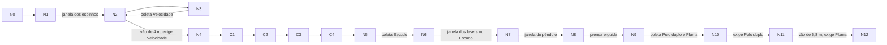

# Fase 7 — Despertar

Última fase do protótipo estendido e a mais colorida (paleta `PhaseTheme.Fase7`, saturação e exposição maiores que as das fases anteriores, como pede o GDD). Reúne todas as mecânicas em seis atos, em linha reta ao longo de +Z. O poder de cada ato é coletado antes de ser exigido.

Código: `Assets/Scripts/Editor/Phases/Fase7Builder.cs`. Cena gerada: `Assets/Scenes/Fase7_Despertar.unity`.

## Limites usados nos cálculos

Valores do `CharacterMotor`: pulo de 1,1 m, gravidade 20 m/s², correr a 5 m/s (7,5 m/s com Velocidade). Tempo no ar de um pulo: 2·√(2·1,1/20) ≈ 0,66 s. Com Pluma (gravidade pela metade) o tempo sobe para ≈ 1,33 s.

| Condição | Alcance horizontal de um pulo |
| --- | --- |
| Correr (5 m/s) | ≈ 3,3 m |
| Correr com Velocidade (7,5 m/s) | ≈ 5,0 m |
| Correr com Pluma | ≈ 6,6 m |
| Velocidade e Pluma | ≈ 10 m |

## Pontos e arestas

| Ponto | Posição (centro da face de cima) | Ato |
| --- | --- | --- |
| N0 | (0, 0, 0), 6×6 | Entrada |
| N1 | (0, 0, 8), 2×8 | Espinhos em ciclo |
| N2 | (0, 0, 15), 6×6 | Praça |
| N3 | (5,5, 0, 15), 3×3 | Velocidade |
| N4 | (0, 0, 24), 4×4 | Aterrissagem do vão |
| C1..C4 | (0, 0, 28/31/34/37), 2×2 | Pisos que cedem |
| N5 | (0, 0, 41), 6×6 | Escudo |
| N6 | (0, 0, 50), 4×10 | Lasers A e B |
| N7 | (0, 0, 59,5), 4×5 | Pêndulo |
| N8 | (0, 0, 65), 1,8×6 | Prensa |
| N9 | (0, 0, 72), 6×6 | Pulo duplo e Pluma |
| N10 | (0, 1,7, 77,4), 2,4×2,4 | Degrau 1 |
| N11 | (0, 3,4, 81,6), 2,4×2,4 | Degrau 2 |
| N12 | (0, 3,4, 91,6), 6×6 | Porta de conclusão |

A rota única passa por todos os pontos; os desvios (N3 e a coleta de poderes em N9) são obrigatórios porque cada poder é exigido adiante. Estado da busca como em `docs/DS14.md`: (ponto, poderes coletados).

## Cálculos das passagens difíceis

- **N1:** os espinhos ficam expostos por 1,2 s e recolhidos por 2,0 s (começam a subir 0,3 s antes de ferir). Atravessar 2 m a 5 m/s leva 0,4 s mais o raio do jogador: cabe com folga na janela de 2,0 s.
- **N2 → N4 (vão de 4,0 m, z de 18 a 22):** correndo sem poder, o alcance é ≈ 3,3 m e o jogador cai. Com Velocidade o alcance é ≈ 5,0 m, margem de 1,0 m.
- **C1..C4:** pisos de 2 m com vão de 1 m; cada um cede 0,8 s depois de pisado. A 5 m/s o jogador gasta 0,6 s por piso (2 m do piso mais 1 m de vão), bem abaixo dos 0,8 s de atraso; com Velocidade, 0,4 s.
- **N6:** lasers de 1,5 s ligado e 1,8 s apagado, o segundo atrasado 1,65 s. O espaço entre eles é de 4 m (0,8 s a 5 m/s): o jogador cruza o primeiro ao apagar e chega ao segundo ainda apagado. O Escudo absorve um toque se errar a janela e dá 1 s de proteção para sair do feixe.
- **N7 e N8:** o pêndulo tem 55° e período de 2,4 s; a prensa fica erguida 2,0 s e desce em 0,2 s. O corredor da prensa tem 1,8 m e o bloco ocupa 1,6 m, então não há como passar ao lado.
- **N9 → N10:** subida de 1,7 m em vão horizontal de 1,2 m: pulo (1,1 m) mais pulo no ar (1,1 m) dão até 2,2 m, margem de 0,5 m. **N10 → N11:** mesma subida, vão de 1,8 m.
- **N11 → N12 (vão de 5,8 m):** só Velocidade (≈ 5,0 m) não chega; Pluma sozinha dá ≈ 6,6 m; as duas juntas dão ≈ 10 m. O jogador sempre chega com Velocidade (coletada no ato 2), então o vão exige o Pluma.
