# Fase 7: Falso Despertar

Cena: `Assets/Scenes/Fase7_Despertar.unity` (o nome da cena continua `Fase7_Despertar`), gerada por `Assets/Scripts/Editor/Phases/Fase7Builder.cs`. Tema `PhaseTheme.Fase7`, o mais claro e saturado das Fases 1 a 7.

## A ideia

A luz da manhã entra na biblioteca. Tudo parece o fim do sonho: abajures com luz branca e quente, um relógio enorme no horizonte e uma porta no alto de uma torre de livros, visível desde o *spawn*. Atrás da porta, as placas perguntam `ACORDOU?` e respondem `o sonho continua...`. É um **falso despertar**: depois desta fase vêm as Fases 8 a 17.

Mecanicamente, é a **revisão de tudo** o que foi aprendido nas Fases 1 a 6. Cada ato cobra uma mecânica, e o último junta poderes.

## Forma

A fase deixou de ser uma linha reta. Ela é um **anel de galerias que sobe em espiral** em volta de um átrio vazio. No centro do átrio fica a torre de livros, com um livro aberto gigante no topo (y 5,6), onde está a porta. O jogador sai do sul, segue para leste e dá a volta inteira no sentido anti-horário visto de cima: leste, norte, oeste e sudoeste. Ao longo do caminho sobe de y 0 a 2,4, escala duas pilhas até o mirante (y 5,8) e salta para a torre.

```
        z ↑   norte (y 1,2): pisos que cedem  /  pilhas firmes (mais ao norte)
  NW ┌───────────────────────────────────────────┐ NE
     │                                           │
oeste│   ato 4      [torre y 5,6 + porta]        │ leste: ato 2 (vão da Velocidade)
y 1,8│  lasers                                   │ y 0,5
     │   ato 5      mirante y 5,8 ↗              │
y 2,4│  pêndulo     pilha y 4,1                  │ ato 1 (espinhos) y 0
     │  prensa → base da escalada (y 2,4)        │
     └────────────── entrada (spawn) ────────────┘  → x
```

## Ritmo e atos

| Ato | Onde | Mecânica | Apresentar → testar |
| --- | --- | --- | --- |
| 1 | Leste, y 0 | Espinhos em ciclo, dois pares alternados | Igual à Fase 3, sem pausa longa. |
| 2 | Leste, y 0,5 | Vão de 4,4 m que exige a Velocidade | O poder fica no pátio, 8 m antes do lançamento. |
| 3 | Norte, y 1,2 | Escolha: pisos que cedem em linha reta (curto, sem luz) **ou** quatro pilhas firmes mais ao norte, subindo e descendo 0,5 m (longo, iluminado) | Retoma o truque das Fases 3 e 5: luz = chão firme. |
| 4 | Oeste, y 1,8 | Escudo e dois lasers alternados | Com o Escudo, um laser pode ser atravessado sem esperar. |
| 5 | Sudoeste, y 2,4 | Pêndulo de parede a parede e prensa num corredor de 1,6 m | A sala do pêndulo só tem saída pela prensa. |
| 6 | Centro, y 2,4 → 5,8 | Pulo Duplo para duas pilhas de +1,7 m; Pluma no mirante; salto final de 9 m, que pede **Pluma e pulo duplo juntos** | O desafio final, com tudo junto. |

Os poderes são coletados logo antes do trecho que os exige, e o efeito dura 30 s:

- **Velocidade:** no pátio, em (9,8; 0; 15), a 8 m da borda do vão.
- **Escudo:** no patamar oeste, em (−8,5; 1,8; 34,5), a 4,5 m do primeiro laser.
- **Pulo Duplo:** na base da escalada, em (−3,2; 2,4; 9,5), a 2,5 m do primeiro degrau. Até o salto final são ≈ 10 m e dois degraus, ou seja, cerca de 4 a 6 s.
- **Pluma:** no mirante, de onde sai o salto final.

## Plataformas e pontos (topo em Y)

| Ponto | Peça | Centro do topo | Tamanho X × Z | Papel |
| --- | --- | --- | --- | --- |
| N0 | `Platform` | (3; 0; 0) | 14 × 6 | Entrada; *spawn* em (0; 0; −1) olhando para a torre |
| N1 | `Platform` | (8,5; 0; 8) | 3 × 10 | Corredor dos espinhos (1,7 m livres) |
| N2 | `Platform` | (8,5; 0; 16) | 5 × 6 | Pátio do relâmpago, com a Velocidade |
| N3 | `BookPlatform` | (8,5; 0,5; 21) | 3 × 4 | Lançamento, z 19..23 |
| N4 | `BookPlatform` | (8,5; 0,5; 29,4) | 3 × 4 | Pouso, z 27,4..31,4 |
| N5 | `Platform` | (8,5; 1,2; 39) | 4 × 12 | Patamar nordeste, z 33..45 |
| K1–K4 | `CrumblingPlatform` | (5 / 2 / −1 / −4; 1,2; 39) | 2 × 2 | Pisos que cedem (0,8 s) |
| Q1 | `BookPlatform` | (8,5; 1,7; 47,5) | 2,4 × 2,4 | Pilha firme |
| Q2, Q3 | `OpenBookPlatform` | (4,5 / 0; 2,2; 47,5) | 2,4 × 2,4 | Pilhas firmes (com base de livros abaixo) |
| Q4 | `BookPlatform` | (−4,5; 1,7; 47,5) | 2,4 × 2,4 | Pilha firme |
| N6 | `Platform` | (−8,5; 1,2; 42,85) | 4 × 11,7 | Patamar noroeste, z 37..48,7 |
| N7 | `BookPlatform` | (−8,5; 1,8; 34) | 4 × 4 | Patamar do escudo |
| N8 | `Platform` | (−8,5; 1,8; 28) | 3 × 8 | Corredor dos lasers (2,7 m livres), z 24..32 |
| N9 | `Platform` | (−8,5; 2,4; 20) | 4 × 6 | Sala do pêndulo, z 17..23 |
| N10 | `Platform` | (−8,5; 2,4; 13,5) | 2,2 × 7 | Corredor da prensa (1,6 m livres), z 10..17 |
| N11 | `Platform` | (−8,05; 2,4; 9) | 3,1 × 2 | Curva, x −9,6..−6,5 |
| N12 | `OpenBookPlatform` | (−3,2; 2,4; 10) | 4 × 4 | Base da escalada, com o Pulo Duplo |
| N13 | `BookPlatform` | (−2,4; 4,1; 13,2) | 2,4 × 2,4 | Pilha 1, z 12..14,4 |
| N14 | `BookPlatform` | (−2,4; 5,8; 16,8) | 2,4 × 2,4 | Mirante, z 15,6..18, com a Pluma |
| N15 | `OpenBookPlatform` | (0; 5,6; 30) | 6 × 6 | Livro da manhã, z 27..33 |
| G | `Goal` | (0; 5,6; 31,5), yaw 180 | — | Porta voltada para o sul (para o *spawn*) |

Armadilhas:

- Espinhos A em (8,5; 0; 6,5), com offset 0, e espinhos B em (8,5; 0; 10,5), com offset 1,35. Os dois ficam 1,2 s expostos e 1,5 s recolhidos.
- Laser A em (−8,5; 1,8; 30), com offset 0, e laser B em (−8,5; 1,8; 26), com offset 1,65. Os dois ficam 1,5 s ligados e 1,8 s apagados.
- Pêndulo em (−8,5; 2,4; 20): 55°, 2,4 s, yaw 0 (balança em X).
- Prensa em (−8,5; 2,4; 13,5): 2 s erguida e 0,8 s embaixo (ciclo de 3,8 s).

Zona de queda: y = −10.

## Grafo das rotas

O estado é **(ponto, poderes ativos)**. As arestas `==>` exigem poder.

```mermaid
flowchart LR
    N0["N0 entrada"] -->|andar| N1["N1 espinhos"]
    N1 -->|"janela A, refúgio, janela B"| N2["N2 pátio"]
    N2 -->|coleta Velocidade| N2
    N2 -->|degrau +0,5| N3["N3 lançamento"]
    N3 ==>|"Velocidade: vão 4,4 m"| N4["N4 pouso"]
    N4 -->|"pulo 1,6 m, +0,7"| N5{"N5 nordeste"}
    N5 -->|"curto: 4 pisos que cedem, sem parar"| N6["N6 noroeste"]
    N5 -->|"longo: Q1 → Q2 → Q3 → Q4"| N6
    N6 -->|"pulo 1,0 m, +0,6; coleta Escudo"| N7["N7 escudo"]
    N7 -->|"janela laser A, espera, janela laser B"| N8["N8 fim dos lasers"]
    N7 ==>|"Escudo: atravessa um laser sem esperar"| N8
    N8 -->|"pulo 1,0 m, +0,6"| N9["N9 pêndulo"]
    N9 -->|janela do pêndulo| N10["N10 prensa"]
    N10 -->|prensa erguida| N11["N11 curva"]
    N11 -->|"pulo 1,3 m; coleta Pulo Duplo"| N12["N12 base"]
    N12 ==>|"PD +1,7 m"| N13["N13 pilha 1"]
    N13 ==>|"PD vão 1,2 m, +1,7 m"| N14["N14 mirante; coleta Pluma"]
    N14 ==>|"Pluma + PD: vão 9 m, −0,2"| N15["N15 livro da manhã"]
    N15 -->|andar| G(["G porta"])
    style G fill:#d4f0cc,stroke:#3c8a3a
    style N5 fill:#fff3c4,stroke:#b59a2a
```



### Rotas e distâncias (em planta)

| Rota | Distância | Diferença |
| --- | --- | --- |
| Pela ala norte curta (pisos que cedem) | **≈ 119 m** | Sem esperas no ato 3, mas não se pode parar: os pisos cedem 0,8 s depois do primeiro toque. |
| Pela ala norte longa (pilhas firmes) | ≈ 132 m | 13 m a mais e cinco pulos de 0,8 a 2,1 m, mas sem pressa e com luz. |

As partes fixas medem ≈ 44,6 m da entrada até N5 e ≈ 57,7 m de N6 até G.

## Cálculos

Motor: gravidade 20 m/s², pulo de 1,1 m (v₀ = 6,633 m/s), corrida a 5 m/s (7,5 m/s com Velocidade), cápsula de 0,28 m de raio e *coyote* de 0,12 s. O tempo para pousar com desnível h é t = (v₀ + √(v₀² − 2·g·h)) / g.

- Com a **Pluma**, g cai para 10 m/s², mas o impulso continua o mesmo. Por isso cada pulo sobe 2,2 m.
- Com **Pluma e pulo duplo**, o segundo pulo leva a 4,4 m.
- O **limite teórico** soma o *coyote* (0,6 m) e as duas bordas da cápsula (0,56 m) ao alcance nominal. Ele serve para provar que um atalho é impossível.

### Pulos

| Salto | Vão | Desnível | Alcance | Margem |
| --- | --- | --- | --- | --- |
| **N3 → N4 com Velocidade** | 4,4 m | 0 | 7,5 · 0,663 = 4,97 m | **0,57 m** |
| N3 → N4 sem poder | 4,4 m | 0 | 3,32 m (limite 4,16 m) | impossível |
| N4 → N5 | 1,6 m | +0,7 | 2,66 m | 1,06 m |
| N5 → K1, K1 → K2 → K3 → K4 | 0,5 / 1,0 m | 0 | 3,32 m | ≥ 2,32 m |
| K4 → N6 | 1,5 m | 0 | 3,32 m | 1,82 m |
| N5 → Q1 | 1,3 m | +0,5 | 2,88 m | 1,58 m |
| Q1 → Q2 | 1,6 m | +0,5 | 2,88 m | 1,28 m |
| Q2 → Q3 | 2,1 m | 0 | 3,32 m | 1,22 m |
| Q3 → Q4 | 2,1 m | −0,5 | 3,66 m | 1,56 m |
| Q4 → N6 | 0,8 m | −0,5 | 3,66 m | 2,86 m |
| N6 → N7 | 1,0 m | +0,6 | 2,78 m | 1,78 m |
| N8 → N9 | 1,0 m | +0,6 | 2,78 m | 1,78 m |
| N11 → N12 | 1,3 m | 0 | 3,32 m | 2,02 m |
| N12 → N13 (pulo duplo) | 0 (encostado) | +1,7 | 2,2 m de altura | **0,5 m** (2º toque entre 0,11 e 0,56 s) |
| N13 → N14 (pulo duplo) | 1,2 m | +1,7 | 2,2 m de altura | **0,5 m** |
| **N14 → N15 (Pluma + pulo duplo)** | 9,0 m | −0,2 | ≥ 11,4 m | **≥ 2,4 m** |

**Salto final.** Com a Pluma, o ápice do primeiro pulo vem em 0,663 s, a 2,2 m. O segundo pulo dado nesse ponto leva a 4,4 m em mais 0,663 s, e a queda de 4,6 m até o livro leva √(2·4,6/10) = 0,959 s. São 2,285 s no ar, ou **11,4 m** correndo. Dar o segundo pulo depois do ápice rende ainda mais: em t = 1,0 s, o voo total passa de 2,5 s. Dar o segundo pulo cedo demais (t ≈ 0,1 s) rende só ≈ 7,7 m e cai. Daí a dica: pule de novo **no alto**.

**O salto final não sai com um poder só.** Só com a Pluma, o alcance é (6,633 + √48) / 10 = 1,356 s, ou seja, 6,78 m nominais e ≈ 7,9 m de limite teórico, menos que 9 m. Só com o pulo duplo, o alcance é 0,663 + √(2·2,4/20) = 1,153 s, ou 5,77 m nominais e ≈ 6,9 m de limite. A Pluma só existe no mirante e o pulo duplo só na base da escalada, então os dois estão ativos juntos apenas aqui.

### Atalhos verificados

- **A torre (y 5,6) não é alcançável pelo anel.** O anel chega no máximo a y 2,4, e subir +3,2 m exige Pluma e pulo duplo juntos, que só existem no mirante.
- **A porta fica livre na linha de visão.** As pilhas da escalada ocupam x −3,6..−1,2, e a linha de visão do *spawn* à porta corre em x = 0.
- **A sala do pêndulo só sai pela prensa.**
  - As estantes da sala (topo 3,5 m acima do piso) a fecham a leste e no sul, fora da boca do corredor.
  - Pulando da borda sul da sala (z 17) para a curva (z ≤ 10), o vão é de 7 m. É mais que o limite com Velocidade (4,97 + 1,16 ≈ 6,1 m), caso ela ainda esteja ativa.
  - Do patamar do escudo (z 32) até a sala do pêndulo (z 23), o vão é de 9 m.
- **Os corredores não deixam contornar as armadilhas.**
  - O corredor dos espinhos tem 1,7 m livres e os espinhos medem 1,8 m. O dos lasers tem 2,7 m, a largura do feixe. O da prensa tem 1,6 m, a largura da prensa.
  - Do lado de fora das estantes só há o vazio.
  - Nenhuma estante pode ser escalada: o topo fica 3,5 m ou mais acima do piso, e o pulo duplo sem Pluma chega a 2,48 m contando a quina.
- **Velocidade no salto final.** Se a Velocidade ainda estivesse ativa no mirante, Pluma e Velocidade dariam 7,5 · 1,356 = 10,2 m. Isso não pula nenhuma parte da fase, só facilita o último salto. Na prática, o efeito de 30 s acaba antes: da coleta ao mirante há ≈ 95 m de rota e quatro janelas de armadilha.

### Janelas das armadilhas

Todos os ciclos usam `Time.timeSinceLevelLoad`, que zera quando a cena recarrega. Por isso, cada tentativa começa no mesmo ponto de todos os ciclos.

- **Espinhos** (ciclo de 2,7 s): A fere em t ∈ [0; 1,2) e B em [1,35; 2,55), quase em alternância perfeita. Cruzar um campo cobre 1,8 + 0,56 = 2,36 m, o que leva 0,47 s correndo, contra 1,5 s recolhido. O refúgio entre os pares tem 2,2 m.
- **Pisos que cedem:** cada piso cede 0,8 s depois do primeiro toque. Correndo, o jogador passa ≤ 0,5 s em cada um (2 m e o pulo). Andando (2,2 m/s), passaria 0,9 s: daí a placa "rápido e frágil". Os vãos são de 1 m.
- **Lasers** (ciclo de 3,3 s, indo em −Z): A fere em t ∈ [0; 1,5) e B em [1,65; 3,15).
  - Parando: atravessa-se A quando ela apaga (t = 1,5), espera-se no refúgio de 3,2 m e atravessa-se B quando ela apaga (t = 3,15). Cada janela tem 1,64 s úteis.
  - Correndo direto: os feixes ficam a 4 m um do outro (0,8 s). Só dá certo entrando em A com t entre 2,35 e 3,14, uma janela de 0,79 s.
  - Com o Escudo: o primeiro toque é absorvido e há 1 s de graça para sair do feixe.
- **Pêndulo** (55°, 2,4 s): pelo centro da sala, fere enquanto |θ| < 19,9°. São duas passagens de 0,28 s por ciclo, com **0,92 s livres** entre elas. A faixa de perigo tem 1,8 m e leva 0,36 s correndo. Junto às paredes ele passa só uma vez por ciclo, mas fica 0,95 s.
- **Prensa:** fere de T = 2,0 a 3,0 s de um ciclo de 3,8 s, ou seja, fica 2,8 s sem ferir. Cruzar cobre 2,16 m, o que leva 0,43 s correndo. Não pule embaixo dela: a cabeça chega a 2,86 m, e a caixa erguida começa a 1,95 m.

## Cenário (fora do volume jogável)

- Estantes altas de 7 a 8 m fecham o anel por fora: leste em x 11,3, norte em z 49,3 e oeste em x −11,6. Para o átrio, os parapeitos da entrada e do pátio têm 1,4 m: deixam ver a torre e impedem quedas bobas. Estantes inteiras fecham as faces das pilhas da escalada até o vazio.
- Os abajures com luz de manhã ficam sobre o topo da estante norte (iluminando só a rota firme do ato 3), em cantos e na torre, a 1,6 m ou mais da porta. Os pisos que cedem ficam sem luz de propósito.
- O relógio gigante fica em (0; 14; 52), com raio 4, atrás da torre. As páginas ficam no átrio, a ≥ 2,5 m do anel e abaixo de y 2,5 (longe do salto, que passa acima de y 5,6), e acima da torre, a y ≥ 11,5 (o salto chega a 10,2). Os livros e as partículas ficam abaixo do anel.
- `LibraryBackdrop` envolve x[−11,6; 11,6] × z[−3,6; 49,6] (base −6, altura 16, margem 6).

## Pendências

- *Playtest*: a margem de 0,57 m do vão da Velocidade e a leitura do salto final (a dica "SUBA E VOE" talvez precise dizer "pule de novo no alto").
- Confirmar se a orientação da porta com yaw 180 deixa a face voltada para o mirante e para o *spawn*, como na versão anterior.
